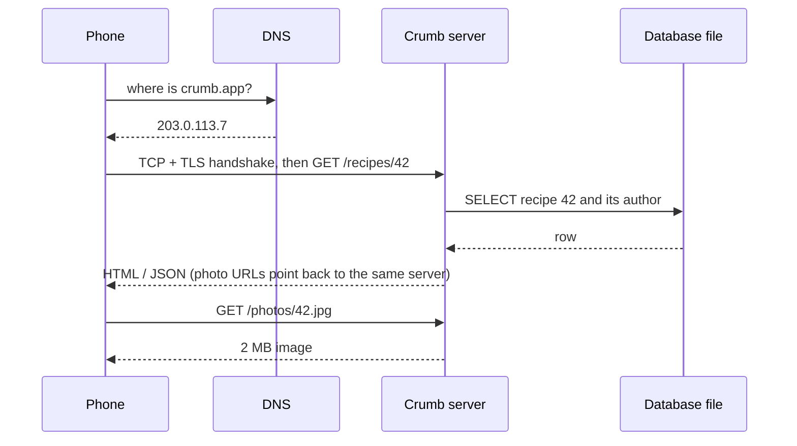
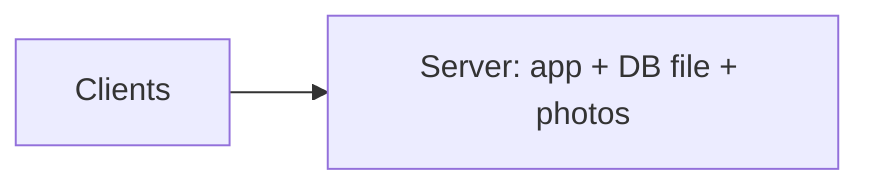

# Chapter 1 · One Box Runs Everything

## The incident
Crumb has 300 users. They load about **3 pages a second** at dinner time. Everything runs on one rented server: the web app, a SQLite file with users and recipes, and a folder of photos. It works. But a friend asks: "What happens when someone opens a recipe?" and you can't fully answer. Before Crumb grows, you need to know the path every request takes, and which part will break first.

## What happens on one request

The phone is the **client**; it asks. The server does the work and owns the data. The phone never touches the database directly.

## Before and after
This chapter adds no new box. It's about understanding the one you have.

## What breaks first
| Resource | Today | Limit on this server | Breaks at |
|---|---|---|---|
| CPU (app code) | 5% | ~300 pages/s | ~60x today |
| Disk reads (DB) | low | thousands of small reads/s | later |
| **Network out (photos)** | 3 pages/s x 2 MB = 6 MB/s | ~12 MB/s on this plan | **2x today** |
| Disk space | 20 GB | 80 GB | months |

The photos fill the network pipe long before CPU is a problem. That's typical: look for the resource with the least headroom, not the one people talk about most.

Also: one server means one point of failure. A reboot, a full disk or a bad deploy takes Crumb down completely.

## What it costs
Running everything on one box costs nothing extra and is simple to reason about. That's the right choice today. The price is that every part shares one machine's limits and fails together.

## What interviewers ask
- *Walk me through what happens when a user opens a page.* DNS, TCP/TLS, request, app logic, DB query, response, then static assets.
- *What's the first bottleneck?* Answer with numbers, like the table above.
- *Is a single server ever OK?* Yes, for small scale, early products and internal tools, as long as you have backups.

## Try it
Crumb grows to 3,000 users and 30 pages a second. Using the table, what fails first and roughly when?

Answer

Network out: 30 pages/s x 2 MB = 60 MB/s, five times the 12 MB/s limit. Photos break first, long before CPU (30 of 300 pages/s). Chapter 6 fixes this with object storage and a CDN.

**Next:** [Chapter 2: The second server can't see the data](02-separate-the-database.md) · **Deeper:** [Clients and servers](../01-fundamentals/28-client-server-basics.md), [Networking basics](../01-fundamentals/01-networking-basics.md)
