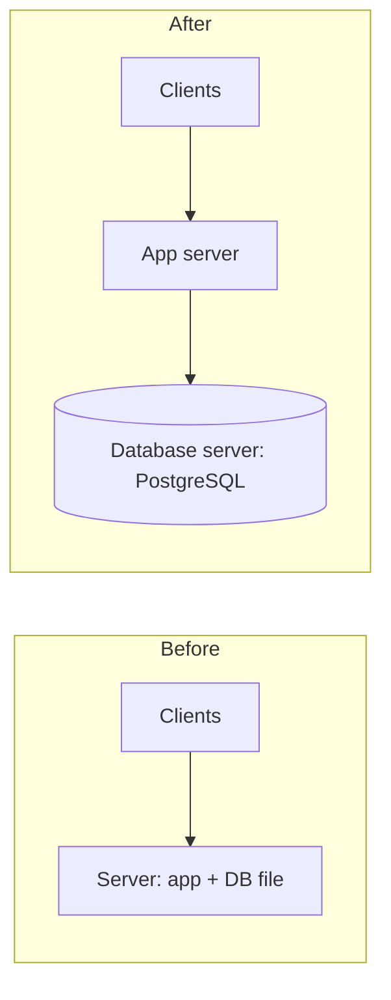

# Chapter 2 · The Second Server Can't See the Data

## The incident
Crumb grew to **40 pages a second**. A cooking newsletter with 500,000 readers will feature Crumb in two weeks. You plan to rent a second server for launch day. Then you notice the problem: every user and recipe lives in a SQLite file on server 1's disk. Server 2 can't read it. Two copies of the file would drift apart within minutes.

## Why it breaks
State that lives on one machine's local disk is invisible to every other machine. As long as the database is a file inside the app server, you can only ever have one app server.

## Before and after

## The fix
1. Move the data into a database server (PostgreSQL) on its own machine.
2. App servers connect to it over the network, with a **connection pool**.
3. Now you can scale the app tier and the data tier separately: more app servers for CPU, a bigger database machine for data.
4. Set up nightly **backups** and test a restore once.

## Which database?
Crumb's data is relational: users follow users, recipes have authors, comments belong to recipes. You need transactions (posting a recipe and its ingredients together) and you don't know all future queries yet. PostgreSQL fits. You'll revisit this in later chapters when one database stops being enough.

| Choose SQL when | Choose a NoSQL store when |
|---|---|
| Relationships, joins, transactions | Simple key lookups at huge scale |
| Queries will change over time | Access patterns are known and fixed |
| Data fits on one primary (with replicas) | Data must spread over many machines from day one |

## What it costs
- Every query now crosses the network (~0.5 ms inside a data center), so chatty code with 50 queries per page gets slower. Batch queries.
- One more machine to run and patch.
- The database is now the shared single point of failure (chapter 15 fixes that).

## What interviewers ask
- *Why separate the DB first?* It's the precondition for running more than one app server.
- *SQL or NoSQL?* Tie it to access patterns and consistency needs, not popularity.
- *How many connections can Postgres take?* Hundreds, not thousands: use pools or a proxy like PgBouncer.

## Try it
After the split, page latency rose from 40 ms to 90 ms. The recipe page runs 1 query for the recipe and 1 per ingredient (about 25). What's wrong and how do you fix it?

Answer

An N+1 query pattern: 26 network round trips per page. Fetch the ingredients in one query (`WHERE recipe_id = 42`) or a join, bringing it back to 1-2 round trips.

**Next:** [Chapter 3: A food blogger shares Crumb](03-load-balancer-and-stateless.md) · **Deeper:** [Databases](../01-fundamentals/04-databases-sql-vs-nosql-acid-indexing.md), [Scaling from zero to millions](../01-fundamentals/21-scaling-from-zero-to-millions.md)
