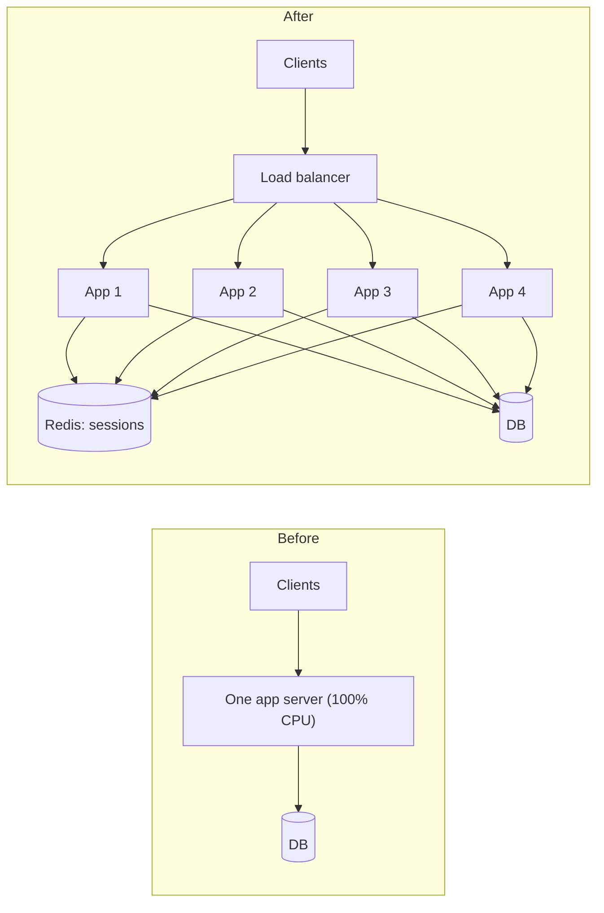

# Chapter 3 · A Food Blogger Shares Crumb

## The incident
Launch day. A food blogger with 2 million followers shares a Crumb recipe. Traffic jumps from **40 to 450 pages a second**. The single app server hits 100% CPU, pages take 7 seconds, and many people leave. The database is at 30% CPU; it isn't the problem.

You add three more app servers, but now users are randomly logged out. Their session (who they are, what's in their saved list) lives in the memory of whichever server they logged in on.

## Why it breaks
1. One machine has a CPU ceiling. Making it bigger (**scale up**) helps once, costs more, and still fails as one unit.
2. Adding machines (**scale out**) needs something to spread requests, and it needs every server to handle every user, which is impossible if sessions live in server memory.

## Before and after

## The fix
1. Put a **load balancer** in front (one public address). It spreads requests (round robin or least connections) and runs health checks to skip dead servers.
2. Make app servers **stateless**: sessions go to Redis (or a signed token the client carries). Any server can now serve any request.
3. Use **autoscaling**: add servers when CPU passes 60%, remove them when traffic drops.
4. Run the load balancer as a redundant pair (or a managed cloud LB) so it isn't a new single point of failure.

## What it costs
- A load balancer and Redis to run (or pay for).
- Each request reads the session from Redis (~1 ms).
- Sticky sessions would avoid Redis, but then losing a server logs its users out and load spreads unevenly. Stateless is worth it.

## What interviewers ask
- *Scale up or scale out?* Up is simpler and fine early; out has no hard ceiling and survives single machine failures.
- *Which load-balancing algorithm?* Round robin for similar short requests, least connections for long-lived ones (WebSockets).
- *L4 or L7?* L7 if you route by path or terminate TLS; L4 for raw speed.
- *What does stateless mean exactly?* Nothing a later request needs is kept in one server's memory.

## Try it
Each app server handles about 120 pages a second at a comfortable 60% CPU. How many servers do you need for 450 pages/s, with one allowed to fail?

Answer

450 / 120 = 3.75, so 4 servers, plus 1 spare for failure (N+1): **5 servers**.

**Next:** [Chapter 4: Caching](04-caching.md) · **Deeper:** [Load balancing](../01-fundamentals/03-load-balancing.md), [Load balancer design](../03-problems/79-load-balancer.md)
