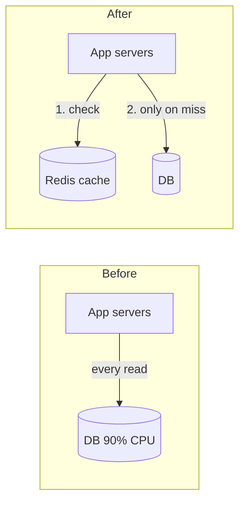
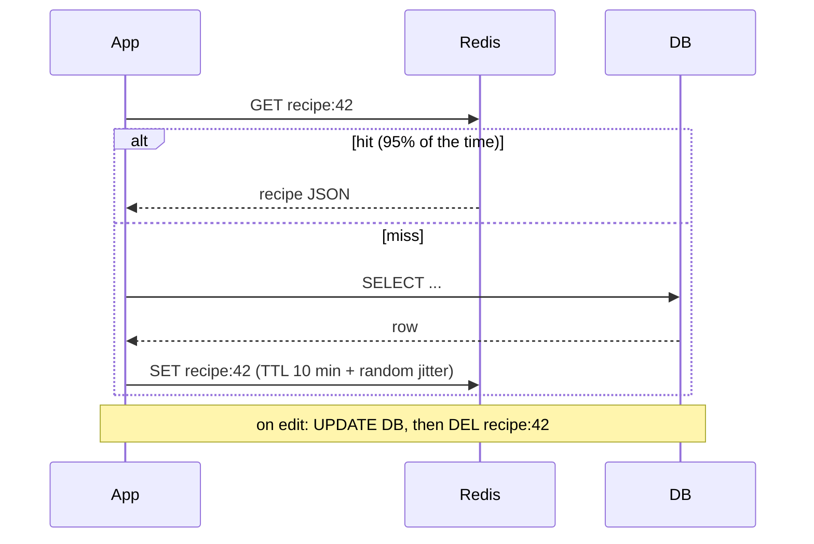

# Chapter 4 · The Database Answers the Same Question 10,000 Times a Second

## The incident
Crumb now serves **12,000 pages a second**. App servers scale fine, but the database sits at **90% CPU**. Looking at its query log: the top 200 recipes account for 70% of reads, and the same "get recipe 42 with author and rating" query runs thousands of times a second with the same answer.

## Why it breaks
Reads are repetitive and data changes rarely (a recipe is edited maybe once a month), yet every read does the full work: parse, plan, read pages, join. The database is doing the same work over and over.

## Before and after

## The fix: cache-aside

1. Read: try the cache; on a miss read the DB and store the result with a TTL.
2. Write: update the DB, then **delete** the cache key (don't update it, to avoid races).
3. Add random jitter to TTLs so many keys don't expire at the same moment.
4. For the hottest keys, a lock so only one request rebuilds an expired entry (prevents a stampede).

With a 95% hit rate, the DB sees 5% of 12,000 = 600 reads/s instead of 12,000.

## Other strategies, briefly
| Strategy | Use when |
|---|---|
| Read-through | Same as cache-aside, but the cache library loads from the DB |
| Write-through | You want the cache always fresh and can pay slower writes |
| Write-behind | Very write-heavy counters, accepting loss risk |

## What it costs
- **Staleness:** a reader might see an old version for up to the TTL if an invalidation is missed.
- Memory: the top 1 million recipes at 2 KB ≈ 2 GB, cheap.
- A new failure mode: if Redis dies, all traffic hits the DB at once. Use replicas and protect the DB with timeouts and load shedding.

## What interviewers ask
- *What do you cache and for how long?* Read-heavy, rarely changing data; TTL based on how stale is acceptable.
- *How do you keep cache and DB consistent?* Delete on write, short TTLs as a safety net.
- *What's a cache stampede?* Many requests missing the same expired hot key at once; fix with locking or early refresh.
- *Hit rate math:* DB load = total reads x miss rate.

## Try it
A cook edits a recipe and immediately reloads, but sees the old title. The code updates the cache and then the database. What went wrong?

Answer

Order and race: another request could read the old DB row between the two steps and write it back into the cache. Update the DB first, then delete the key, so the next read loads fresh data.

**Next:** [Chapter 5: Read replicas](05-read-replicas.md) · **Deeper:** [Caching deep dive](../01-fundamentals/07-caching-deep-dive.md), [Distributed cache](../03-problems/31-distributed-cache.md)
