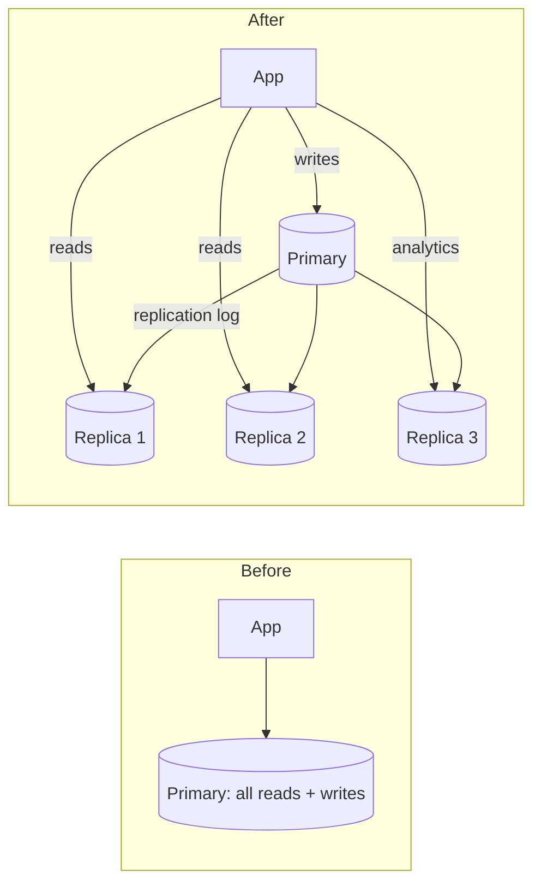
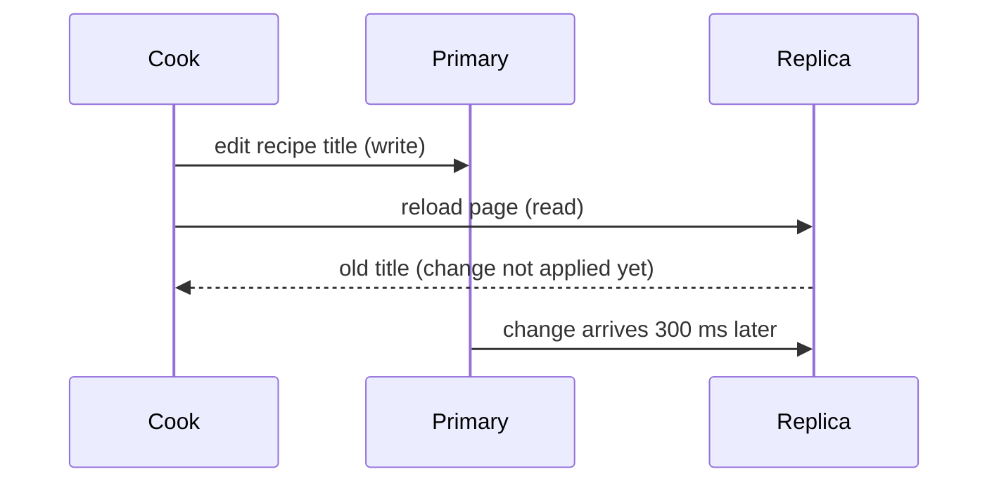

# Chapter 5 · Cache Misses Still Drown the Database

## The incident
Crumb holds **40 million recipes**. People increasingly find old recipes through search engines, and those long-tail pages are rarely cached. The cache hit rate fell from 95% to **78%**, so the database now serves about 6,000 reads a second, plus the cooks' analytics pages. It's at 95% CPU again, and caching more doesn't help because the misses are spread across millions of different recipes.

## Why it breaks
One database machine has one CPU and one disk's worth of read capacity. Writes are only about 200 a second; the load is reads.

## Before and after

## The fix
1. Add **read replicas**: copies that apply the primary's change log and serve reads.
2. Route writes to the primary, reads to replicas (a read/write split in the data access layer or a proxy).
3. Give analytics its own replica so heavy reports can't slow user pages.
4. Replicas double as standbys for failover (chapter 15).

## The catch: replication lag
Replication is usually asynchronous: a replica may be 50 ms to a few seconds behind.

Fix for **read-your-own-writes**: for a few seconds after a user writes, send that user's reads to the primary (or to a replica known to have caught up). Everyone else can tolerate a little lag.

## What it costs
- Stale reads on replicas; you must decide where that's acceptable.
- Each replica is a full copy of the data (storage x N).
- Replicas don't help writes at all; that's chapter 9.

## What interviewers ask
- *Sync or async replication?* Async for speed, semi-sync (one replica confirms) to avoid losing writes on failover.
- *How many replicas?* Read QPS / per-replica capacity, plus one spare.
- *How do you handle read-after-write?* Primary reads for the writer for a short window, or session-level version tracking.

## Try it
Each replica comfortably serves 2,500 reads/s. Reads that reach the database are 6,000/s and analytics needs its own machine. How many replicas?

Answer

6,000 / 2,500 = 2.4, so 3 for user reads, +1 spare, +1 for analytics = **5 replicas**.

**Next:** [Chapter 6: Photos crawl in Australia](06-object-storage-and-cdn.md) · **Deeper:** [Replication](../01-fundamentals/05-replication.md)
