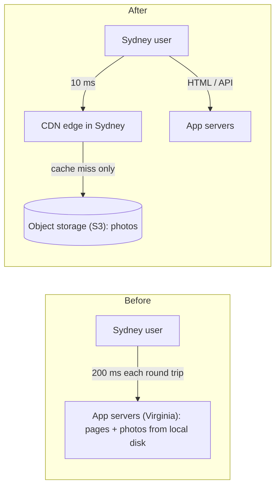
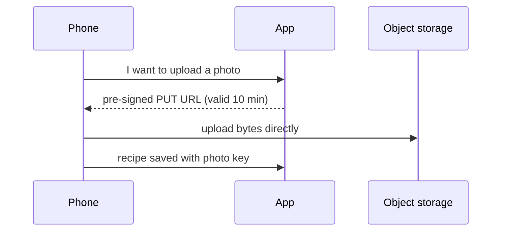

# Chapter 6 · Photos Crawl for Users in Australia

## The incident
A third of Crumb's users are now outside the US. A user in Sydney waits **4 seconds** for a recipe page: each recipe has 6 photos at ~1.5 MB, served from app servers in Virginia, 200 ms round trip away. Photos also eat 80% of the app servers' bandwidth, and the disk holding them is 85% full.

## Why it breaks
- Large, unchanging files are being served by machines meant for running code.
- Distance: every new connection costs several round trips (TCP, TLS, request) before a byte arrives. At 200 ms each, physics alone adds most of a second.
- Photos sit on app server disks, which also breaks the "stateless app servers" rule from chapter 3.

## Before and after

## The fix
1. Move photos to **object storage** (S3 or similar): virtually unlimited, highly durable, cheap. The database stores only the photo's key.
2. Upload with **pre-signed URLs**: the app gives the phone a temporary upload URL and the bytes go straight to storage, never through app servers.
3. Serve photos through a **CDN**: edge servers in hundreds of cities keep copies close to users. Most requests never cross an ocean.
4. Make photo URLs **immutable** (`/p/42/abc123_800w.webp`): a changed photo gets a new URL, so you can cache for a year and never purge.
5. Generate a few sizes (thumbnail, 800px, 1600px) and modern formats so phones download less.

## What it costs
- CDN bills per GB delivered (still far cheaper than serving from your servers).
- Changing a photo means a new URL; purging old content takes care.
- A slight delay for the very first request at each edge (cache miss).

## What interviewers ask
- *Where do large files go?* Object storage, metadata in the database.
- *Push or pull CDN?* Pull (fetch on first miss) for user content; push for big planned releases.
- *How do you invalidate CDN content?* Versioned URLs instead of purging.
- *Can a CDN cache API responses?* Yes, for public, cacheable responses with short TTLs; never personal data.

## Try it
Recipe pages get 20,000 views/s, each loading 6 photos of 300 KB (after resizing). The CDN hit rate is 97%. How much traffic reaches object storage?

Answer

20,000 x 6 x 300 KB = 36 GB/s at the edge. 3% misses = about **1.1 GB/s** to object storage, and the app servers serve none of it.

**Next:** [Chapter 7: Two recipes get the same ID](07-unique-ids.md) · **Deeper:** [CDN design](../03-problems/52-cdn.md), [Storage systems](../01-fundamentals/16-storage-systems-block-file-object-oltp-vs-olap.md), [DNS](../03-problems/59-dns.md)
