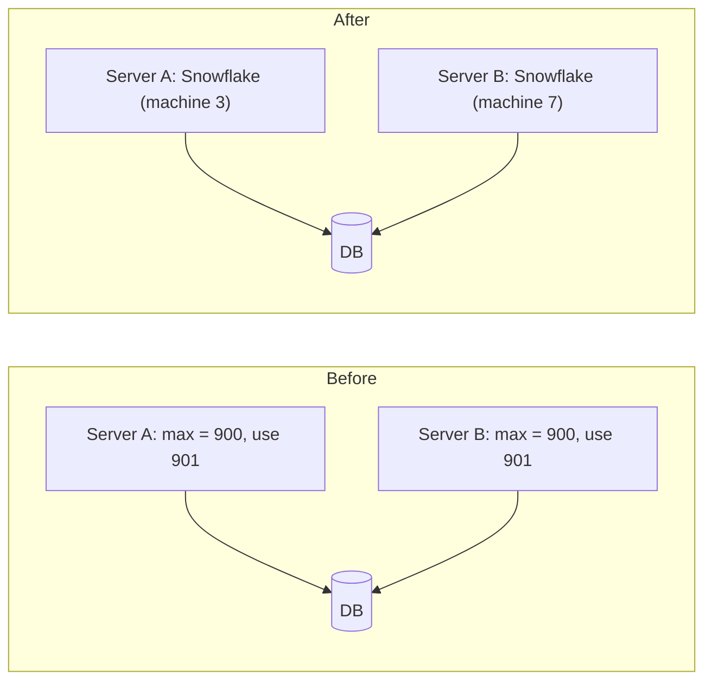
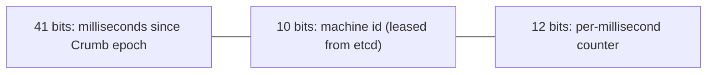

# Chapter 7 · Two Recipes Get the Same ID

## The incident
To prepare for splitting the database (chapter 9), the team stops relying on the database's auto-increment. A quick fix ships: each app server reads the current highest recipe ID and adds 1. Under **500 new recipes a second**, two servers often read the same maximum. In one hour, **12,000 recipe creations fail** with duplicate key errors, and a few comments get attached to the wrong recipe.

## Why it breaks
"Read the max, add one" is a race: between reading and writing, another server does the same thing. Any scheme where many machines pick IDs without coordination must make collisions impossible, not unlikely.

## Before and after

## Options
| Approach | How | Good | Bad |
|---|---|---|---|
| Random UUID v4 | 128 random bits | No coordination | Long, not sortable, poor index locality |
| UUID v7 / ULID | Time prefix + random | No coordination, sortable | 128 bits |
| Range blocks | Each server reserves 1,000 IDs at a time from a counter | Short numbers | Counter service to run; gaps |
| **Snowflake** | 41 bits time + 10 bits machine + 12 bits sequence | 64-bit, time-ordered, no coordination per ID | Needs unique machine IDs, sane clocks |

## The fix
1. Use Snowflake-style 64-bit IDs generated inside each app server (a library, no network call).
2. Lease machine IDs from a coordination service at startup so no two servers share one.
3. Refuse to generate IDs if the clock moves backwards (wait until it catches up).
4. Bonus: IDs sort by time, so "newest recipes" can sort by ID and paginate with `WHERE id < cursor`.

## What it costs
- Clock dependence and machine-ID management.
- IDs reveal roughly when something was created and how fast you're growing. For public short links you might prefer random codes.

## What interviewers ask
- *Why not auto-increment?* It needs one central database (a bottleneck and single point of failure once you shard).
- *How many IDs per second can Snowflake produce?* 4,096 per millisecond per machine.
- *What if the clock goes backwards?* Wait or fail, never reuse a timestamp.
- *Short public codes?* Base62-encode an ID, or generate random codes and check for collisions.

## Try it
Crumb's epoch is January 1, 2025. With 41 bits of milliseconds, roughly when do IDs run out?

Answer

2^41 ms ≈ 2.2 trillion ms ≈ 69.7 years, so around **2094**.

**Next:** [Chapter 8: Search takes 6 seconds](08-indexes-and-search.md) · **Deeper:** [Unique ID generator](../03-problems/04-unique-id-generator.md), [Clocks and ordering](../01-fundamentals/20-time-clocks-and-ordering.md)
