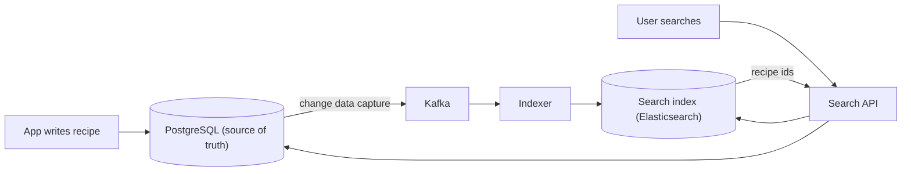

# Chapter 8 · Search Takes 6 Seconds

## The incident
Two complaints arrive the same week:
1. A cook's profile page ("all recipes by this cook, newest first") takes **2 seconds**.
2. Searching "chicken curry" takes **6 seconds** and sometimes times out. The query is `WHERE title LIKE '%chicken%curry%'` over 60 million recipes.

## Why it breaks
- Without an index, the database **scans every row** to find a cook's recipes.
- `LIKE '%word%'` can't use a normal index at all (the leading wildcard), and it has no idea that "curries" matches "curry" or which result is most relevant.

## Fix 1: the right index
```sql
CREATE INDEX idx_recipes_author_created ON recipes (author_id, created_at DESC);
```
A B-tree on `(author_id, created_at)` turns "scan 60M rows" into "jump to this author, read 20 entries in order": a few page reads.

| Without index | With index |
|---|---|
| Full table scan, ~2 s | ~2 ms |
| Every query pays | Every insert pays a little extra to update the index |

Rules: index the columns you filter and sort by, in that order (leftmost prefix); don't index everything, since each index slows writes and uses disk.

## Fix 2: a search index

An **inverted index** maps each word to the recipes containing it: `curry -> [7, 42, 913]`, `chicken -> [7, 42, 55]`. A search intersects short lists instead of scanning text. The indexer also lowercases and stems words ("curries" -> "curry") and ranks by relevance (BM25) plus signals like ratings.

The search index is a **copy**: if it's lost, rebuild it from the database. New recipes appear in search a few seconds after saving.

## What it costs
- Another system to run and keep in sync (lag of seconds).
- Indexes slow writes and take space.
- Two places to query: the DB for exact lookups, the search engine for text.

## What interviewers ask
- *How does an index make reads faster?* Sorted structure (B-tree), O(log n) lookups and ordered range scans.
- *What's the cost of an index?* Slower writes, more storage.
- *Why not LIKE?* Can't use indexes with a leading wildcard, no relevance, no stemming.
- *How do you keep search in sync?* CDC/outbox events to an indexer; full reindex possible.

## Try it
The query `SELECT * FROM recipes WHERE cuisine = 'thai' ORDER BY rating DESC LIMIT 20` is slow. Which index helps?

<details><summary>Answer</summary>

`CREATE INDEX ON recipes (cuisine, rating DESC)`: filter column first, then the sort column, so the database reads the top 20 Thai recipes directly in order.
</details>

**Next:** [Chapter 9: The comments table fills the disk](09-sharding.md) · **Deeper:** [Databases and indexing](../01-fundamentals/04-databases-sql-vs-nosql-acid-indexing.md), [Search systems](../01-fundamentals/19-search-systems-and-inverted-index.md)
