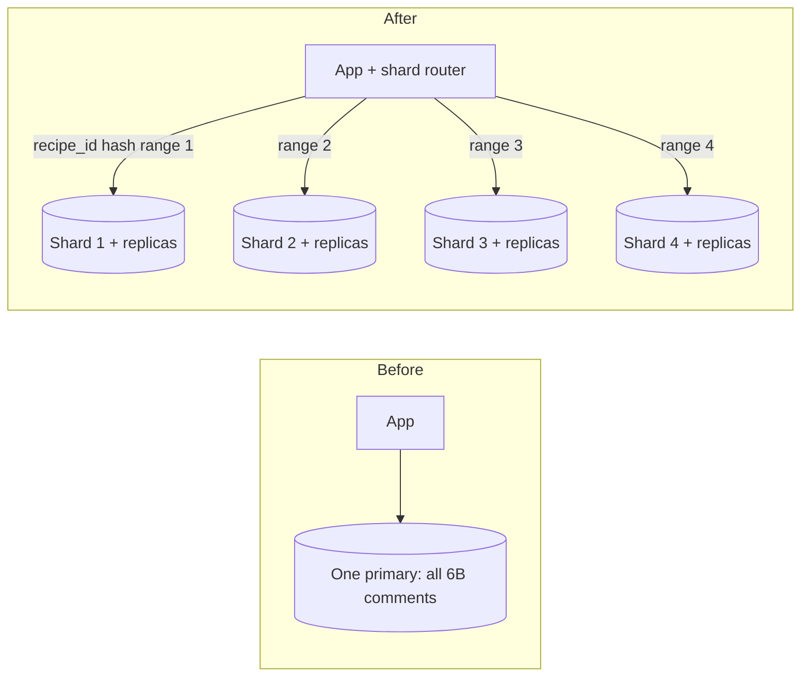
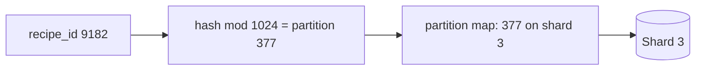

# Chapter 9 · The Comments Table Fills the Disk

## The incident
Comments and likes exploded with Crumb's popularity: **6 billion rows, 4.5 TB** on a primary whose biggest disk is 6 TB. It grows **30 GB a day**, so the disk is full in about seven weeks. Writes also hit **8,000 per second** at dinner time, and the single primary's write queue is backing up. Replicas don't help: each holds a full copy and every write still goes to one primary.

## Why it breaks
Replication copies data; it doesn't split it. One primary has one disk and one write path. To go further you must **split the data** so each machine owns only a part.

## Before and after

## The fix
1. **Pick a shard key** from the main query. Comments are almost always read as "comments for recipe X", so shard by `recipe_id`: one recipe's comments live on one shard, and that query touches one machine.
2. **Hash, don't range**: recipe IDs are time-ordered, so range sharding would send every new comment to the newest shard. `hash(recipe_id)` spreads them evenly.
3. **Plan for growth**: map keys to many logical partitions (say 1,024) and partitions to machines; adding a machine moves whole partitions. Consistent hashing gives the same property.
4. Keep each shard replicated (primary + replicas) as before.

## What gets harder
| Problem | What you do |
|---|---|
| "All comments by user U" (not by recipe) | A second table sharded by user_id, written async, or a search index |
| Joins across shards | Denormalize (store author name on the comment) or join in the app |
| A viral recipe makes one shard hot | Cache its comments, or split hot keys across sub-partitions |
| Transactions across shards | Avoid; design so one write touches one shard |
| Moving data when adding shards | Copy partitions in the background, then switch the map |

## What it costs
Operational complexity: more machines, routing logic, rebalancing, cross-shard queries. Shard only when numbers force it; that's why this is chapter 9, not chapter 2. Managed systems (Vitess, Citus, DynamoDB, Cassandra) take on much of this work.

## What interviewers ask
- *How do you choose a shard key?* From the dominant query; high cardinality, even load.
- *Why not shard by created_at?* All new writes hit one shard.
- *How do you add shards without moving everything?* Logical partitions or consistent hashing.
- *What about the celebrity recipe?* Hot-key handling: caching, splitting.

## Try it
With 30 GB/day growth and shards you want to keep under 2 TB, how many shards do you need to last three years, starting from 4.5 TB?

Answer

4.5 TB + 30 GB x 1,095 days ≈ 4.5 + 33 = 37.5 TB. 37.5 / 2 ≈ 19, so plan **~20-24 shards** (or 32 for even powers of two and headroom).

**Next:** [Chapter 10: Uploading takes 9 seconds](10-queues-and-workers.md) · **Deeper:** [Partitioning and sharding](../01-fundamentals/06-partitioning-and-sharding.md), [Consistent hashing](../03-problems/02-consistent-hashing.md)
