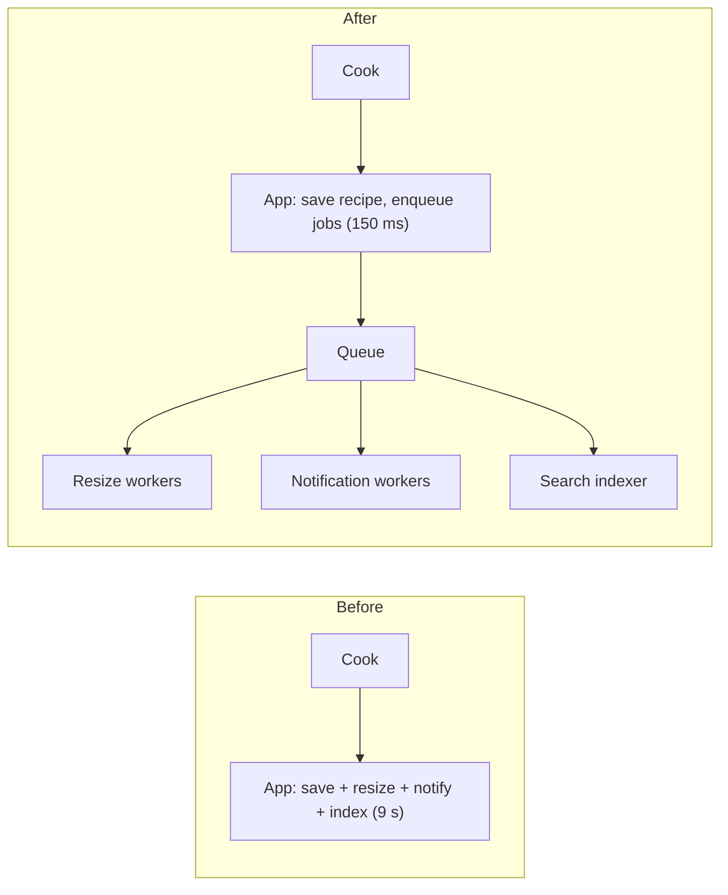
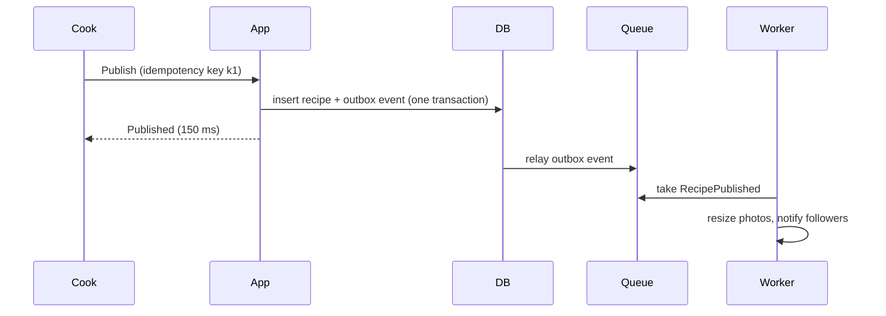

# Chapter 10 · Uploading a Recipe Takes 9 Seconds

## The incident
When a cook taps "Publish", the request: saves the recipe, resizes 6 photos into 3 sizes, notifies up to 50,000 followers, and pings the search indexer. All of it happens **inside the request**. Publishing takes **9 seconds**; on bad networks the app times out and cooks tap Publish again, creating duplicates. When the notification provider is slow, publishing fails entirely.

## Why it breaks
The user only needs one thing to finish before they see "Published": the recipe is saved. Everything else can happen a few seconds later, but it's chained to the request, so the slowest step (and every failure) becomes the user's problem.

## Before and after

## The fix
1. The request saves the recipe and puts a `RecipePublished` message on a **queue**, then answers right away.
2. **Workers** take messages off the queue and do the slow work at their own pace; each kind of work scales separately.
3. If notifications are slow, messages wait in the queue; publishing is unaffected.
4. To avoid "saved but message lost", write the event in the same transaction as the recipe (an **outbox** table) and publish it from there.
5. Duplicate taps: the app sends an idempotency key, so a retried publish returns the first result.

## What it costs
- The work happens later: thumbnails appear a few seconds after publishing; show a placeholder.
- Messages can be delivered more than once, so workers must be idempotent (chapter 11).
- A queue to run and monitor (watch the backlog).

## What interviewers ask
- *What belongs on the request path?* Only what the user must see succeed.
- *Queue or event stream?* Queue for jobs done once (resize this photo); stream when many consumers need the same events (chapter 12).
- *What if a worker crashes mid-job?* The message becomes visible again and another worker retries.

## Try it
Resizing takes 2 seconds of CPU per photo. Cooks publish 50 recipes/s with 6 photos each. How many single-core workers keep up?

Answer

50 x 6 = 300 photos/s x 2 s = 600 CPU-seconds per second -> **600 cores** (plus headroom). This is why resizing must be async and autoscaled on queue depth.

**Next:** [Chapter 11: The push provider goes down](11-retries-and-idempotency.md) · **Deeper:** [Message queues](../01-fundamentals/11-message-queues-pub-sub-and-event-streaming.md), [Distributed transactions: outbox](../01-fundamentals/10-distributed-transactions-2pc-saga-outbox.md)
