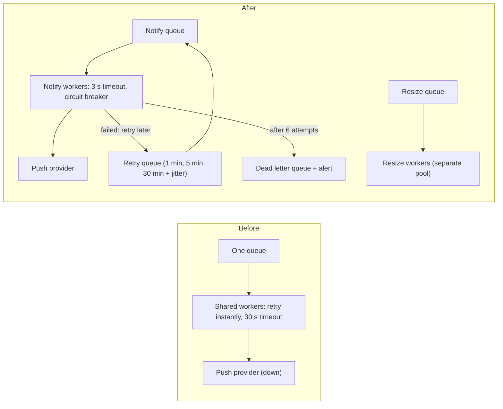
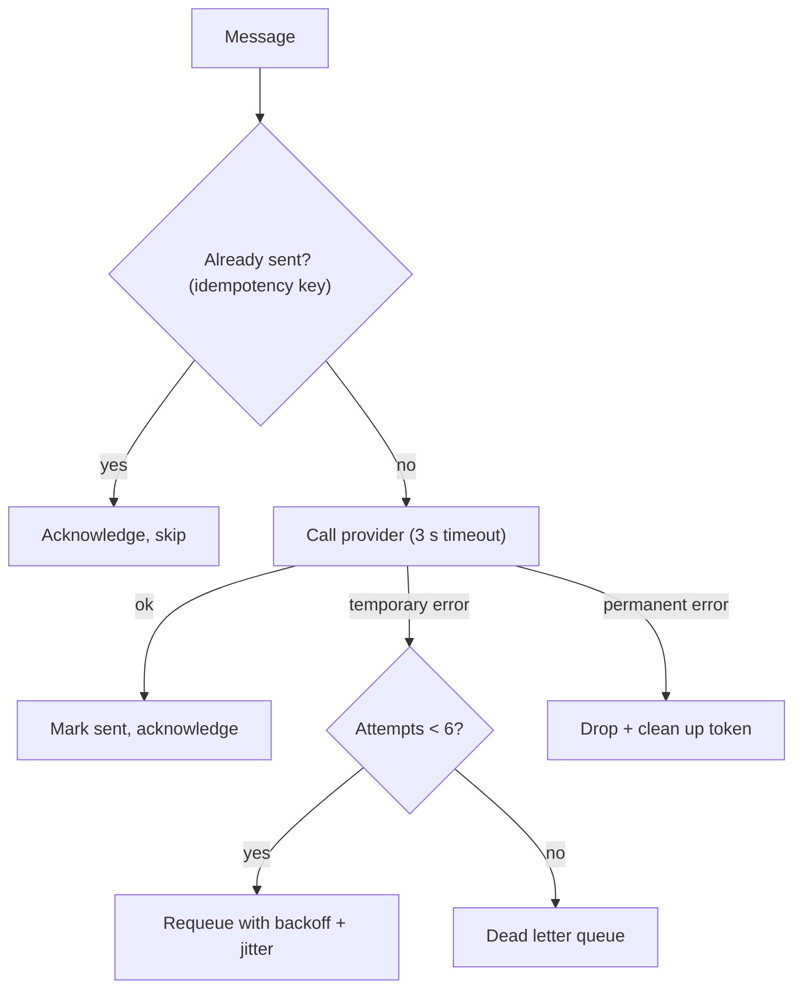

# Chapter 11 · The Push Provider Goes Down and Takes the Workers With It

## The incident
The push notification provider has a bad hour: requests hang for 30 seconds and then fail. Notification workers retry every failed message **immediately**, each attempt holding a worker for the full 30-second timeout. Within ten minutes every worker is stuck, the queue backlog hits 4 million, and photo resizing (sharing the same worker pool) stops too. When the provider recovers, the flood of retries knocks it over again. Some followers get the same notification **five times**.

## Why it breaks
1. Immediate retries multiply load on a service that is already struggling.
2. Long timeouts tie up workers; one slow dependency consumes the shared pool.
3. Retries without idempotency create duplicates.
4. Messages that can never succeed (a deleted device token) retry forever.

## Before and after

## The fix
1. **Short timeouts** (2-3 s for a push call) so a hung provider can't hold workers for long.
2. **Exponential backoff with jitter**: wait 1 min, 5 min, 30 min (randomized) between attempts, instead of retrying instantly.
3. **Circuit breaker**: after many failures, stop calling the provider for a minute and let messages wait, then probe with a few requests.
4. **Dead letter queue**: after N attempts, park the message for inspection and stop retrying; drop permanent errors (invalid token) immediately.
5. **Separate pools per kind of work** (bulkheads), so a push outage can't stop photo resizing.
6. **Idempotency**: each notification has an ID; before sending, record it (`SET NX sent:{id}`); a retry that finds it already sent skips.

## What it costs
- Notifications can arrive minutes late during an outage (that's fine for "new recipe" alerts).
- Idempotency storage (a key per message for a day).
- More queues and dashboards to watch.

## What interviewers ask
- *Why jitter?* So thousands of clients don't retry at exactly the same moment.
- *Which operations can you retry safely?* Idempotent ones, or ones carrying an idempotency key.
- *Exactly-once delivery?* Not possible end to end; at-least-once plus dedupe gives effectively once.
- *What is a retry budget?* Cap retries to a share of traffic (say 10%) so they can't multiply load.

## Try it
A payment call times out. Your code retries and the customer is charged twice. What two changes prevent it?

Answer

Send the same idempotency key on every attempt so the provider dedupes, and treat a timeout as "unknown": check the payment's status before retrying.

**Next:** [Chapter 12: Views per recipe per day](12-event-streams-and-counting.md) · **Deeper:** [Reliability patterns](../01-fundamentals/13-reliability-and-resilience-patterns.md), [Notification system](../03-problems/07-notification-system.md), [Webhooks](../03-problems/47-webhook-delivery-service.md)
