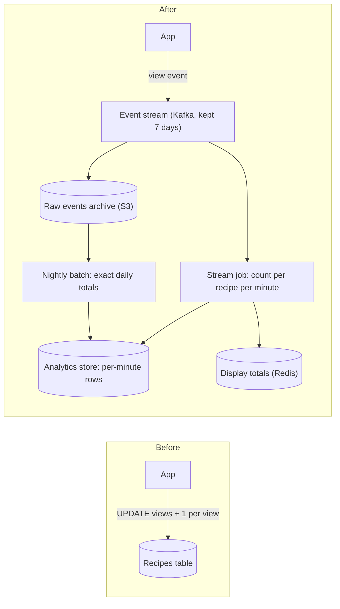

# Chapter 12 · Cooks Want Views per Recipe per Day

## The incident
Popular cooks ask for a dashboard: views and saves per recipe **per hour and per day**, and where viewers come from. Crumb tracks views with `UPDATE recipes SET views = views + 1` on every page view, **25,000 times a second**. That gives one lifetime total per recipe, no history by hour, and viral recipes cause row-lock contention that slows the whole shard.

## Why it breaks
- A running total throws away the "when" and "where" of each view, so you can't answer per-hour questions later.
- Updating one row per view turns hot recipes into hot rows.
- The queue from chapter 10 deletes each message once processed, so nothing is left to recount if a bug corrupts the numbers.

## Before and after

## The fix
1. Each view becomes an **event** `{recipe_id, time, country, referrer, viewer_hash}` appended to an **event stream**. Unlike a queue, the stream keeps events for days, and many readers follow it at their own pace and can replay from any point.
2. A **stream job** counts views per recipe per minute (windows by event time) and writes small aggregate rows; per-hour and per-day are sums of minutes.
3. Display totals update a cache every few seconds instead of one DB write per view.
4. Raw events go to cheap storage; a **nightly batch job** recomputes exact daily numbers and fixes any streaming mistakes (late or duplicated events).
5. Unique viewers per day use a HyperLogLog sketch (12 KB per recipe-day) instead of storing every viewer.

## Stream vs queue
| Queue (chapter 10) | Event stream (this chapter) |
|---|---|
| Each message handled once, then deleted | Events kept for days, replayable |
| One consumer group per job type | Many independent consumers (counts, recommendations, fraud) |
| Good for tasks | Good for facts that many systems care about |

## What it costs
- Dashboards lag by a minute or so.
- Two code paths (stream for fresh, batch for exact).
- Storage for raw events (compressed, tiered to cold storage).

## What interviewers ask
- *Event time vs processing time?* Count by when the view happened; mobile events can arrive late.
- *How do you avoid double counting?* Event IDs with dedupe in the job, exactly-once sinks, or reconciliation by batch.
- *Why keep raw events?* Recompute after bugs and answer new questions.

## Try it
25,000 views/s, each event 200 bytes, kept 7 days in the stream. How much storage (before replication)?

Answer

25,000 x 200 B = 5 MB/s x 86,400 s ≈ 432 GB/day x 7 ≈ **3 TB**, roughly 9 TB with 3 replicas. Compression often cuts that by 3-5x.

**Next:** [Chapter 13: The home feed times out](13-feed-fan-out.md) · **Deeper:** [Batch and stream processing](../01-fundamentals/17-batch-and-stream-processing.md), [Ad click aggregation](../03-problems/18-ad-click-aggregation.md), [Distributed counter](../03-problems/42-distributed-counter.md)
