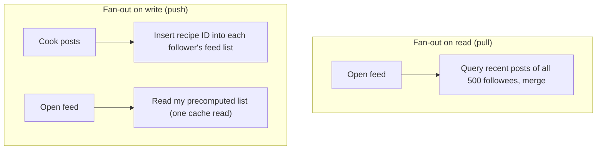
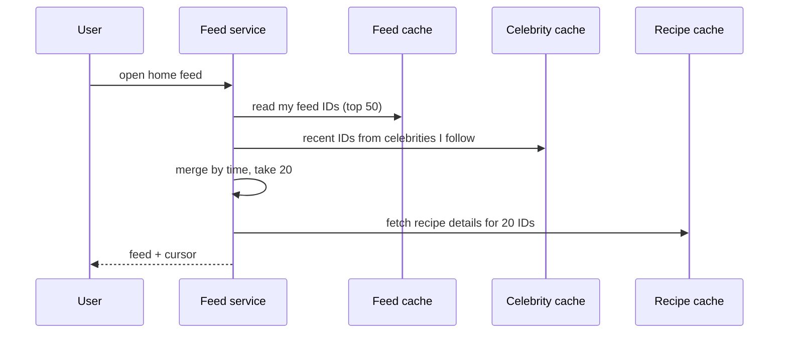

# Chapter 13 · The Home Feed Query Times Out

## The incident
The home feed shows new recipes from everyone you follow. It's built at read time: `SELECT ... FROM recipes WHERE author_id IN (500 followed cooks) ORDER BY created_at DESC LIMIT 20`. Followed cooks are spread across all shards, so each feed load fans out to every shard and merges. At **15,000 feed loads a second**, p99 hits **3 seconds**. Meanwhile one celebrity chef with 8 million followers posts daily.

## Why it breaks
Reads vastly outnumber posts (users open the feed 20 times a day but post once a month), yet all the work happens on read, repeated for every open.

## The two models

| | Pull | Push |
|---|---|---|
| Work happens | Every feed open | Once per post |
| Feed latency | Slow (many sources) | Fast (one list) |
| Cook with 8M followers | Fine | 8M writes per post |
| Inactive users | No waste | Wasted writes |

## The fix: hybrid
1. **Push for normal cooks:** when they post, a worker (via the chapter 10 queue) appends the recipe ID to each follower's feed list in Redis (keep the newest 500 IDs).
2. **Pull for celebrities** (over ~50K followers): don't fan out; at read time, fetch their recent posts (cached per celebrity) and merge into the list.
3. **Skip inactive users:** don't fan out to accounts that haven't opened Crumb in 30 days; rebuild their feed on their next visit.
4. Feed lists hold only IDs; recipe details come from the recipe cache (chapter 4), so edits show up everywhere.

## What it costs
- Write amplification: average 200 followers means 200 cache writes per post.
- Memory for feed lists (IDs only: 500 x 8 bytes = 4 KB per active user).
- More moving parts and a slight delay before a new post appears in followers' feeds.

## What interviewers ask
- *Push or pull?* Push for most, pull for huge accounts; justify with read/write ratios.
- *Where's the celebrity threshold?* Where fan-out time or cost becomes unacceptable; measure.
- *How do you paginate?* Cursor on the last recipe ID (time-ordered IDs from chapter 7).
- *Ranked feed?* Score a few hundred candidates from the list at read time.

## Try it
Crumb has 2M new recipes a day, average 300 followers, 40% of followers inactive. How many feed-list writes per second with push and inactive users skipped?

Answer

2M x 300 x 0.6 = 360M writes/day ≈ **4,200 writes/s** on average (peaks maybe 3x), easy for a Redis cluster.

**Next:** [Chapter 14: Live cook-along comments lag](14-real-time-and-pub-sub.md) · **Deeper:** [News feed](../03-problems/08-news-feed-system.md), [Twitter](../03-problems/26-twitter.md)
