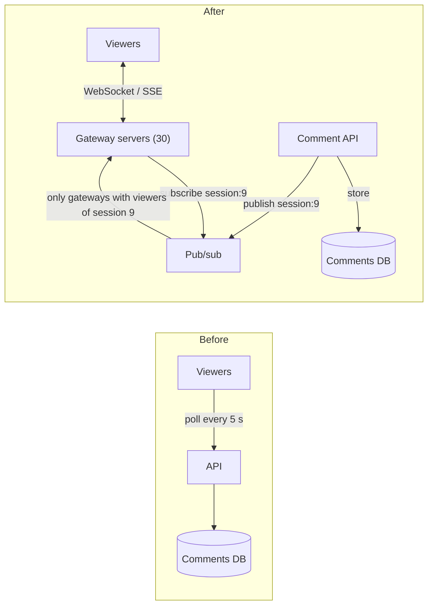

# Chapter 14 · Live Cook-Along Comments Lag by 20 Seconds

## The incident
Crumb launches **live cook-alongs**: a cook streams, viewers comment and see new comments as they arrive. Version one polls `GET /comments?after=...` every 5 seconds. With 40,000 viewers in a popular session that's 8,000 requests a second, almost all returning nothing, and comments still feel 5-20 seconds late. Then Crumb adds 30 WebSocket gateway servers. But when a comment is posted, the server that receives it doesn't know which gateways hold the viewers of that session.

## Why it breaks
- Polling trades freshness for wasted requests: poll faster and load explodes, poll slower and it feels laggy.
- With persistent connections, viewers of one session are spread over many gateways. The sender needs a way to reach "everyone watching session 9" without knowing where they are.

## Before and after

## Choosing the transport
| Option | Direction | Use when |
|---|---|---|
| Short polling | Client asks repeatedly | Updates rare, freshness not critical |
| Long polling | Server holds request until news | Fallback where sockets are blocked |
| **Server-Sent Events** | Server to client over HTTP | One-way live updates (counters, feeds, comments display) |
| **WebSocket** | Both ways | Chat, typing indicators, games |

Crumb uses SSE for watching and a normal POST for sending (simple, works through proxies), or WebSocket if it adds typing indicators.

## The fix
1. Viewers hold a connection to a gateway. When they join a session, the gateway **subscribes** to channel `session:9` (once per gateway, however many viewers it has).
2. Posting a comment stores it, then **publishes** to `session:9`. Pub/sub delivers a copy to each subscribed gateway, which pushes it to its viewers.
3. **Batch** pushes every 200-300 ms and, for huge sessions, **sample** comments down to a readable rate.
4. On reconnect, the client asks for comments after its last seen ID to fill the gap.

## What it costs
- Long-lived connections need gateways tuned for many sockets and careful deploys (drain, reconnect with jitter).
- Pub/sub is usually fire-and-forget; durability comes from the comments DB plus gap filling.

## What interviewers ask
- *SSE or WebSocket?* SSE if updates flow one way; WebSocket for two-way.
- *How does the server find the right connections?* Pub/sub channels per topic, gateways subscribe for their users.
- *How many connections per gateway?* Tens to hundreds of thousands with event-driven servers.
- *What if a gateway dies?* Clients reconnect elsewhere and fill gaps from the last seen ID.

## Try it
40,000 viewers polling every 5 s versus SSE. Roughly how many requests per second does each approach cost when comments arrive at 10 per second?

Answer

Polling: 40,000 / 5 = **8,000 requests/s**, regardless of comments. SSE: zero polling requests; 10 publishes/s fanned out to the gateways (batched), plus 40,000 idle connections.

**Next:** [Chapter 15: The primary dies at 2 a.m.](15-failover-and-monitoring.md) · **Deeper:** [Live comments](../03-problems/72-live-comments.md), [Chat system](../03-problems/09-chat-system.md), [Networking basics](../01-fundamentals/01-networking-basics.md)
