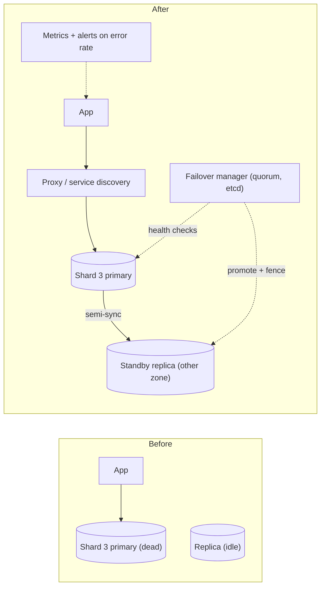
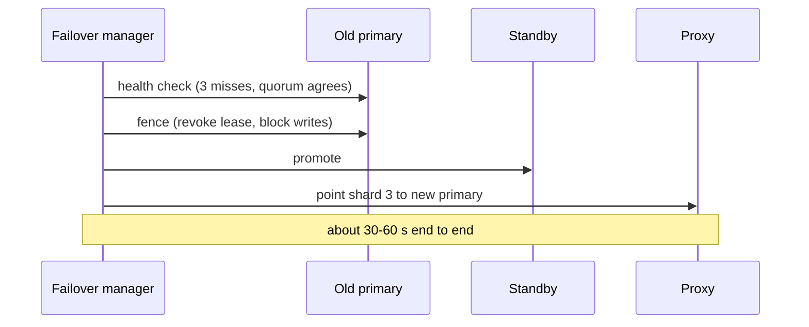

# Chapter 15 · The Database Primary Dies at 2 a.m.

## The incident
At 2:07 a.m. the disk under **shard 3's primary** fails. Its replicas are healthy but nothing promotes one. A third of new comments and likes fail to save. No alert fires because Crumb only alerts on CPU. A cook tweets about it at 3:10; the on-call engineer wakes up at 3:25 and promotes a replica by hand. **78 minutes** of partial outage.

## Why it breaks
1. A spare existed, but switching to it needed a human.
2. Nobody noticed: there was no signal tied to what users experience (failed writes).
3. Nobody could quickly tell *which* shard was failing.

## Before and after

## The fix: automatic failover
1. Each shard has a standby replica in another availability zone, replicated **semi-synchronously** (at least one standby confirms each write) so failover loses nothing.
2. A **failover manager** (Patroni, Orchestrator, or a managed database) health-checks the primary. If a **majority** of observers agree it's dead for ~15-30 s, it **fences** the old primary and promotes the standby.
3. Apps reach shards through a proxy or service discovery, which is updated to the new primary.
4. A new standby is built so there's a spare again.

## The fix: see it before users do
| Signal | Example alert |
|---|---|
| **Metrics** (golden signals) | Write error rate > 1% for 2 min on any shard; p99 latency; saturation |
| **Logs** | Structured logs with shard, request ID, error type |
| **Traces** | Which service and shard a slow request spent time in |

Alert on symptoms users feel (errors, latency), page on-call, link each alert to a runbook.

## What it costs
- A standby per shard (doubles database cost).
- Semi-sync adds a little write latency.
- False failovers if timeouts are too aggressive; split brain if fencing is missing.

## What interviewers ask
- *How fast is failover?* Detection + promotion + redirect: under a minute is typical.
- *How do you avoid split brain?* Quorum decisions and fencing the old primary.
- *What do you monitor?* Golden signals per service and per shard; SLO-based alerts.
- *RPO and RTO here?* RPO ≈ 0 with semi-sync, RTO ≈ 1 minute.

## Try it
Crumb's write path depends on the app (99.95%), a shard primary (99.9%) and the queue (99.95%). What is the availability of the write path, and what does automatic failover change?

Answer

0.9995 x 0.999 x 0.9995 ≈ 99.8% (about 17 hours down a year). Automatic failover shrinks each database outage from tens of minutes to about a minute, raising the database link to roughly 99.99% and the path to about 99.89%.

**Next:** [Chapter 16: A scraper sends 5,000 requests a second](16-rate-limiting-and-back-pressure.md) · **Deeper:** [Availability and failover](../01-fundamentals/30-availability-and-failover.md), [Observability](../01-fundamentals/14-observability-logs-metrics-tracing.md)
