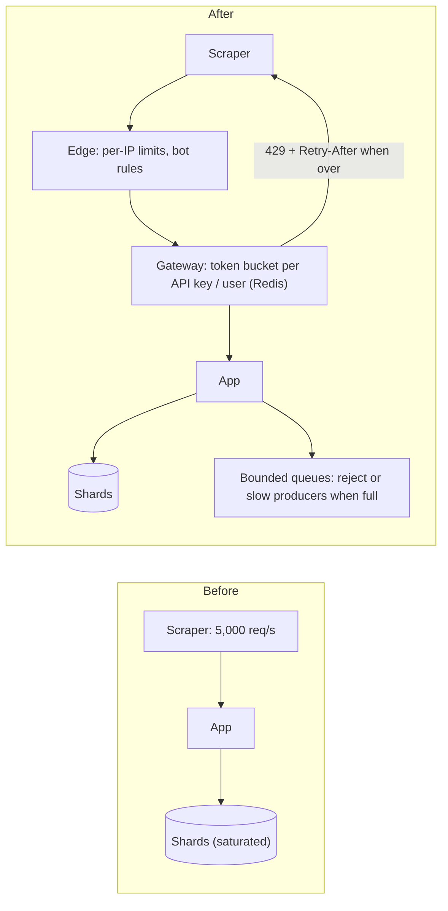

# Chapter 16 · A Scraper Sends 5,000 Requests a Second

## The incident
A recipe aggregator starts scraping Crumb's API with a single API key: **5,000 requests a second**, mostly for old recipes that miss the cache. Shard replicas saturate, everyone's pages slow to 4 seconds, and the photo resize queue (also fed by a buggy partner integration uploading in a loop) grows to 2 million jobs, using all worker memory.

## Why it breaks
- Nothing caps what one client can send, so one client can consume everyone's capacity.
- Queues and buffers are unbounded, so overload turns into growing backlogs and memory use instead of a clear "slow down".

## Before and after

## The fix: rate limiting
1. **Token bucket per API key** at the gateway: for example 50 requests/s with bursts up to 100; per-user limits for logged-in users; per-IP limits at the edge for anonymous traffic.
2. Counters live in Redis, updated atomically (Lua script) so many gateway servers share one limit.
3. Over the limit -> **429 Too Many Requests** with `Retry-After`; well-behaved clients back off.
4. Different tiers: partners pay for higher limits; write endpoints (posting, uploading) get stricter limits than reads.

## The fix: back-pressure
1. **Bound every queue.** The resize queue gets a maximum depth per partner; when full, new uploads from that partner get a 503 with retry instead of piling up.
2. **Shed low-priority work first:** analytics and background refreshes before user page loads.
3. **Timeouts and deadlines** so servers don't work on requests whose callers already gave up.
4. **Autoscale on queue depth**, but treat that as the slow fix; rejection is the fast one.

## What it costs
- Legitimate heavy users may hit limits; you need clear docs, headers and an upgrade path.
- Redis is now on the request path for limits (fail open if it's down, to stay available).
- Rejected work must be retried by clients.

## What interviewers ask
- *Which algorithm?* Token bucket (bursts allowed) or sliding window counter (smooth); know both.
- *Where do you enforce limits?* Edge for coarse per-IP, gateway for per-key/per-user, services for expensive operations.
- *What's back-pressure?* Pushing overload back to producers via bounded queues, rejection or slowing, instead of absorbing it until you fall over.
- *Fail open or closed when the limiter is down?* Usually open for availability, closed for security-sensitive limits (login attempts).

## Try it
A token bucket has capacity 100 and refills 50 tokens per second. A client sends 300 requests in the first second, then nothing. How many are allowed in that first second?

Answer

The bucket starts with 100 tokens and refills 50 during the second, so about **150** are allowed; the other ~150 get 429s.

**Next:** [Chapter 17: The whole region goes dark](17-multi-region.md) · **Deeper:** [Rate limiter](../03-problems/01-rate-limiter.md), [Back-pressure](../01-fundamentals/29-back-pressure.md)
