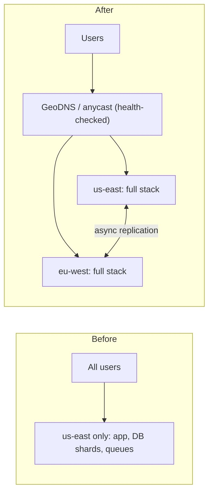

# Chapter 17 · The Whole Region Goes Dark

## The incident
Crumb runs entirely in **us-east**. A power and networking failure takes the region down for **5 hours**. Standbys from chapter 15 were in other availability zones of the same region, so they're gone too. The CDN keeps serving cached photos, but every page needing the API fails, nobody can post, and notifications stop. Meanwhile 45% of users are in Europe and Asia and have always paid an extra 100-250 ms per request.

## Why it breaks
Redundancy inside one region protects against a machine or a zone failing, not against the region itself. And one region is far from most of the world.

## Before and after

## The fix, step by step
1. **Second region with the full stack** (load balancers, app servers, caches, queues, database shards).
2. **Route users** to the nearest healthy region with GeoDNS or anycast; health checks move traffic away from a failing region.
3. **Decide per kind of data** how it's shared:

| Data | Choice |
|---|---|
| Photos | Object storage replicated across regions, CDN in front |
| Recipes, comments, follows | Each user has a **home region** for writes; async replication to the other for reads |
| Sessions, caches, feed lists | Per region, rebuilt on failover |
| Usernames (must be unique) | Single writer region (or a globally consistent store), since a duplicate handle is unacceptable |
| View counts | Count per region, merge totals (conflict-free) |

4. **Failover:** when a region dies, the survivor becomes writable for the dead region's users. Writes still in flight (seconds of async lag) may be lost; that's the accepted RPO.
5. Keep capacity headroom so one region can carry all traffic, and practice failover regularly.
6. Deploy to one region at a time so a bad release never hits both.

## The consistency choice (CAP in practice)
During a network split between regions, Crumb can either keep both regions accepting writes (available, possibly conflicting) or refuse writes in one (consistent, partly unavailable). For recipes and comments, availability wins and conflicts are rare (last writer wins per field). For usernames and anything involving money, consistency wins.

## What it costs
- Roughly double the infrastructure.
- Async replication means stale reads across regions and a small loss window on failover.
- Much more operational complexity: data residency, deploys, testing.

## What interviewers ask
- *Active-passive or active-active?* Passive for simpler DR; active-active for global latency.
- *How do you handle writes in two regions?* Home region per user, or single-writer for critical data, or conflict resolution (LWW, CRDTs).
- *What do you lose on regional failover?* The async replication lag (RPO of seconds).
- *What stays global and single?* Things that need uniqueness or strict ordering.

## Try it
A user in Paris (home region eu-west) edits a recipe, then flies to New York and reads it from us-east 20 seconds later. Replication lag is 2 seconds. Do they see the edit? What if eu-west had died 1 second after the edit?

Answer

Yes in the normal case: 20 s is far more than the 2 s lag. If eu-west died 1 s after the edit, the change might not have replicated and could be lost (within the RPO), unless that write was synchronously replicated.

**Next:** [Chapter 18: Estimate out loud](18-estimation-out-loud.md) · **Deeper:** [Multi-region design](../01-fundamentals/31-multi-region-design.md), [CAP and consistency](../01-fundamentals/08-cap-pacelc-and-consistency-models.md)
