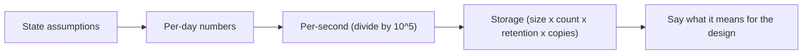

# Chapter 18 · "How Much Storage for Five Years?"

## The situation
A phone screen. The interviewer asks you to design Crumb and says: "50 million daily users, each views 30 recipes a day, 1% of users post a recipe a day with 6 photos. How much storage over five years, and how many reads per second?" You start multiplying in your head, lose track of zeros, and hear "How did you get that?"

## The method: write it down, round hard, keep units

## Worked example
**Assumptions (say them out loud):** 50M DAU; 30 recipe views per user per day; 1% post daily; recipe text and metadata 5 KB; 6 photos at 1 MB original + 300 KB of resized versions; 3 copies of data; 5 years.

**Reads**
- 50M x 30 = 1.5B views/day
- 1.5B / 10^5 ≈ **15,000 views/s average**, peak ≈ 3x = **45,000/s**

**Writes**
- 1% of 50M = 500K recipes/day ≈ **5 recipes/s** (peak 15/s). Writes are tiny compared to reads, so read scaling (caching, CDN, replicas) matters far more.

**Storage**
- Text: 500K x 5 KB = 2.5 GB/day -> x 1,825 days ≈ **4.6 TB**, x 3 copies ≈ 14 TB. Fits on a few database shards.
- Photos: 500K x 6 x 1.3 MB ≈ 3.9 TB/day -> x 1,825 ≈ **7 PB**. Object storage, not a database.

**Bandwidth**
- 45,000 views/s x 6 photos x 300 KB ≈ 81 GB/s at peak -> only a CDN can serve this.

**Conclusions to say:** photos dominate storage and bandwidth (object storage + CDN); text fits a modestly sharded database; reads dominate writes 3,000 to 1 (cache aggressively); feeds need precomputation.

## Handy numbers
| Fact | Value |
|---|---|
| Seconds in a day | 86,400 ≈ 10^5 |
| 1M per day | ≈ 12 per second |
| Days in 5 years | ≈ 1,825 (round to 2,000 for speed) |
| KB, MB, GB, TB, PB | each 1,000x the last |
| Peak vs average | 2-3x |

## Tips
- Round early: 86,400 -> 100,000; 1,825 -> 2,000. State that you're rounding.
- Keep units on every number (GB/day, not "3.9").
- Separate small things from big things: here, text is noise next to photos.
- Always finish with a design decision the number forces.

## What interviewers ask
- *Why does this number matter?* Every estimate should change a choice: shard or not, cache or not, CDN or not.
- *What's your peak?* Average x 2-3, more for events.
- *Did you include replication?* Multiply by copies.

## Try it
Each user opens their home feed 10 times a day and each load reads 20 recipe IDs from the feed cache. How many feed-cache reads per second at peak?

Answer

50M x 10 = 500M feed loads/day ≈ 5,000/s average, ≈ 15,000/s peak. Each load is one list read plus a batch of 20 recipe lookups, so about 15,000 list reads/s and 300,000 recipe-cache lookups/s at peak (batched).

**Next:** [Chapter 19: Defend your choices](19-defending-choices.md) · **Deeper:** [Back-of-the-envelope estimation](../01-fundamentals/22-back-of-the-envelope-estimation.md), [Estimation drills](../04-interview-questions/03-estimation-drills.md)
