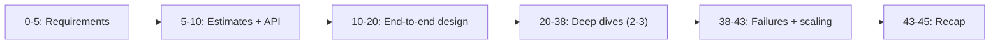

# Chapter 20 · Half the Design Is Missing at Minute 45

## The situation
In a mock interview you spend 22 minutes clarifying requirements and doing estimates, then start drawing. At minute 45 Crumb is half drawn: no feed, no failure handling. The feedback says: "No end-to-end design. No deep dive."

## Why it goes wrong
Requirements and numbers feel productive, so they expand to fill the time. But interviewers score an **end-to-end design first** and **depth second**. A simple complete design beats a perfect half design.

## A 45-minute plan

| Minutes | Step | What "done" looks like |
|---|---|---|
| 0-5 | Requirements | 3-5 core features written down, 3-4 non-functional numbers (users, latency, availability, consistency) |
| 5-10 | Estimates and API | QPS, storage, one sentence on what they imply; 3-5 endpoints |
| 10-20 | End-to-end design | Every feature flows through the diagram: client to storage and back |
| 20-38 | Deep dives | The 2-3 hardest parts, with options and trade-offs |
| 38-43 | Failures and scale | What breaks at 10x, single points of failure, monitoring |
| 43-45 | Recap | Main decisions and their costs in 60 seconds |

## Habits that keep you on time
- **Say the plan at the start:** "I'll take 5 minutes for requirements, then numbers, then a simple design end to end, then go deep where you'd like."
- **Draw the simple version first** (one app tier, one database, one cache), then evolve it. That's exactly what chapters 1-17 did.
- **Park details:** "I'll come back to how IDs are generated" keeps momentum.
- **Ask where to go deep:** "Would you like me to go deeper on the feed or on photo processing?" The interviewer usually has a preference.
- **Watch the clock** at minute 20: if the end-to-end design isn't on the board, stop refining and finish it.

## Crumb in 45 minutes (what you'd draw)
1. Requirements: post recipes with photos, follow, home feed, likes/comments, search. 50M DAU, feed < 300 ms, photos durable, likes eventually consistent.
2. Numbers: 15K reads/s avg, 5 writes/s, 7 PB photos over 5 years -> CDN + object storage, read-heavy caching.
3. Design: clients -> CDN / LB -> stateless app -> Redis + sharded DB + object storage; queue + workers for photos and fan-out; search index.
4. Deep dives: feed fan-out (hybrid), photo pipeline, sharding comments.
5. Failures: failover per shard, rate limits, second region.

## Try it
It's minute 25 and the interviewer asks a detailed question about cache eviction policies, but your diagram has no feed yet. What do you say?

Answer

Answer briefly (LRU with TTLs, protect against stampedes), then: "I want to make sure we have the whole flow first, can I sketch the feed in two minutes and come back to eviction if you'd like more depth?" Interviewers usually appreciate the time management.

**Next:** [Capstone: three mock interviews](21-capstone-mocks.md) · **Deeper:** [Interview framework](../01-fundamentals/23-interview-framework.md)
