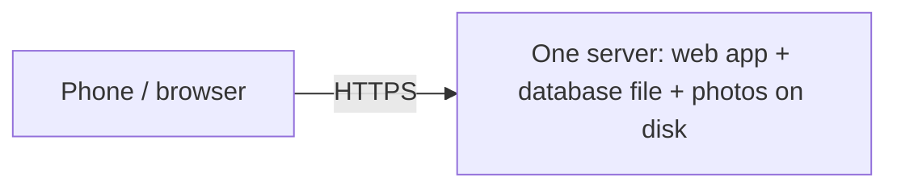
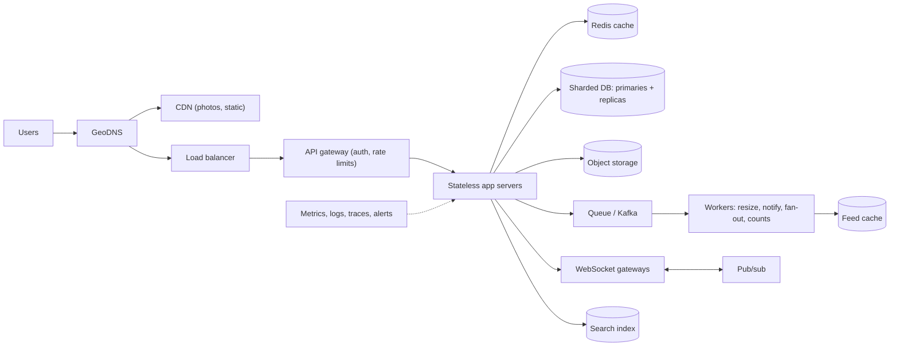

# The Crumb Course: System Design by Growing One App

Most system design material explains concepts one at a time. This course does it the other way around: you run one app, **Crumb**, and every chapter starts with something going wrong. You fix it, and the fix is the concept. By the end, Crumb has grown from one rented server to a multi-region system, and you can explain every box on the diagram because you added it yourself.

---

## Meet Crumb

Crumb is a recipe-sharing app. Home cooks post recipes with photos, follow other cooks, get a home feed of new recipes, like and comment, and get notified when someone they follow posts. Later, cooks run live "cook-along" sessions where viewers comment in real time.

You built it over a few weekends. Today it runs on **one rented server** with one database file on its disk. 300 people use it. That's where chapter 1 starts.

---

## How each chapter works

Every chapter has the same parts, in the same order:

| Part | What it gives you |
|---|---|
| **The incident** | What went wrong, with real numbers (users, requests per second, latency, disk) |
| **Why it breaks** | The root cause, in plain words |
| **Before and after** | Two small diagrams of Crumb |
| **The fix** | What you change, step by step |
| **What it costs** | The downside you accept, and when you'd choose differently |
| **What interviewers ask** | The follow-up questions and numbers they probe |
| **Try it** | A short exercise; the answer is hidden until you click |

Links at the end of each chapter point to the deeper notes in [01-fundamentals](../01-fundamentals/) and the full problems in [03-problems](../03-problems/).

---

## The chapters

### Part 1: From one box to many
| # | Incident | Concept |
|---|---|---|
| 01 | [One box runs everything](01-one-box.md) | Clients, servers, the request path |
| 02 | [The second server can't see the data](02-separate-the-database.md) | Separating the database |
| 03 | [A food blogger shares Crumb](03-load-balancer-and-stateless.md) | Load balancing, stateless servers |

### Part 2: Keep pages fast
| # | Incident | Concept |
|---|---|---|
| 04 | [The database answers the same question 10,000 times a second](04-caching.md) | Caching and invalidation |
| 05 | [Cache misses still drown the database](05-read-replicas.md) | Read replicas, replication lag |
| 06 | [Photos crawl for users in Australia](06-object-storage-and-cdn.md) | Object storage, CDN |

### Part 3: Store a lot of data
| # | Incident | Concept |
|---|---|---|
| 07 | [Two recipes get the same ID](07-unique-ids.md) | ID generation |
| 08 | [Search takes 6 seconds](08-indexes-and-search.md) | Indexes, inverted index |
| 09 | [The comments table fills the disk](09-sharding.md) | Sharding, consistent hashing |

### Part 4: Get slow work out of the way
| # | Incident | Concept |
|---|---|---|
| 10 | [Uploading a recipe takes 9 seconds](10-queues-and-workers.md) | Message queues, workers |
| 11 | [The push provider goes down and takes the workers with it](11-retries-and-idempotency.md) | Retries, backoff, idempotency, dead letters |
| 12 | [Cooks want views per recipe per day](12-event-streams-and-counting.md) | Event streams, aggregation |

### Part 5: Feeds and live features
| # | Incident | Concept |
|---|---|---|
| 13 | [The home feed query times out](13-feed-fan-out.md) | Fan-out on write vs read |
| 14 | [Live cook-along comments lag by 20 seconds](14-real-time-and-pub-sub.md) | WebSockets/SSE, pub/sub |

### Part 6: Survive failures
| # | Incident | Concept |
|---|---|---|
| 15 | [The database primary dies at 2 a.m.](15-failover-and-monitoring.md) | Failover, observability |
| 16 | [A scraper sends 5,000 requests a second](16-rate-limiting-and-back-pressure.md) | Rate limiting, back-pressure |
| 17 | [The whole region goes dark](17-multi-region.md) | Multi-region design, consistency choices |

### Part 7: Take Crumb into the interview
| # | Situation | Skill |
|---|---|---|
| 18 | ["How much storage for five years?"](18-estimation-out-loud.md) | Back-of-the-envelope estimates |
| 19 | ["What does that choice cost you?"](19-defending-choices.md) | Trade-offs, CAP |
| 20 | [Half the design is missing at minute 45](20-running-the-clock.md) | Pacing the interview |

### Capstone
[Three timed mock interviews with a self-review rubric](21-capstone-mocks.md).

---

## Short on time?
Interview in a few days: read chapters **01, 03, 04, 06, 09, 10, 13, 15, 18, 19, 20**, then do one mock. That's about two and a half hours.

## The finished picture

Every box in that picture is added in one of the chapters above.
