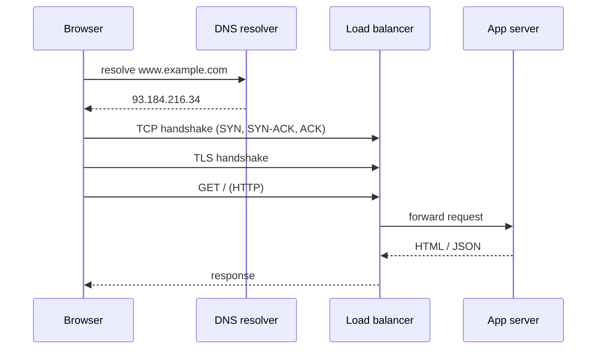

# Networking Basics for System Design

Every system design starts with a request leaving a client and arriving at a server. Knowing what happens on that journey explains *why* latency, timeouts, connection limits and protocol choices matter.

---

## 1. What happens when you type `https://www.example.com` in a browser?

1. **URL parsing** - browser extracts scheme (`https`), host (`www.example.com`), port (443 default), path.
2. **DNS resolution** - host name -> IP address (browser cache -> OS cache -> resolver -> root -> TLD -> authoritative server).
3. **TCP handshake** - `SYN -> SYN-ACK -> ACK` (1 round trip).
4. **TLS handshake** - negotiate cipher, verify certificate, exchange keys (1 RTT in TLS 1.3, 2 RTT in TLS 1.2).
5. **HTTP request** - `GET / HTTP/1.1` with headers (cookies, user-agent, accept-encoding...).
6. **Server processing** - load balancer -> web server -> app server -> cache/DB.
7. **HTTP response** - status code, headers, body (HTML/JSON).
8. **Rendering** - browser parses HTML, fetches CSS/JS/images (often from a CDN), renders.

**Interview takeaway:** before *any* byte of your API runs, a cold connection already costs DNS + TCP + TLS ≈ 3 round trips. That's why we use **connection pooling, keep-alive, CDNs close to users, and HTTP/2/3**.

---

### Diagram



## 2. OSI vs TCP/IP model (only the layers that matter)

| Layer | Examples | Why you care in system design |
|---|---|---|
| L7 Application | HTTP, gRPC, WebSocket, DNS, SMTP | L7 load balancers route on URL/headers/cookies |
| L4 Transport | TCP, UDP, QUIC | L4 load balancers route on IP+port only (faster, dumber) |
| L3 Network | IP, ICMP | Routing, anycast, subnets, VPCs |
| L2 Data link | Ethernet, ARP | Rarely discussed |

---

## 3. TCP vs UDP

| | TCP | UDP |
|---|---|---|
| Connection | Connection-oriented (handshake) | Connectionless |
| Reliability | Guaranteed delivery, retransmits | Best effort, may drop |
| Ordering | In-order | No ordering |
| Flow / congestion control | Yes | No |
| Header size | 20+ bytes | 8 bytes |
| Use cases | Web, APIs, DBs, file transfer, email | Video calls, gaming, DNS, live streaming, VoIP |

**Rule of thumb:** If losing a packet is *worse* than receiving it late -> TCP. If receiving it late is *useless* (a video frame from 2 s ago) -> UDP.

**Head-of-line blocking:** in TCP, one lost packet blocks all packets behind it. HTTP/2 multiplexes many streams over one TCP connection, so one loss stalls *all streams*. QUIC (HTTP/3) fixes this by running independent streams over UDP.

---

## 4. DNS (Domain Name System)

- **Hierarchy:** Root servers (`.`) -> TLD servers (`.com`) -> Authoritative servers (`example.com`).
- **Record types:**
  - `A` - name -> IPv4, `AAAA` - name -> IPv6
  - `CNAME` - alias to another name
  - `MX` - mail servers, `TXT` - verification/SPF, `NS` - delegating name servers
- **TTL** - how long resolvers may cache a record. Low TTL = faster failover but more DNS traffic.
- **DNS in system design:**
  - **GeoDNS / latency-based routing** - return the IP of the nearest data center.
  - **DNS load balancing** - return multiple A records (round robin). Crude: clients cache, no health awareness.
  - **Failover** - health-checked DNS (e.g., Route 53) swaps IPs when a region dies.
- **Anycast** - the same IP announced from many locations; BGP routes users to the closest one (used by CDNs and public DNS like 1.1.1.1).

---

## 5. HTTP Evolution

| Version | Key features | Problem it solved |
|---|---|---|
| HTTP/1.0 | New TCP connection per request | - |
| HTTP/1.1 | Keep-alive (persistent connections), pipelining, chunked transfer | Connection setup cost |
| HTTP/2 | Binary framing, **multiplexing** many requests on one connection, header compression (HPACK), server push | Browser opening 6 connections per host, HOL blocking at HTTP level |
| HTTP/3 | Runs on **QUIC (UDP)**, 0-RTT resumption, no TCP HOL blocking, connection migration (Wi-Fi -> 4G) | TCP head-of-line blocking, slow handshakes on mobile |

### Important HTTP concepts
- **Methods:** `GET` (safe, idempotent), `PUT` (idempotent), `DELETE` (idempotent), `POST` (not idempotent), `PATCH` (not necessarily idempotent).
- **Status codes:**
  - `2xx` success - 200 OK, 201 Created, 202 Accepted (async), 204 No Content
  - `3xx` redirect - 301 Permanent, 302 Found/Temporary, 304 Not Modified
  - `4xx` client error - 400, 401 Unauthorized (not authenticated), 403 Forbidden (not allowed), 404, 409 Conflict, 429 Too Many Requests
  - `5xx` server error - 500, 502 Bad Gateway, 503 Unavailable, 504 Gateway Timeout
- **Caching headers:** `Cache-Control: max-age=3600, public`, `ETag` + `If-None-Match`, `Last-Modified`.
- **Cookies vs tokens:** cookies sent automatically by browsers (need CSRF protection); bearer tokens sent explicitly in `Authorization` header.

---

## 6. TLS / HTTPS in 60 seconds
- Provides **confidentiality** (encryption), **integrity** (MAC), **authentication** (certificate signed by a CA).
- Uses **asymmetric crypto** (RSA/ECDHE) to agree on a key, then **symmetric crypto** (AES-GCM, ChaCha20) for data - symmetric is ~1000× faster.
- **TLS termination** usually happens at the load balancer / edge so backend servers don't pay the CPU cost; traffic inside the VPC may be re-encrypted (mTLS) in zero-trust setups.

---

## 7. Real-time communication options

| Technique | How it works | Pros | Cons | Use case |
|---|---|---|---|---|
| **Short polling** | Client asks every N seconds | Simple | Wasteful, latency up to N s | Dashboards refreshing every minute |
| **Long polling** | Server holds request open until data or timeout | Works everywhere | Connection churn, hard to scale | Fallback for chat |
| **Server-Sent Events (SSE)** | One long-lived HTTP response streaming events server -> client | Simple, auto-reconnect, HTTP-friendly | One-way only | Live scores, stock tickers, LLM token streaming |
| **WebSocket** | HTTP upgrade to a full-duplex TCP channel | Bi-directional, low overhead | Stateful servers, LB stickiness, harder scaling | Chat, multiplayer games, collaboration |
| **WebRTC** | Peer-to-peer UDP media/data channels | Lowest latency | NAT traversal (STUN/TURN), complex | Video calls |
| **Webhooks** | Server calls *your* URL when an event occurs | No polling | Receiver must be public, retries, security (signatures) | Payments (Stripe), GitHub events |

---

## 8. Proxies

- **Forward proxy** - sits in front of *clients* (corporate proxy, VPN). Server sees the proxy's IP.
- **Reverse proxy** - sits in front of *servers* (Nginx, Envoy, HAProxy). Client sees the proxy. Provides TLS termination, compression, caching, routing, rate limiting, hiding internal topology.
- **Load balancer** = a reverse proxy that spreads load (see the Load Balancing note).
- **API Gateway** = a reverse proxy with API concerns: auth, rate limits, request transformation, versioning, aggregation.

---

## 9. Latency mental model

```
Same machine (memory)        ~100 ns
Same data center RTT         ~0.5 ms
Same region, different AZ    ~1-2 ms
Cross-continent (US ↔ EU)    ~80-150 ms
Around the world             ~250-300 ms
```
Speed of light in fiber ≈ 200,000 km/s -> **~1 ms per 100 km one-way**. You *cannot* optimise past physics; the only fix is moving data closer to users (CDN, edge, multi-region).

---

## 10. Interview Q&A

- **Why is HTTP/2 faster?** Multiplexing over one connection, header compression, fewer handshakes.
- **When would you choose UDP?** Real-time media/gaming where late data is useless.
- **How does a CDN pick the closest server?** GeoDNS and/or anycast routing.
- **What does a 502 vs 504 mean?** 502: upstream sent an invalid response / refused; 504: upstream didn't respond in time.
- **Why keep-alive / connection pools?** Avoid paying TCP + TLS handshakes for every request.
