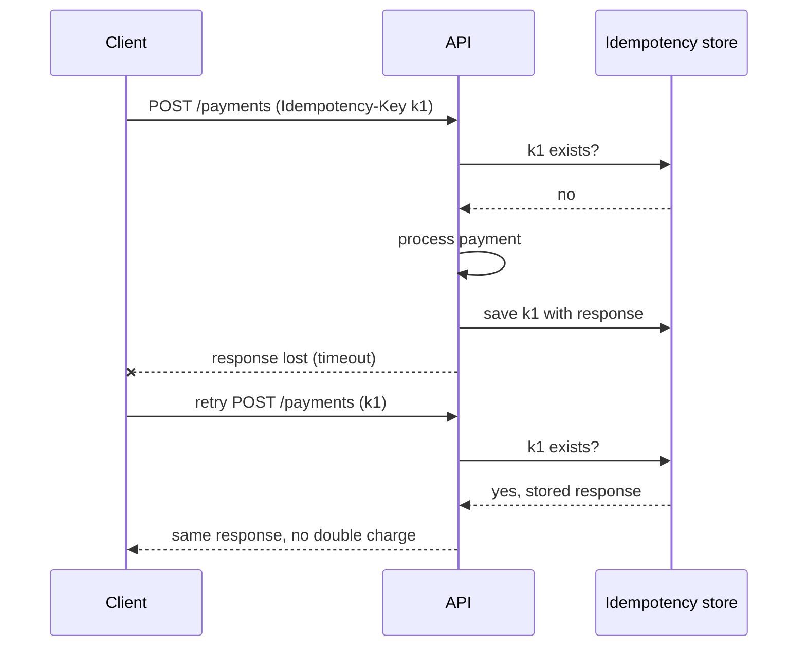

# API Design (REST, GraphQL, gRPC & Best Practices)

> The API is the contract between your system and the world. In interviews, defining the API early forces you to pin down *what* the system does before *how*.

---

## 1. API Styles Compared

| | REST | GraphQL | gRPC |
|---|---|---|---|
| Transport | HTTP/1.1 or 2 | HTTP (usually POST) | HTTP/2 |
| Payload | JSON (text) | JSON | Protocol Buffers (binary) |
| Contract | OpenAPI (optional) | Strongly typed schema | `.proto` file (strict) |
| Fetching | Fixed resource shapes → over/under-fetching | Client asks for exactly the fields it needs | Fixed RPC methods |
| Streaming | No (use SSE/WebSocket) | Subscriptions | Uni- and bi-directional streaming built in |
| Caching | Easy (HTTP caching by URL) | Hard (single endpoint) | Hard |
| Best for | Public APIs, CRUD, web | Mobile/web clients with varied data needs, aggregating many services | Internal service-to-service, low latency, polyglot microservices |

**Typical answer in an interview:** *"Public-facing REST over HTTPS, internal microservices talk gRPC, and the mobile app could use a GraphQL BFF if screens need data from many services."*

---

## 2. REST Fundamentals

- **Resources are nouns**, HTTP methods are verbs:
  ```
  GET    /v1/users/123            → read user
  POST   /v1/users                → create user
  PUT    /v1/users/123            → replace user
  PATCH  /v1/users/123            → partial update
  DELETE /v1/users/123            → delete user
  GET    /v1/users/123/orders     → sub-resource collection
  ```
- **Stateless** – each request carries everything needed (auth token etc.). Makes horizontal scaling easy.
- **Use correct status codes** (201 on create, 202 for async accepted jobs, 409 conflicts, 429 throttled).
- **HATEOAS** – responses contain links to related actions (rarely required in interviews).

---

## 3. Pagination

| Type | Request | Pros | Cons |
|---|---|---|---|
| **Offset** | `?limit=20&offset=40` | Simple, jump to any page | `OFFSET 1000000` scans & skips rows (slow); items shift when new rows inserted |
| **Cursor / keyset** | `?limit=20&cursor=eyJpZCI6MTIzfQ` | O(log n) via index (`WHERE id < last_id`), stable under inserts | Can't jump to page N |
| **Page token** | Opaque token from server | Server free to change implementation | Same as cursor |

✅ For feeds, timelines, chat history → **cursor-based pagination** (`WHERE created_at < :cursor ORDER BY created_at DESC LIMIT 20`).

---

## 4. Idempotency (very important!)

An operation is **idempotent** if performing it multiple times has the same effect as once.

Networks fail *after* a server processed a request but *before* the client got the response → client retries → **double charge**.

**Solution: Idempotency keys**
```
POST /v1/payments
Idempotency-Key: 8f14e45f-ceea-467a-9b36-...
```
1. Server looks up the key in a store (Redis/DB) with a unique constraint.
2. If not present → process, store `{key → response}`.
3. If present → return the stored response without re-processing.
4. Expire keys after e.g. 24 h.

Used by Stripe, PayPal, every payment system. Also useful for "create order", "send message", etc.

---

### Diagram



## 5. Versioning

- URL: `/v1/orders` (most common, explicit)
- Header: `Accept: application/vnd.myapi.v2+json`
- Query: `?version=2`

Rules: never break existing clients; additive changes (new optional fields) don't need a new version; removing/renaming fields does.

---

## 6. Rate limiting & quotas in APIs
Return `429 Too Many Requests` with headers:
```
X-RateLimit-Limit: 100
X-RateLimit-Remaining: 0
Retry-After: 30
```
(see [Rate Limiter](../03-problems/01-rate-limiter.md) – Rate Limiter.)

---

## 7. Async APIs / long-running jobs

For video transcoding, report generation, bulk imports:
```
POST /v1/reports          → 202 Accepted, { "job_id": "abc", "status_url": "/v1/jobs/abc" }
GET  /v1/jobs/abc         → { "status": "RUNNING", "progress": 40 }
GET  /v1/jobs/abc         → { "status": "DONE", "result_url": "..." }
```
Or notify via **webhook** / push notification when done.

---

## 8. Filtering, sorting, partial responses
```
GET /v1/products?category=shoes&price_lt=100&sort=-rating&fields=id,name,price
```

---

## 9. Security checklist for APIs
- HTTPS everywhere.
- AuthN with OAuth 2.0 / JWT bearer tokens; AuthZ checks on *every* resource (avoid IDOR – Insecure Direct Object Reference: user A reading `/orders/999` that belongs to user B).
- Validate input, limit payload sizes.
- Rate limit per user/IP/API key.
- Don't leak internals in error messages.
- Signed webhooks (HMAC signature header).

---

## 10. API Gateway

A single entry point in front of microservices that handles:
- Authentication & authorization
- Rate limiting / throttling
- Routing & load balancing to services
- Request/response transformation, protocol translation (REST ↔ gRPC)
- Response aggregation (call 3 services, return 1 response)
- Caching, logging, metrics, tracing

Examples: Kong, AWS API Gateway, Apigee, Envoy, Nginx.

**BFF (Backend For Frontend):** a separate gateway per client type (web BFF, mobile BFF) to tailor payloads.

---

## 11. How to present APIs in an interview

Write 3–5 core endpoints only:
```
POST /v1/tweets               body: {text, media_ids}        → {tweet_id}
GET  /v1/timeline?cursor=&limit=20                           → {tweets[], next_cursor}
POST /v1/users/{id}/follow
GET  /v1/search?q=&cursor=
```
Mention auth (token in header), pagination, and idempotency for writes. Don't spend more than ~3 minutes here.
