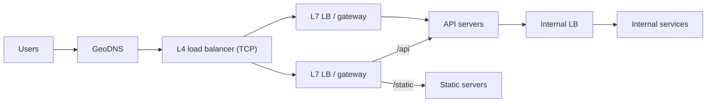

# Load Balancing

A load balancer (LB) spreads traffic across a pool of servers so that no single server is overloaded, and removes unhealthy servers from rotation. It is the component that makes horizontal scaling possible.

---

## 1. Where load balancers sit

```
Client → DNS/GeoDNS → [Global LB / CDN edge] → [Regional L4 LB] → [L7 LB / API Gateway] → App servers → [Internal LB] → Services / DB proxies
```
Load balancers appear at **every tier**: between users and web servers, between web servers and internal services, in front of database read replicas.

---

### Diagram



## 2. Layer 4 vs Layer 7

| | L4 (Transport) | L7 (Application) |
|---|---|---|
| Looks at | IP + port (TCP/UDP) | HTTP method, URL path, headers, cookies |
| Speed | Very fast, low CPU | Slower (must parse HTTP, often terminate TLS) |
| Features | Simple forwarding, NAT / DSR | Path routing (`/api` -> service A, `/img` -> B), sticky cookies, header rewrites, caching, auth, retries, WAF |
| Examples | AWS NLB, LVS, Maglev | AWS ALB, Nginx, Envoy, HAProxy (both modes) |

---

## 3. Load-balancing algorithms

| Algorithm | How | Good for |
|---|---|---|
| **Round robin** | Next server in order | Identical servers, similar requests |
| **Weighted round robin** | Servers with higher weight get more requests | Mixed instance sizes, canary (5% weight) |
| **Least connections** | Server with fewest active connections | Long-lived connections (WebSockets) or variable request time |
| **Least response time** | Fewest connections + lowest latency | Latency-sensitive services |
| **IP hash** | `hash(client_ip) % N` | Crude stickiness |
| **Consistent hashing** | Hash ring of servers | Caches/sharded stateful backends; minimal remapping on change |
| **Random / Power of two choices** | Pick 2 random servers, send to the less loaded | Scales well without global state (used by Envoy, Nginx) |

**Power of two choices** is a great interview nugget: nearly as good as least-connections but needs no shared global view.

---

## 4. Health checks
- **Active:** LB pings `/health` every few seconds; N failures -> remove; M successes -> add back.
- **Passive:** LB watches real traffic for errors/timeouts (outlier detection).
- Keep `/health` cheap; have a separate deep `/ready` that checks dependencies (careful: a DB outage shouldn't make *every* server "unhealthy" and empty the pool - that's a cascading failure).

---

## 5. Sticky sessions (session affinity)
- Route the same user to the same server (cookie or IP hash).
- Needed when servers keep in-memory session state or WebSocket connections.
- **Downside:** uneven load, lost sessions when a server dies.
- **Better:** make the web tier **stateless** and store sessions in Redis ([Scaling from Zero to Millions of Users](21-scaling-from-zero-to-millions.md)).

---

## 6. Avoiding the LB as a single point of failure
- Run LBs in **active-passive** pairs with a floating virtual IP (keepalived/VRRP), or **active-active** behind DNS/anycast.
- Cloud LBs (ALB/NLB/GCLB) are already distributed managed services.

---

## 7. Global load balancing (multi-region)
- **GeoDNS** - return the regional LB IP closest to the user.
- **Anycast** - one IP advertised from many PoPs (Google Front End, Cloudflare).
- **Latency-based / weighted routing** - Route 53 policies.
- **Failover** - health checks per region; drain traffic from an unhealthy region.

---

## 8. Other LB responsibilities
- **TLS termination** - decrypt once at the edge.
- **Connection pooling / multiplexing** to backends.
- **Rate limiting & WAF** (block SQL injection, bots).
- **Retries & timeouts** (careful: retries can amplify load - use budgets).
- **Graceful draining** - stop sending new requests to a server being deployed, let in-flight finish.
- **Autoscaling integration** - new instances register automatically.

---

## 9. Client-side load balancing & service discovery
In microservices, instead of a central LB, clients can fetch the list of healthy instances from a **service registry** (Consul, etcd, Eureka, Kubernetes DNS) and balance themselves (gRPC client LB, or a **sidecar proxy** like Envoy in a **service mesh** such as Istio/Linkerd).

| Server-side LB | Client-side LB |
|---|---|
| Simple clients | Clients need a library / sidecar |
| Extra network hop | No extra hop |
| Central bottleneck possible | Scales with clients |

---

## 10. Points to mention in an interview
- "Put a **L7 load balancer** in front of stateless web servers; use **least-connections** for WebSocket servers."
- "Health checks remove dead nodes; LBs run redundantly so they aren't a SPOF."
- "For global users, **GeoDNS + regional LBs**; for static content, a **CDN**."
- "For caches/sharded stores, use **consistent hashing** so adding a node moves only ~1/N keys."
