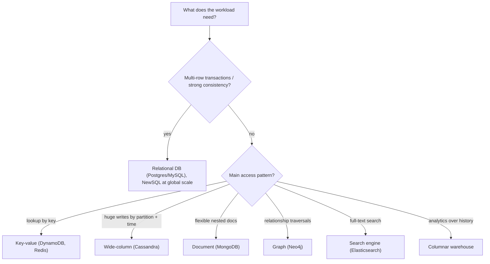

# Databases: SQL vs NoSQL, ACID, Isolation & Indexing

> "Which database?" is asked in nearly every system design interview. The right answer is always driven by **access patterns, consistency needs, scale and data shape** - not by brand names.

---

## 1. Families of databases

| Type | Data model | Examples | Strengths | Typical use |
|---|---|---|---|---|
| **Relational (SQL)** | Tables, rows, joins, schema | PostgreSQL, MySQL, Oracle, SQL Server | ACID transactions, joins, flexible queries, mature | Payments, orders, users, inventory, anything with strong consistency |
| **Key-Value** | `key -> blob` | Redis, DynamoDB, Riak, etcd | O(1) lookups, massive scale | Caching, sessions, carts, feature flags |
| **Document** | JSON/BSON documents | MongoDB, Couchbase, Firestore | Flexible schema, nested data, one read per object | Catalogs, CMS, user profiles |
| **Wide-column** | Row key -> column families, sorted | Cassandra, HBase, Bigtable, ScyllaDB | Huge write throughput, time-series, linear scale | Messages, activity logs, IoT, metrics |
| **Graph** | Nodes & edges | Neo4j, Neptune, JanusGraph | Multi-hop relationship queries | Social graph, recommendations, fraud rings |
| **Time-series** | Timestamped points | InfluxDB, TimescaleDB, Prometheus | Compression, downsampling, range queries | Metrics, monitoring, IoT |
| **Search** | Inverted index | Elasticsearch, OpenSearch, Solr | Full-text, fuzzy, faceted search | Product search, log search |
| **NewSQL / Distributed SQL** | SQL + horizontal scale | Spanner, CockroachDB, TiDB, YugabyteDB | ACID + sharding + geo-replication | Global financial/ledger systems |
| **OLAP / Columnar** | Columns stored together | BigQuery, Snowflake, Redshift, ClickHouse, Druid | Fast aggregations on billions of rows | Analytics, dashboards |
| **Vector** | Embeddings + ANN index | Pinecone, Milvus, pgvector, Weaviate | Similarity search | Semantic search, RAG, recommendations |

---

## 2. How to choose (interview decision guide)

1. **Need multi-row transactions / strong consistency (money, inventory)?** -> SQL (or NewSQL at global scale).
2. **Simple lookups by key at huge scale?** -> Key-value (DynamoDB / Redis).
3. **Massive write volume, append-heavy, query by partition key + time?** -> Wide-column (Cassandra).
4. **Flexible, nested, evolving schema?** -> Document DB.
5. **Deep relationship traversals?** -> Graph DB.
6. **Full-text search?** -> Elasticsearch (as a secondary index, not source of truth).
7. **Analytics over history?** -> Columnar warehouse fed by CDC/ETL.

Real systems are **polyglot**: Postgres for orders, Redis for cache, Cassandra for messages, Elasticsearch for search, S3 for blobs, Snowflake for analytics.

---

### Diagram



## 3. ACID

| Property | Meaning | Example |
|---|---|---|
| **Atomicity** | All or nothing | Debit A and credit B both happen or neither |
| **Consistency** | Transaction moves DB from one valid state to another (constraints hold) | Balance never negative if constraint says so |
| **Isolation** | Concurrent transactions don't see each other's partial work | Two people buying the last ticket |
| **Durability** | Once committed, survives crashes | Write-ahead log (WAL) fsynced to disk |

**BASE** (typical of NoSQL): *Basically Available, Soft state, Eventually consistent.*

---

## 4. Isolation levels & anomalies

| Anomaly | Description |
|---|---|
| **Dirty read** | Read uncommitted data from another txn |
| **Non-repeatable read** | Same row read twice gives different values |
| **Phantom read** | Same query returns new rows inserted by another txn |
| **Lost update** | Two txns read-modify-write; one overwrite is lost |
| **Write skew** | Two txns read overlapping data, write different rows, violate an invariant (e.g., two doctors both go off-call) |

| Level | Dirty | Non-repeatable | Phantom | Notes |
|---|---|---|---|---|
| Read Uncommitted | possible | possible | possible | Rarely used |
| Read Committed | prevented | possible | possible | Postgres/Oracle default |
| Repeatable Read | prevented | prevented | possible (MySQL InnoDB prevents most) | MySQL default |
| Snapshot Isolation | prevented | prevented | prevented (mostly) | MVCC; still allows write skew |
| Serializable | prevented | prevented | prevented | Safest, slowest |

### Preventing lost updates / double booking
- **Pessimistic locking:** `SELECT ... FOR UPDATE` locks the row until commit.
- **Optimistic locking:** add a `version` column:
  ```sql
  UPDATE seats SET status='BOOKED', version=version+1
  WHERE seat_id=42 AND version=7;   -- 0 rows updated → someone else won, retry
  ```
- **Atomic operations:** `UPDATE stock SET qty = qty - 1 WHERE id=1 AND qty > 0`.
- **Unique constraints:** `UNIQUE(event_id, seat_id)` on a bookings table - the DB itself prevents doubles.

---

## 5. MVCC (Multi-Version Concurrency Control)
Instead of locking readers out, the DB keeps multiple versions of a row. Each transaction sees a consistent **snapshot** as of its start time. Readers never block writers and vice versa. Used by Postgres, MySQL InnoDB, Oracle, CockroachDB.

---

## 6. Indexing

An index is a separate data structure that lets the DB find rows without scanning the whole table.

### B-Tree / B+Tree (default in SQL DBs)
- Balanced tree, data sorted; O(log n) lookups and **range scans** (`BETWEEN`, `ORDER BY`).
- Great for read-heavy workloads; writes require in-place page updates (random I/O).

### LSM Tree (Log-Structured Merge Tree)
- Used by Cassandra, RocksDB, LevelDB, HBase, ScyllaDB.
- Write path: append to **commit log** -> insert into in-memory **memtable** -> flush to immutable sorted **SSTables** on disk -> background **compaction** merges SSTables.
- Read path: memtable -> bloom filters -> SSTables (newest first).
- **Very fast writes** (sequential I/O); reads can touch several files (mitigated by bloom filters & compaction).

| | B-Tree | LSM Tree |
|---|---|---|
| Writes | Slower (random I/O) | Very fast (sequential) |
| Reads | Fast, predictable | Slower, may read multiple SSTables |
| Space amplification | Fragmentation | Compaction overhead |
| Best for | OLTP, read-heavy | Write-heavy, time-series, logs |

### Other indexes
- **Hash index** - O(1) equality lookups, no ranges.
- **Composite index** `(user_id, created_at)` - follows the **leftmost prefix rule**: helps `WHERE user_id=?` and `WHERE user_id=? ORDER BY created_at`, not `WHERE created_at=?` alone.
- **Covering index** - contains every column the query needs -> no table lookup.
- **Inverted index** - word -> list of documents (full-text search).
- **Geospatial** - R-tree, geohash, quadtree, S2 (see Proximity Service chapter).
- **Bitmap index** - low-cardinality columns in analytics.

### Cost of indexes
Every index speeds up reads but **slows writes** (each insert updates every index) and uses storage. Index the columns you filter/sort/join on, nothing more.

---

## 7. Normalization vs Denormalization
- **Normalize** (3NF) - no duplicate data, easy updates, requires joins. Good for OLTP correctness.
- **Denormalize** - duplicate data to avoid joins (e.g., store `author_name` in the post row). Faster reads, harder updates. Essential once you **shard**, since cross-shard joins are expensive.

---

## 8. Connection pooling & proxies
DB connections are expensive (Postgres forks a process per connection). Use a pool (HikariCP) or a proxy (PgBouncer, ProxySQL, RDS Proxy) so thousands of app instances share hundreds of DB connections.

---

## 9. Scaling a database - the usual ladder
1. Add indexes, fix slow queries (`EXPLAIN`).
2. Vertical scaling (bigger box).
3. Caching (Redis) in front of reads.
4. Read replicas (see Replication note).
5. Functional partitioning (separate DBs per service/domain).
6. Sharding (see Partitioning note).
7. Move specific workloads to specialized stores (search, analytics, time-series).

---

## 10. Interview Q&A
- **Why not NoSQL for payments?** Need multi-row atomic transactions & strong consistency.
- **Why Cassandra for chat messages?** Write-heavy, query by `(channel_id, time)`, linear scale, LSM writes.
- **How do you prevent double booking?** Unique constraint or `SELECT FOR UPDATE` / optimistic version check inside a transaction.
- **What's the leftmost prefix rule?** Composite index `(a,b,c)` serves queries on `a`, `a,b`, `a,b,c`.
