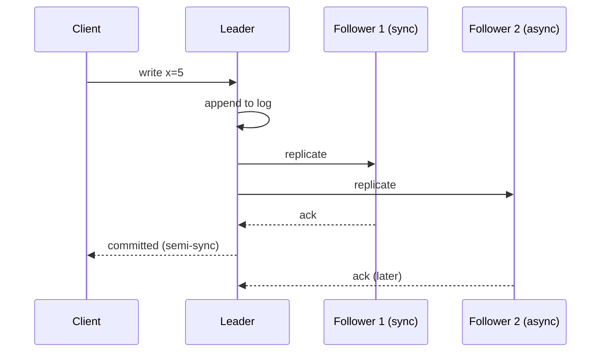

# Replication

Replication = keeping copies of the same data on multiple machines. It gives **high availability** (survive node loss), **read scalability** (serve reads from replicas) and **lower latency** (copies close to users).

---

## 1. Three replication topologies

### a) Single-leader (master-slave / primary-replica)
```
          writes
Client ─────────► Leader ──replication log──► Follower 1
                    │                     └──► Follower 2
Client ◄── reads ───┴──────── reads ─────────── Followers
```
- All writes go to the leader; followers apply the leader's log in the same order.
- Used by: MySQL, PostgreSQL, MongoDB (replica sets), Redis, Kafka partitions.
- Simple, no write conflicts. Leader is a write bottleneck; failover needed.

### b) Multi-leader (master-master)
- Several nodes accept writes (often one per data center) and replicate to each other.
- Low-latency writes in every region, tolerates DC outage.
- **Write conflicts** (two regions edit the same row). Must resolve: last-write-wins, merge functions, CRDTs, or app logic.
- Used by: multi-region MySQL setups, CouchDB, collaborative editing, offline-first mobile apps.

### c) Leaderless (Dynamo-style)
- Clients (or a coordinator) write to **N** replicas and read from several; uses **quorums** (`W + R > N`).
- **Read repair** and **anti-entropy (Merkle trees)** fix stale replicas; **hinted handoff** covers temporarily down nodes.
- Used by: Cassandra, DynamoDB (internally), Riak, ScyllaDB. (Covered in [Distributed Key-Value Store (Dynamo / Cassandra style)](../03-problems/03-key-value-store.md).)

---

### Diagram



## 2. Synchronous vs Asynchronous replication

| | Synchronous | Asynchronous | Semi-synchronous |
|---|---|---|---|
| Leader waits for follower ack? | Yes | No | Waits for **one** follower |
| Durability | No data loss on leader failure | Recent writes can be lost | At least 2 copies |
| Latency | Higher (slowest follower) | Lowest | Moderate |
| Availability | A slow follower blocks writes | High | Good |

Most production setups: **semi-sync** or async within a region + async cross-region.

---

## 3. Replication lag problems (and fixes)

With async replication followers are *eventually* consistent. Classic anomalies:

| Problem | Example | Fix |
|---|---|---|
| **Read-your-writes** | User updates profile, refreshes, sees old value (read hit a lagging replica) | Read user's own data from leader for X seconds after a write; or track the write's log position and read from a replica that has caught up |
| **Monotonic reads** | User sees a comment, refreshes, it disappears (different replica) | Pin a user to one replica (hash user_id) |
| **Consistent prefix reads** | See an answer before the question | Write causally related data to same partition; causal consistency |

---

## 4. Failover (leader dies)
1. **Detect** failure (missed heartbeats / timeout).
2. **Elect** a new leader (the most up-to-date follower; via consensus - Raft, ZooKeeper, Patroni, Orchestrator).
3. **Reconfigure** clients/proxies to send writes to the new leader.

Pitfalls:
- **Lost writes** - async writes not yet replicated vanish.
- **Split brain** - old leader comes back thinking it's still leader -> two leaders accepting writes. Fix with **fencing tokens / epochs** and STONITH ("shoot the other node in the head").
- **Timeout tuning** - too short = unnecessary failovers under load; too long = long outage.

---

## 5. How replication is implemented
- **Statement-based** - ship SQL statements (breaks with `NOW()`, `RAND()`).
- **Write-ahead log (WAL) shipping** - ship physical byte changes (Postgres). Tied to storage version.
- **Logical (row-based) log** - ship row-level changes (MySQL binlog row format). Basis of **CDC (Change Data Capture)** tools like Debezium that stream DB changes into Kafka.

---

## 6. Multi-region strategies

| Strategy | Writes | Reads | Trade-off |
|---|---|---|---|
| Active-passive | One region | Any region (stale) | Simple, failover takes time, RPO > 0 |
| Active-active (multi-leader) | All regions | Local | Conflicts must be resolved |
| Geo-partitioned | Each user's "home" region | Local for home users | Cross-region users pay latency |
| Globally consistent (Spanner, CockroachDB) | Any, via consensus | Any | Write latency = cross-region round trip |

---

## 7. Replication vs Backup
Replication is **not** a backup: `DROP TABLE` replicates instantly to every replica. You still need **point-in-time backups / snapshots** (and test restoring them!).

---

## 8. Points to mention in an interview
- "Writes to the primary, reads from replicas; read-your-writes by routing the user's own reads to the primary right after they write."
- "Semi-sync replication in-region for durability, async cross-region for DR."
- "Automatic failover with Raft/ZooKeeper-based leader election and fencing to avoid split brain."
- "For global writes with conflicts, use leaderless/multi-leader with LWW or CRDTs - or Spanner if we need strong consistency."
