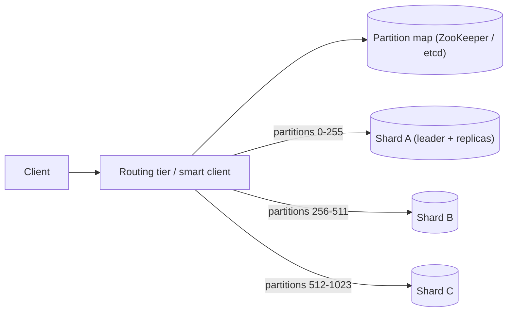

# Partitioning (Sharding)

When data or write throughput no longer fits on one machine, split it into **partitions (shards)**, each owned by a different node. Replication copies data; partitioning *splits* it. Real systems do both: each shard is replicated.

---

## 1. Vertical vs Horizontal partitioning
- **Vertical partitioning** - split *columns/tables* (e.g., move `user_photos` blobs to another store, or split the DB per microservice: users DB, orders DB).
- **Horizontal partitioning (sharding)** - split *rows* of the same table across nodes by a **shard key**.

---

## 2. Sharding strategies

### a) Range-based
`user_id 1-1M -> shard 1, 1M-2M -> shard 2 ...` or by date / alphabet.
- Efficient range queries (`created_at BETWEEN`).
- **Hot spots**: all new writes go to the latest range (time-based keys!).
- Used by: HBase, Bigtable, Spanner, MongoDB (range mode).

### b) Hash-based
`shard = hash(user_id) % N`
- Even distribution.
- Range queries must hit all shards; **changing N remaps almost every key** -> use **consistent hashing** ([Consistent Hashing](../03-problems/02-consistent-hashing.md)) or a fixed large number of logical partitions.
- Used by: Cassandra, DynamoDB, Redis Cluster (16384 hash slots).

### c) Directory / lookup-based
A lookup service maps `key -> shard`.
- Total flexibility, easy to move individual tenants.
- Lookup service is an extra hop and must be highly available (cache it).
- Used for multi-tenant SaaS (big customer gets its own shard).

### d) Geo-based
Shard by region/country - data residency (GDPR) and latency.

---

## 3. Choosing a shard key - the most important decision

A good shard key:
1. **High cardinality** (many distinct values).
2. **Even distribution** of data *and* traffic.
3. **Matches the dominant query** so most queries hit a single shard.

| System | Good shard key | Why |
|---|---|---|
| Chat messages | `channel_id` | All messages for a conversation together |
| Social feed | `user_id` | User's timeline on one shard |
| E-commerce orders | `customer_id` (or `order_id` for writes) | "My orders" page |
| Metrics | `metric_name + time bucket` | Spread + range queries |
| Multi-tenant SaaS | `tenant_id` | Isolation, easy to move tenants |

 Bad keys: `country` (low cardinality, skew), `created_at` alone (hot latest shard), `status` (few values).

---

## 4. Hot spots / celebrity problem
Even with hashing, one key can be hot (Justin Bieber's tweets, a viral product).
- **Key salting:** append random suffix `celebrity_id#0..9` -> spread writes over 10 shards; reads must fan-in from all 10.
- **Dedicated shard** for very hot tenants.
- **Caching** hot reads in front.
- **Split hot partitions dynamically** (DynamoDB adaptive capacity).

---

## 5. Rebalancing (resharding)
When adding nodes, data must move. Approaches:
- `hash % N` - moves ~all data.
- **Fixed number of partitions** (e.g., 1024 logical partitions, many per node). Adding a node moves *whole partitions* (Elasticsearch, Riak, Kafka, Redis Cluster slots).
- **Dynamic partitioning** - split a partition when it grows too big, merge when small (HBase regions, MongoDB chunks).
- **Consistent hashing with virtual nodes** (Cassandra, Dynamo).

Do it **online**: double-write or copy + catch up via change log, then flip routing. Throttle to avoid hurting production traffic.

---

### Diagram

## 6. Request routing - how does a client find the shard?
1. **Any node routes** (gossip knows the ring; Cassandra).
2. **Routing tier / proxy** (Vitess VTGate, MongoDB mongos, Twemproxy).
3. **Partition-aware client** (Redis Cluster client, Kafka client).
Metadata about "which partition lives where" is often stored in **ZooKeeper/etcd**.

---

## 7. Secondary indexes on sharded data
- **Local (document-partitioned) index:** each shard indexes its own data. Writes are local; reads by secondary key must **scatter-gather** to all shards.
- **Global (term-partitioned) index:** index itself is sharded by the indexed term. Reads hit one index shard; writes update a remote shard (usually asynchronously).

---

## 8. Problems sharding introduces
| Problem | Mitigation |
|---|---|
| Cross-shard joins | Denormalize, application-side joins, keep related data on same shard |
| Cross-shard transactions | Avoid; use sagas, or 2PC (slow), or NewSQL DBs |
| Global unique IDs | Snowflake IDs ([Unique ID Generator for Distributed Systems](../03-problems/04-unique-id-generator.md)) instead of auto-increment |
| Aggregations (`COUNT(*)`) | Scatter-gather, or maintain counters / analytics store |
| Operational complexity | Use managed / auto-sharded DBs (DynamoDB, Spanner, Vitess, Citus) |

---

## 9. Real-world examples
- **Instagram**: Postgres logical shards (thousands), mapped to fewer physical servers; IDs embed the shard ID.
- **Discord**: Cassandra -> ScyllaDB, messages partitioned by `(channel_id, bucket)` where bucket = time window.
- **YouTube**: Vitess to shard MySQL.
- **Uber**: Schemaless (sharded MySQL) keyed by UUID.

---

## 10. Points to mention in an interview
1. Say *why* you need to shard (numbers from back-of-envelope: "5 TB/year writes, 50k write QPS").
2. Pick the **shard key** based on the main access pattern and explain hot-spot handling.
3. Mention **consistent hashing / logical partitions** for painless rebalancing.
4. Mention each shard is **replicated** (leader + 2 followers).
5. Call out what gets harder: joins, transactions, secondary indexes.
