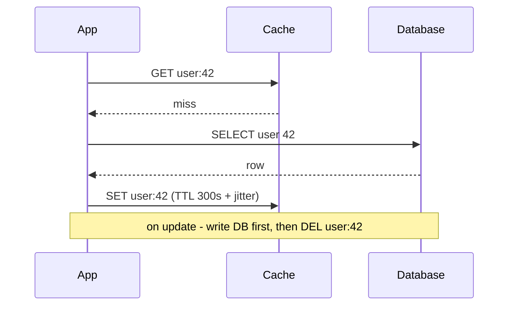

# Caching Deep Dive

> "There are only two hard things in Computer Science: cache invalidation and naming things." - Phil Karlton

A cache stores the result of expensive work (DB query, computation, remote call) in fast storage (RAM) so future requests are served faster and the backend is protected.

---

## 1. Where can you cache? (from client to DB)

| Layer | Example | What's cached |
|---|---|---|
| Client / browser | HTTP cache, localStorage, mobile app cache | Static assets, API responses |
| CDN / edge | Cloudflare, Akamai, CloudFront | Images, video segments, JS/CSS, even API responses |
| Load balancer / reverse proxy | Nginx, Varnish | Full HTTP responses |
| Application (in-process) | Guava/Caffeine, local HashMap | Hot config, small lookup tables |
| Distributed cache | Redis, Memcached | Sessions, query results, computed feeds, counters |
| Database | Buffer pool, query cache | Pages/rows in memory |

---

## 2. Caching patterns (read & write strategies)

### Cache-aside (lazy loading) - *most common*
```
read(key):
    v = cache.get(key)
    if v is None:                 # miss
        v = db.query(key)
        cache.set(key, v, ttl=300)
    return v

write(key, v):
    db.update(key, v)
    cache.delete(key)             # invalidate, don't update
```
- Only requested data is cached; cache failure ≠ outage (fall back to DB).
- First request is a miss; possible stale data window.
- **Delete instead of update** on writes avoids races where two concurrent writers leave the cache with the older value.

### Diagram



### Read-through
The cache library itself loads from DB on miss (app talks only to the cache). Same semantics as cache-aside, cleaner code.

### Write-through
Write to cache **and** DB synchronously.
- Cache always fresh. Higher write latency; caches data that may never be read.

### Write-behind (write-back)
Write to cache, acknowledge, flush to DB asynchronously in batches.
- Very fast writes, absorbs bursts (counters, likes).
- **Data loss** if cache dies before flush.

### Write-around
Write directly to DB, skip the cache; cache fills on read.
- Avoids polluting cache with write-once data (logs, uploads).

| Pattern | Read perf | Write perf | Consistency | Risk |
|---|---|---|---|---|
| Cache-aside | Good after warm-up | DB speed | Short stale window | Miss storms |
| Write-through | Great | Slower | Strong-ish | Cache churn |
| Write-behind | Great | Fastest | Eventual | Data loss |
| Write-around | Miss on recent writes | DB speed | Good | Read-after-write misses |

---

## 3. Eviction policies

| Policy | Evicts | Notes |
|---|---|---|
| **LRU** (Least Recently Used) | Item not accessed for longest | Default choice; implemented with HashMap + doubly linked list (O(1)) |
| **LFU** (Least Frequently Used) | Item with lowest access count | Better for stable popularity; Redis `allkeys-lfu` |
| **FIFO** | Oldest inserted | Simple, usually worse |
| **TTL-based** | Expired items | Combine with LRU |
| **Random** | Random item | Surprisingly OK, cheap |
| **W-TinyLFU** | Admission filter + LRU | Caffeine; best hit rates in practice |

---

## 4. Cache invalidation strategies
1. **TTL (time-to-live)** - simplest; accept staleness up to TTL.
2. **Explicit invalidation** on write (`DEL key`).
3. **Event-driven invalidation** - DB change -> CDC (Debezium) -> Kafka -> invalidate cache keys across services/regions.
4. **Versioned keys** - `user:123:v7`; bump version on write, old keys expire naturally.

---

## 5. Classic cache failure modes

### Cache stampede / thundering herd
A hot key expires -> thousands of requests miss simultaneously -> all hit the DB.
- **Request coalescing / single-flight:** only one request recomputes; others wait for it.
- **Mutex lock** on recompute (`SET lock:key NX EX 5`).
- **Probabilistic early expiration** (refresh before TTL with some probability).
- **Background refresh** of hot keys.

### Cache penetration
Requests for keys that **don't exist** (e.g., attacker queries random IDs) always miss and hit DB.
- Cache **negative results** (`key -> NULL` with short TTL).
- **Bloom filter** in front: if bloom says "definitely not present", reject immediately.

### Cache avalanche
Many keys expire at the same time (or cache cluster restarts) -> DB overwhelmed.
- Add **random jitter** to TTLs.
- Multi-level caches, cache warming, replicas, circuit breakers on DB.

### Hot key
A single key gets enormous traffic (celebrity profile) -> one cache shard melts.
- Replicate hot key to multiple shards (`key#1..key#N`, read random copy).
- **Local in-process cache** for the hottest keys (L1) in front of Redis (L2).

### Big key
A 50 MB value blocks Redis' single thread. Split into chunks / hashes; compress.

---

## 6. Redis vs Memcached

| | Redis | Memcached |
|---|---|---|
| Data types | Strings, hashes, lists, sets, **sorted sets**, streams, bitmaps, HyperLogLog, geo | Strings only |
| Persistence | RDB snapshots, AOF log | None |
| Replication / HA | Yes (replicas, Sentinel, Cluster) | No (client-side sharding) |
| Threading | Mostly single-threaded command execution (I/O threads optional) | Multi-threaded |
| Extras | Pub/Sub, Lua scripts, transactions, TTL per key | Simple & fast |
| Use | Leaderboards (ZSET), rate limiters, queues, sessions, locks | Pure cache of blobs |

**Redis Cluster**: 16,384 hash slots spread across masters, each with replicas. Keys with the same `{hash tag}` land on the same slot.

---

## 7. Sizing a cache (back-of-envelope)
"80/20 rule": 20% of data serves 80% of reads.
```
Daily read requests = 1B, avg object 1 KB, unique objects/day ≈ 200M
Cache 20% hottest → 40M × 1 KB = 40 GB  → a few Redis nodes (with replicas ~3x)
```

---

## 8. Consistency between cache and DB
Perfect consistency is impossible without distributed transactions. Practical approaches:
- Cache-aside with **delete-after-write** + short TTL as safety net.
- **Delayed double delete:** delete -> write DB -> sleep ~500 ms -> delete again (covers replica-lag races).
- For strongly-consistent data (balances, inventory counts at checkout), **read from DB** - use cache only for display.

---

## 9. Points to mention in an interview
- "Cache-aside with Redis, TTL 5 min plus jitter, invalidate on write."
- "Protect against stampede with single-flight locks; against penetration with a Bloom filter and negative caching."
- "Hot keys get replicated and an in-process L1 cache."
- "CDN for static/media; Redis for dynamic data; never cache the source of truth for money."
