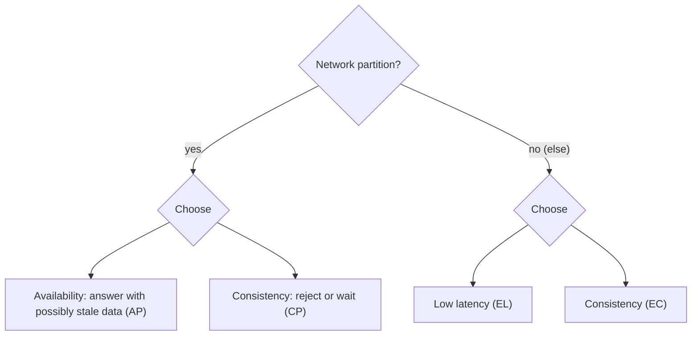

# CAP Theorem, PACELC & Consistency Models

---

## 1. CAP Theorem (Brewer, 2000)

In a distributed data store you can guarantee at most two of:
- **C - Consistency (linearizability):** every read sees the most recent write.
- **A - Availability:** every request to a non-failed node gets a (non-error) response.
- **P - Partition tolerance:** the system keeps working despite dropped/delayed messages between nodes.

**Network partitions WILL happen**, so P is not optional. The real choice is: *during a partition*, do you give up **C** or **A**?

| Choice | Behaviour during partition | Examples | Good for |
|---|---|---|---|
| **CP** | Refuse/err requests that can't be guaranteed consistent | ZooKeeper, etcd, HBase, Spanner, MongoDB (majority), banking systems | Payments, inventory, locks, leader election |
| **AP** | Answer with possibly stale data, reconcile later | Cassandra, DynamoDB (default), Riak, CouchDB, DNS | Social feeds, likes, shopping carts, presence |

Common misconception: CAP says nothing about normal (non-partitioned) operation - that's where PACELC helps.

---

### Diagram

## 2. PACELC (Abadi)

**If Partition -> choose A or C; Else (normal operation) -> choose Latency or Consistency.**

| System | P: A or C | E: L or C |
|---|---|---|
| DynamoDB, Cassandra, Riak | PA | EL |
| Spanner, CockroachDB, HBase, ZooKeeper | PC | EC |
| MongoDB (default) | PA | EC |
| PNUTS (Yahoo) | PC | EL |

Even without failures, strong consistency costs latency (waiting for replicas / consensus).

---

## 3. Consistency models (strongest -> weakest)

| Model | Guarantee | Cost / Example |
|---|---|---|
| **Linearizability (strong)** | System behaves like a single copy; once a write completes, all later reads see it | Consensus (Raft/Paxos); Spanner, etcd |
| **Sequential consistency** | All nodes see operations in the *same* order (not necessarily real-time order) | |
| **Causal consistency** | Causally related ops (reply after post) are seen in order by everyone; concurrent ops can differ | Vector clocks; COPS, some MongoDB sessions |
| **Read-your-writes** | A user always sees their own writes | Route user reads to leader / sticky replica |
| **Monotonic reads** | Once you've seen a value you never see an older one | Pin user to a replica |
| **Consistent prefix** | Never see effects before causes | Same partition for related writes |
| **Eventual consistency** | If writes stop, all replicas converge *eventually* | DNS, Cassandra (ONE), S3 (historically) |

---

## 4. Tunable consistency with quorums
With **N** replicas, write to **W**, read from **R**:
- `W + R > N` -> read and write sets overlap -> read sees latest write (strong-ish).
- `N=3, W=2, R=2` -> balanced, tolerates 1 failure.
- `W=1, R=3` -> fast writes, slow reads; `W=3, R=1` -> fast reads, slow writes.
- `W=1, R=1` -> fastest, eventual.

Cassandra lets you choose per query: `ONE`, `QUORUM`, `LOCAL_QUORUM`, `ALL`.

---

## 5. Conflict resolution in AP systems
When two replicas accept concurrent writes:
- **Last-Write-Wins (LWW)** - highest timestamp wins. Simple, but silently loses data and depends on clocks.
- **Vector clocks** - detect concurrency, return siblings to the client to merge (Dynamo, Riak). See [Distributed Key-Value Store (Dynamo / Cassandra style)](../03-problems/03-key-value-store.md).
- **CRDTs (Conflict-free Replicated Data Types)** - data structures that mathematically always merge (G-Counter, PN-Counter, OR-Set, LWW-Register, RGA for text). Used in Redis Enterprise active-active, Figma-like collaboration, Riak.
- **Application-specific merge** - e.g., shopping cart = union of items.

---

## 6. Strong vs eventual - how to pick per feature

| Feature | Model | Why |
|---|---|---|
| Account balance, payments | Strong | Money must never be double-spent |
| Seat/ticket/hotel booking | Strong (at commit) | No double booking |
| Username uniqueness | Strong | Two users can't get same handle |
| Like counts, view counts | Eventual | Off by a few is fine |
| News feed | Eventual | Seconds of delay OK |
| Profile update | Read-your-writes | User must see own change |
| Chat message order | Causal / per-conversation order | Replies after questions |

*"Different parts of the same system can choose different consistency levels."*

---

## 7. Points to mention in an interview
- P is mandatory -> pick CP or AP **per use case**.
- Mention PACELC to show depth: even without partitions, consistency costs latency.
- Use quorum math `W + R > N`.
- Explain conflict resolution: LWW vs vector clocks vs CRDTs.
