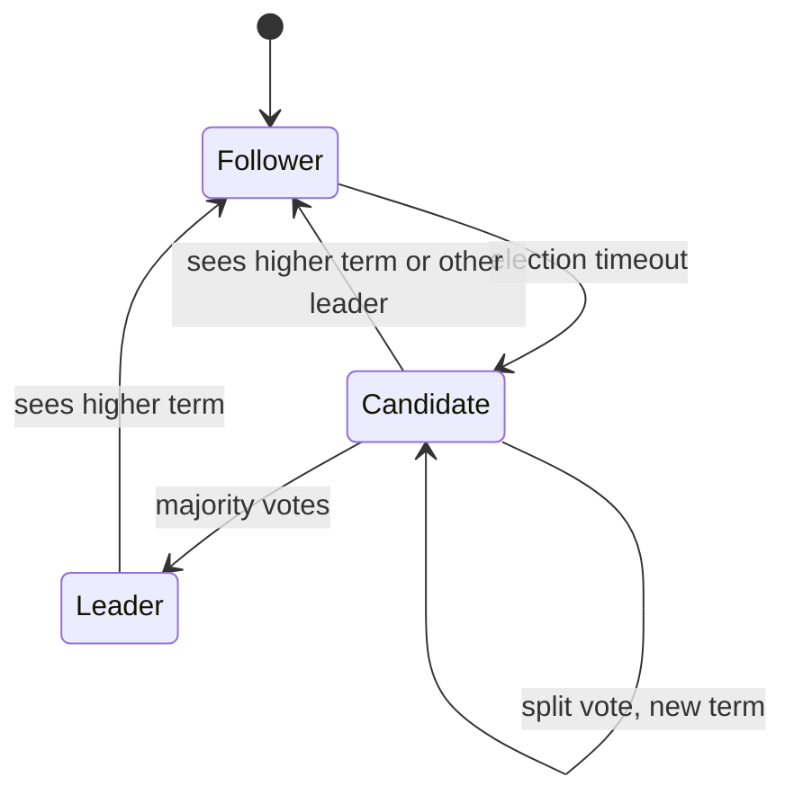

# Consensus, Leader Election & Distributed Locks

Consensus = getting several nodes to **agree on a value** (who is leader, the next log entry, whether a transaction commits) even when some nodes crash or messages are delayed.

---

## 1. Why we need consensus
- **Leader election** - exactly one primary DB / scheduler / Kafka controller.
- **Replicated state machines** - every replica applies the same commands in the same order (etcd, ZooKeeper, Spanner).
- **Distributed locks** - only one worker processes a job.
- **Configuration & membership** - which nodes are in the cluster, which shard lives where.
- **Atomic commit** - all participants agree to commit or abort.

---

## 2. Raft

Raft was designed to be understandable. Each node is a **Follower**, **Candidate** or **Leader**.

### Leader election
1. Followers expect heartbeats from the leader. If none arrives within a **randomized election timeout** (e.g., 150-300 ms) a follower becomes a **candidate**.
2. Candidate increments its **term** number, votes for itself, sends `RequestVote` to all.
3. A node votes for at most one candidate per term (and only if the candidate's log is at least as up to date).
4. Candidate with **majority (quorum)** votes becomes leader and starts sending heartbeats.
5. Randomized timeouts make split votes rare.

### Diagram



### Log replication
1. Client sends command to leader.
2. Leader appends to its log, sends `AppendEntries` to followers.
3. Once a **majority** has stored the entry, it is **committed**; leader applies it to its state machine and replies to the client.
4. Followers apply committed entries in order.

### Safety
- Only a node with all committed entries can win election.
- **Majority quorum** = `floor(N/2) + 1`. A 5-node cluster tolerates 2 failures; 3-node tolerates 1.
- Use **odd** cluster sizes (4 nodes tolerate only 1 failure, same as 3).

Used by: etcd (Kubernetes), Consul, CockroachDB, TiKV, Kafka KRaft, RabbitMQ quorum queues.

---

## 3. Paxos & ZAB
- **Paxos** (Lamport) - the original; proposers, acceptors, learners; two phases (prepare/promise, accept/accepted). Multi-Paxos for logs. Used in Google Chubby, Spanner.
- **ZAB** - ZooKeeper Atomic Broadcast, similar to Raft.
- **Byzantine Fault Tolerance (PBFT, Tendermint)** - tolerate *malicious* nodes (needs `3f+1` nodes); used in blockchains, not typical backends.

---

## 4. Coordination services: ZooKeeper / etcd / Consul
Instead of implementing Raft yourself, use a coordination service:
- Strongly consistent small key-value store (configs, metadata).
- **Ephemeral nodes** - disappear when the client session dies -> great for **membership & leader election**.
- **Watches** - get notified when a key changes (service discovery, config push).
- **Sequential nodes** - build locks/queues.

Leader election with ZooKeeper:
1. Each candidate creates an ephemeral sequential node `/election/n_000000X`.
2. Lowest number = leader.
3. Others watch the node just before theirs; when it disappears, re-check.

---

## 5. Distributed locks

### Redis lock (simple)
```
SET lock:order:42 <unique_owner_id> NX PX 30000    # acquire if not exists, 30s expiry
... do work ...
# release only if we still own it (Lua script for atomicity):
if redis.call("GET", KEYS[1]) == ARGV[1] then return redis.call("DEL", KEYS[1]) end
```
- `NX` - only if not exists; `PX` - auto-expire so a crashed holder doesn't block forever.
- Unique owner id prevents deleting someone else's lock.
- **Redlock** - acquire on majority of N independent Redis masters. Debated (Martin Kleppmann's critique: clock/GC pauses make it unsafe for correctness).

### The GC-pause problem & fencing tokens
```
Client A acquires lock (token 33) → long GC pause → lock expires
Client B acquires lock (token 34) → writes to storage
Client A wakes up → still thinks it holds lock → writes → CORRUPTION
```
**Fix: fencing tokens** - the lock service returns a monotonically increasing token; the storage rejects writes with a token lower than the last seen.

### Choosing a lock
| Need | Use |
|---|---|
| Efficiency (avoid duplicate work, occasional double is OK) | Redis `SET NX PX` |
| Correctness (must never have two holders) | ZooKeeper/etcd lock + fencing tokens, or DB row lock / unique constraint |

Often the best "lock" is a **database constraint** or **conditional write** (`UPDATE ... WHERE version = x`, DynamoDB condition expressions).

---

## 6. Failure detection
- **Heartbeats + timeouts** - simple, but can't distinguish slow from dead.
- **Gossip protocols** (Cassandra, Consul Serf) - nodes randomly exchange membership/heartbeat tables; failure info spreads in O(log N) rounds.
- **Phi accrual failure detector** - outputs a suspicion level instead of binary alive/dead (Cassandra, Akka).

---

## 7. FLP impossibility & practical takeaway
FLP (1985): in a fully asynchronous network, no deterministic consensus algorithm can guarantee termination if even one node may crash. Practical systems use **timeouts** (partial synchrony) and randomization - they're always safe and *usually* live.

---

## 8. Points to mention in an interview
- "Leader election via etcd/ZooKeeper lease; the leader renews the lease, others take over on expiry."
- "Raft needs a majority; 5 nodes tolerate 2 failures."
- "Redis lock with NX + TTL + owner id for efficiency; fencing tokens or DB constraints when correctness matters."
- "Split brain is avoided because a leader without a majority can't commit."
