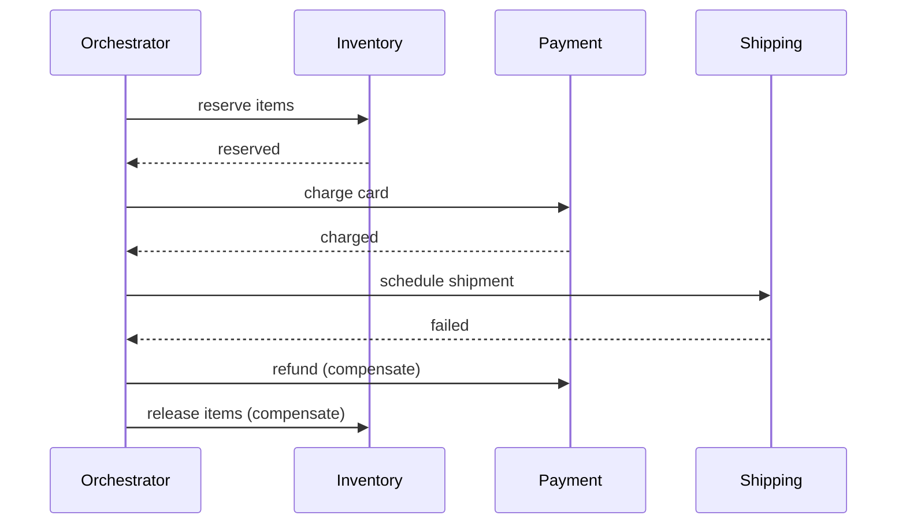

# Distributed Transactions: 2PC, Saga, Outbox & CDC

> In a monolith, one DB transaction keeps everything consistent. In microservices, an "order" touches Order, Payment, Inventory and Shipping services — each with its **own database**. How do we keep them consistent?

---

## 1. The dual-write problem
```
orderDb.save(order)          ✅
kafka.publish(OrderCreated)  ❌ crash here → other services never learn about the order
```
Writing to two systems (DB + queue, or two DBs) without a shared transaction **will** eventually leave them inconsistent. Every pattern below solves this.

---

## 2. Two-Phase Commit (2PC)

A **coordinator** drives all **participants**:

**Phase 1 – Prepare (voting):** coordinator asks "can you commit?" Each participant writes changes to its log, locks resources, replies YES/NO.
**Phase 2 – Commit/Abort:** if all YES → `COMMIT` to all; else `ABORT`.

| ✅ Pros | ❌ Cons |
|---|---|
| Atomic, strong consistency | **Blocking**: if coordinator dies after prepare, participants hold locks indefinitely |
| Familiar (XA transactions) | Latency: 2 round trips + locks held across network |
| | Every participant must support 2PC; availability = product of all participants' availability |

**3PC** adds a pre-commit phase to reduce blocking but doesn't handle network partitions well; rarely used.

**Where 2PC is used:** inside distributed databases (Spanner, CockroachDB use 2PC over Raft groups — the coordinator is itself replicated, removing the blocking problem). Generally **avoid 2PC across microservices**.

---

## 3. Saga pattern ⭐

A saga = sequence of **local transactions**; each step publishes an event/command triggering the next. If a step fails, run **compensating transactions** to undo previous steps.

```
Order Service:     Create order (PENDING)
Payment Service:   Charge card          ── fail? → Order: cancel order
Inventory Service: Reserve items        ── fail? → Payment: refund; Order: cancel
Shipping Service:  Schedule shipment    ── fail? → Inventory: release; Payment: refund; Order: cancel
Order Service:     Mark CONFIRMED
```

### Diagram



### Choreography vs Orchestration

| | Choreography | Orchestration |
|---|---|---|
| How | Services react to each other's events (no central brain) | A central **orchestrator** (saga state machine) tells each service what to do |
| ✅ | Loose coupling, simple for 2–3 steps | Clear flow, easy to monitor, easier compensation logic |
| ❌ | Hard to follow, cyclic dependencies, hard to debug | Orchestrator is extra component |
| Tools | Kafka events | Temporal, AWS Step Functions, Camunda, Netflix Conductor |

### Saga caveats
- **No isolation**: other transactions see intermediate states (order PENDING). Use semantic locks (status fields), "pending" states, commutative updates.
- Compensations must be **idempotent** and **retryable**; some actions can't be undone (email sent) → do them last ("pivot transaction").

---

## 4. Transactional Outbox pattern ⭐

Solves the dual-write problem reliably:
1. In the **same local DB transaction**, write business data **and** an event row into an `outbox` table.
   ```sql
   BEGIN;
     INSERT INTO orders (...) VALUES (...);
     INSERT INTO outbox (id, aggregate_id, type, payload) VALUES (...,'OrderCreated', '{...}');
   COMMIT;
   ```
2. A separate **relay** (poller or CDC like Debezium reading the binlog/WAL) publishes outbox rows to Kafka and marks them sent.
3. Delivery is **at-least-once** → consumers must be **idempotent** (dedupe by event id).

---

## 5. Change Data Capture (CDC)
Tail the database's replication log (MySQL binlog, Postgres WAL, MongoDB oplog) and stream every change as an event (Debezium → Kafka).
Uses: outbox relay, keeping caches/search indexes/data warehouses in sync, migrating databases, event-driven integration without touching app code.

---

## 6. Idempotent consumers & delivery semantics
- **At-most-once** – may lose messages (fire and forget).
- **At-least-once** – may duplicate (retry until ack) ← most common.
- **Exactly-once** – really "effectively once": at-least-once delivery + idempotent processing / dedup, or Kafka transactions (read-process-write within Kafka).

Idempotent consumer:
```sql
INSERT INTO processed_events(event_id) VALUES (:id);   -- unique key; duplicate → skip
-- + business update in the same transaction
```

---

## 7. Other patterns
- **TCC (Try-Confirm-Cancel)**: Try reserves resources, Confirm finalizes, Cancel releases (used in payments/travel booking).
- **Event sourcing**: store events as the source of truth; state is derived (see Architecture Patterns note).
- **Reservation pattern**: reserve with expiry (hold a seat for 10 minutes) then confirm.

---

## 8. Decision guide

| Situation | Use |
|---|---|
| Single DB | Plain ACID transaction |
| Need DB write + event publish | Outbox + CDC |
| Multi-service business workflow | Saga (orchestration for complex flows) |
| Distributed SQL DB internals | 2PC over consensus groups |
| Money movement across ledgers | Saga/TCC + idempotency keys + reconciliation |

---

## 9. Interview cheat-sheet
- "We avoid 2PC across services; we use a **saga** with compensating actions, orchestrated by Temporal/Step Functions."
- "Every service publishes events via the **transactional outbox**, so DB state and events never diverge."
- "Consumers are **idempotent** because delivery is at-least-once."
- "We run **reconciliation jobs** to catch anything that slips through (essential in payments)."
