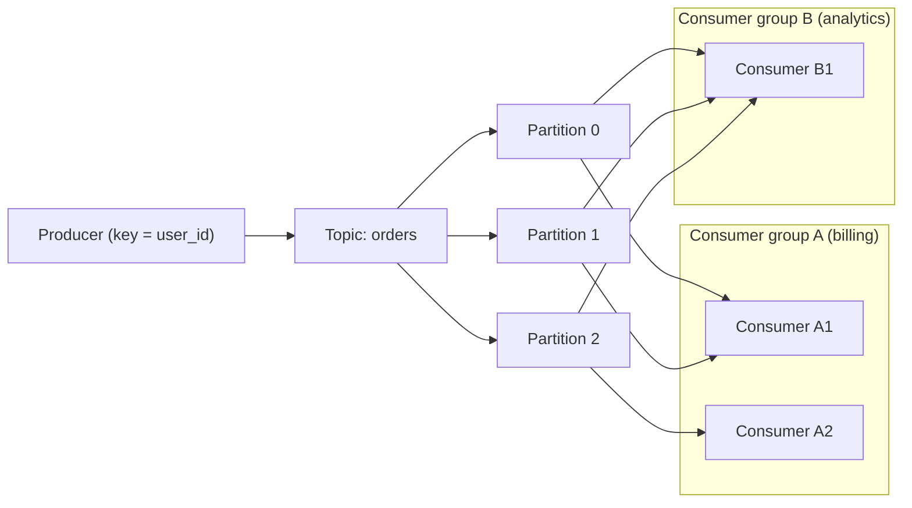

# Message Queues, Pub/Sub & Event Streaming

> Asynchronous messaging decouples producers from consumers in **time**, **space** and **scale**. It's the backbone of notification systems, feeds, video pipelines, payments, analytics and more. ([Distributed Message Queue (Kafka-like)](../03-problems/16-distributed-message-queue.md)) designs a Kafka-like queue in detail.)

---

## 1. Why use a queue?
- **Decoupling** – producer doesn't know/care who consumes.
- **Buffering / load leveling** – absorb traffic spikes; consumers process at their own pace.
- **Async processing** – return 202 to user, do heavy work (transcoding, emails) later.
- **Reliability** – messages persist if a consumer is down; retries.
- **Fan-out** – one event, many independent consumers (email, analytics, search index).
- **Scalability** – add consumers to increase throughput.

---

## 2. Models

### Point-to-point (work queue)
Each message is consumed by **one** consumer among a pool (competing consumers). Tasks, jobs.
Examples: RabbitMQ queues, AWS SQS, Celery.

### Publish/Subscribe
Each message delivered to **every subscriber** (each subscriber group gets its own copy).
Examples: SNS, Google Pub/Sub, Redis Pub/Sub, Kafka topics with multiple consumer groups.

### Log-based event streaming
Messages appended to a durable, ordered, **replayable log**; consumers track their own **offset**. Messages are not deleted on consumption (retention by time/size).
Examples: **Apache Kafka**, Pulsar, AWS Kinesis, Redpanda.

---

## 3. Traditional broker vs Log (RabbitMQ vs Kafka)

| | RabbitMQ / SQS (broker) | Kafka (log) |
|---|---|---|
| Storage | Deleted after ack | Retained (days/forever), replayable |
| Ordering | Per queue (weak with multiple consumers) | **Per partition**, strict |
| Throughput | Tens of thousands msg/s per node | Millions msg/s per cluster |
| Consumer model | Push, per-message ack | Pull, commit offsets |
| Routing | Rich (exchanges, topics, headers) | Topic + partition key |
| Replay | No | Yes – reprocess history, new consumers read from start |
| Best for | Task queues, RPC-ish work, complex routing, per-message delay/priority | Event streaming, CDC, analytics pipelines, event sourcing, logs |

---

## 4. Kafka essentials
- **Topic** split into **partitions**; each partition is an append-only log on a broker, replicated (`replication.factor=3`) with one **leader** and followers (ISR = in-sync replicas).
- **Producer** chooses partition by `hash(key) % partitions` → same key (e.g., `order_id`) → same partition → **ordered**.
- **Consumer group**: each partition consumed by exactly one consumer in the group → parallelism ≤ number of partitions.
- **Offsets** committed per group; restart resumes from committed offset.
- **acks**: `acks=0` (fire & forget), `acks=1` (leader), `acks=all` (all ISR, durable).
- **Retention**: time/size based, or **log compaction** (keep latest value per key — great for changelogs/state).
- Fast because of sequential disk I/O, OS page cache, zero-copy (`sendfile`), batching & compression.

---

### Diagram

## 5. Delivery semantics
| Semantic | How | Risk |
|---|---|---|
| At-most-once | Commit offset **before** processing | Lose messages on crash |
| At-least-once | Commit offset **after** processing | Duplicates on crash → make consumers **idempotent** |
| Exactly-once | Idempotent producer + transactions (Kafka EOS), or at-least-once + dedupe | Complexity |

---

## 6. Ordering
- Global ordering = 1 partition = no parallelism. Usually you only need **per-entity ordering** → partition by entity key (user_id, account_id, chat_id).
- Retries can reorder messages (`max.in.flight.requests` + idempotent producer fixes it in Kafka).

---

## 7. Failure handling
- **Retries with exponential backoff.**
- **Dead Letter Queue (DLQ)** – messages failing N times go to a DLQ for inspection; prevents a "poison pill" from blocking the partition.
- **Retry topics** with delays (retry-1m, retry-10m, DLQ).
- **Visibility timeout** (SQS) – message hidden while being processed; reappears if not deleted in time.

---

## 8. Backpressure
When consumers can't keep up:
- Queue grows (lag) → monitor **consumer lag** and autoscale consumers.
- Bounded queues → producers get blocked/rejected (explicit backpressure).
- Load shedding – drop low-priority messages.
- Rate-limit producers.

---

## 9. Delayed & scheduled messages
- SQS delay queues (≤15 min), RabbitMQ delayed exchange plugin.
- For long delays: store in DB/sorted set with `run_at`, a scheduler moves due jobs into the queue (see Distributed Job Scheduler problem).

---

## 10. Event-driven architecture vocabulary
- **Event** – something that happened (`OrderPlaced`), past tense, immutable, many consumers.
- **Command** – a request to do something (`ChargeCard`), one handler.
- **Event notification** vs **event-carried state transfer** (event contains full data so consumers don't call back).
- **Schema registry** (Avro/Protobuf) – versioned schemas, backward/forward compatibility.

---

## 11. Choosing a tool

| Need | Choose |
|---|---|
| Simple managed task queue | SQS / Cloud Tasks |
| Complex routing, priorities, low latency tasks | RabbitMQ |
| High-throughput event streaming, replay, multiple consumers | Kafka / Kinesis / Pulsar |
| Fan-out notifications to many subscribers | SNS / Google Pub/Sub |
| Lightweight in-app pub/sub (no durability) | Redis Pub/Sub |
| Lightweight durable streams | Redis Streams |

---

## 12. Interview cheat-sheet
- "The API writes to the DB and publishes via outbox to Kafka; downstream services consume asynchronously."
- "Partition by `user_id` to keep per-user ordering; parallelism = partition count."
- "At-least-once delivery with idempotent consumers; DLQ for poison messages."
- "Monitor consumer lag; autoscale workers on lag."
