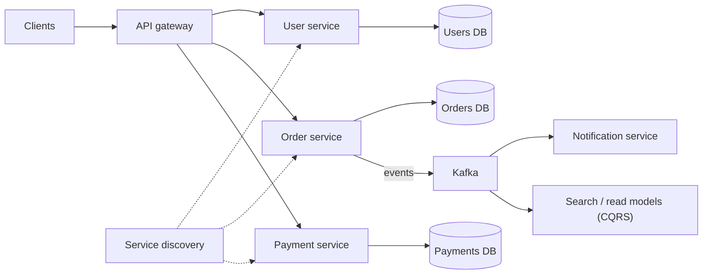

# Architecture Patterns: Monolith, Microservices, CQRS, Event Sourcing & more

---

## 1. Monolith vs Microservices

| | Monolith | Microservices |
|---|---|---|
| Deploy | One unit | Each service independently |
| Scaling | Scale everything together | Scale hot services only |
| Data | One shared DB | **Database per service** |
| Dev speed | Fast for small teams | Fast for many teams (team autonomy) |
| Complexity | In code | In network: latency, partial failures, distributed data, observability |
| Failure | One bug can take down all | Isolated failures (if designed well) |
| Transactions | Easy ACID | Sagas, eventual consistency |

**Rule of thumb:** start with a **modular monolith**; extract services when team size, scaling or deploy cadence demands it. Conway's Law: system structure mirrors org structure.

### Decomposition strategies
- By **business capability / bounded context** (DDD): Users, Catalog, Orders, Payments, Shipping.
- **Strangler fig** migration: route traffic for one feature at a time from the monolith to new services.

---

## 2. Microservice building blocks
- **API Gateway** – single entry point (auth, rate limiting, routing).
- **Service discovery** – registry (Consul, Eureka, K8s DNS) so services find each other dynamically.
- **Service mesh** – sidecar proxies (Envoy) handle mTLS, retries, timeouts, circuit breaking, traffic shifting and telemetry (Istio, Linkerd).
- **Config service** – centralized configuration & feature flags.
- **Observability** – distributed tracing with correlation IDs (see Observability note).
- **Async messaging** – Kafka/RabbitMQ for events.

### Sync vs Async communication
| Sync (REST/gRPC) | Async (events) |
|---|---|
| Simple request/response | Decoupled, resilient |
| Temporal coupling: callee must be up | Callee can be down; processes later |
| Cascading failures & latency add up | Eventual consistency, harder debugging |

---

### Diagram



## 3. CQRS (Command Query Responsibility Segregation)
Separate the **write model** (commands, normalized, validated, transactional) from the **read model** (queries, denormalized, optimized per view).
```
Commands → Write DB (Postgres) ──events/CDC──► Read stores (Elasticsearch, Redis, Cassandra views)
Queries  ───────────────────────────────────────► Read stores
```
- ✅ Scale reads and writes independently; each read model fits its query perfectly.
- ❌ Eventual consistency between write and read sides; more moving parts.
- Used in: e-commerce search (Postgres → Elasticsearch), feeds, dashboards.

---

## 4. Event Sourcing
Instead of storing current state, store the **sequence of events** that led to it. Current state = replay (fold) of events.
```
AccountOpened(100) → Deposited(50) → Withdrew(30)   ⇒ balance = 120
```
- ✅ Full audit trail (finance, compliance), time travel/debugging, rebuild new read models anytime, natural fit with CQRS.
- ❌ Schema evolution of events, replay cost (use **snapshots**), querying requires projections, mental model shift.
- Used in: banking ledgers, stock exchanges ([Stock Exchange (matching engine)](../03-problems/25-stock-exchange.md)), digital wallet ([Digital Wallet (balance transfers at 1M TPS)](../03-problems/24-digital-wallet.md)), shopping carts.

---

## 5. Other common patterns

| Pattern | What it is | When |
|---|---|---|
| **Layered (n-tier)** | Presentation → business → data | Classic web apps |
| **Hexagonal / Clean architecture** | Core domain isolated behind ports & adapters | Testable, swappable infra |
| **Event-driven** | Services communicate via events | Loose coupling, async workflows |
| **Serverless / FaaS** | Functions triggered by events (Lambda) | Spiky, glue, low-ops workloads |
| **BFF (Backend for Frontend)** | Separate API layer per client | Mobile vs web needs |
| **Sidecar** | Helper process alongside each service (proxy, log shipper) | Service mesh, cross-cutting concerns |
| **Ambassador / Adapter** | Proxy that handles connectivity to external services | Legacy integration |
| **Bulkhead** | Isolate resources (thread pools, connection pools) per dependency | Prevent one slow dependency from exhausting everything |
| **Cell-based architecture** | Split the whole stack into independent "cells", each serving a subset of users | Blast radius reduction (AWS, Slack, DoorDash) |
| **Lambda architecture** | Batch layer + speed layer + serving layer | Analytics (see Batch & Stream note) |
| **Kappa architecture** | Stream-only; reprocess by replaying the log | Simpler analytics |
| **Shared-nothing** | Nodes share no memory/disk | Horizontal scalability |
| **Leader–follower / primary–backup** | One node coordinates | DBs, schedulers |
| **Scatter–gather** | Fan request to many shards, merge results | Search engines, distributed queries |

---

## 6. Data management in microservices
- **Database per service** – no service reads another's tables; communicate via APIs/events.
- **API composition** – query multiple services and join in memory (or in a BFF).
- **CQRS views** – subscribe to events and build a local read-optimized copy.
- **Saga** for multi-service writes (see Distributed Transactions note).
- **Outbox** for reliable event publishing.

---

## 7. Interview cheat-sheet
- Start monolith-ish in your diagram, then split into services by domain with an API gateway in front.
- Show **sync** calls for user-facing reads and **async** events for side effects (notifications, analytics, search indexing).
- Mention **CQRS** when read patterns differ strongly from writes (search, feeds, dashboards).
- Mention **event sourcing** for audit-critical domains (ledger, exchange).
- Talk about **cell-based architecture** to limit blast radius at very large scale.
