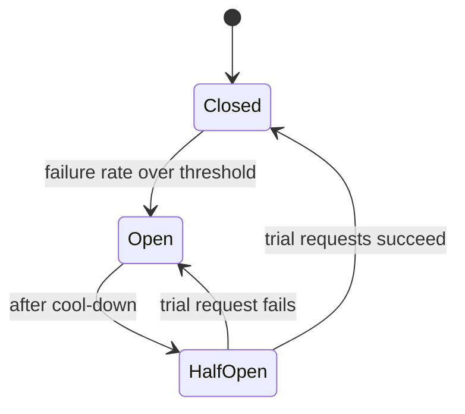

# Reliability & Resilience Patterns

Everything fails: disks, servers, networks, whole regions, dependencies, deploys. Reliable systems **expect failure** and limit its blast radius.

---

## 1. Key vocabulary
- **Availability** = uptime / total time (see [Back-of-the-Envelope Estimation](22-back-of-the-envelope-estimation.md) for "nines").
- **Reliability** = system does the right thing over time.
- **Fault tolerance** = keeps working despite component failures.
- **Resilience** = recovers quickly from failures.
- **Redundancy** = spare components (N+1, N+2).
- **SPOF** = single point of failure - eliminate them at every tier.

### Availability math
- Components in **series**: `A = A1 × A2` -> 99.9% × 99.9% = **99.8%** (worse).
- Components in **parallel**: `A = 1 − (1−A1)(1−A2)` -> two 99% replicas = **99.99%** (better).

---

## 2. SLI, SLO, SLA & Error budgets
- **SLI (Indicator)** - a measured metric: % of requests < 300 ms, % successful requests.
- **SLO (Objective)** - internal target: "99.9% of requests succeed over 30 days".
- **SLA (Agreement)** - contractual promise with penalties (usually looser than SLO).
- **Error budget** = 100% − SLO. 99.9% -> ~43 min/month of allowed failure. If budget is burnt, freeze risky launches.

---

## 3. Timeouts
- **Every** remote call needs a timeout; default "infinite" timeouts cause thread exhaustion and cascading failure.
- Set based on downstream p99 latency (+ margin).
- **Deadline propagation**: pass the remaining time budget along the call chain (gRPC deadlines).

---

## 4. Retries - with exponential backoff and jitter
```
delay = min(cap, base * 2^attempt)
delay = random(0, delay)          # "full jitter"
```
- Retry only **idempotent** or idempotency-keyed operations.
- Retry only **transient** errors (timeouts, 503, 429) - not 400s.
- Cap attempts (e.g., 3) and use a **retry budget** (e.g., retries ≤ 10% of requests) to avoid **retry storms** that DDoS your own services.
- Retry at **one layer**, not every layer (3 layers × 3 retries = 27× amplification).

---

## 5. Circuit breaker
Wraps calls to a dependency and stops calling it when it's failing.
```
CLOSED ──(failures > threshold)──► OPEN ──(after cool-down)──► HALF-OPEN
   ▲                                                              │
   └────────────(trial requests succeed)──────────────────────────┘
                  (trial fails) → back to OPEN
```
- **Closed**: normal, count failures.
- **Open**: fail fast (return fallback/error immediately), giving the dependency time to recover.
- **Half-open**: let a few trial requests through.
Libraries: Resilience4j, Hystrix (legacy), Envoy/Istio outlier detection.

---

### Diagram



## 6. Bulkheads
Isolate resources so one failing dependency can't sink the ship: separate thread pools / connection pools / queues per dependency or per tenant. Cell-based architectures are bulkheads at the infrastructure level.

---

## 7. Graceful degradation & fallbacks
- Serve **stale cache** if the DB is down.
- Show a **default/non-personalized** feed if the recommendation service is slow.
- Disable non-critical features (comments, recommendations) under load via **feature flags / kill switches**.
- **Static fallback pages** from CDN.

---

## 8. Load shedding & backpressure
- Reject excess requests early (`503` / `429`) instead of slowing everyone down.
- Prioritize: drop analytics/background traffic before checkout traffic.
- Queue limits + admission control (e.g., based on concurrency, CPU, latency - "adaptive concurrency limits").

---

## 9. Rate limiting & throttling
Protect services from abusive or buggy clients ([Rate Limiter](../03-problems/01-rate-limiter.md)). Also apply to **outbound** calls to third parties (payment gateways, SMS providers have quotas).

---

## 10. Health checks, autoscaling & self-healing
- Liveness (restart if dead) vs readiness (remove from LB if not ready).
- Autoscale on CPU, QPS, queue lag, or custom metrics.
- Kubernetes restarts crashed pods; ASGs replace unhealthy instances.

---

## 11. Deployment safety
| Strategy | How | Benefit |
|---|---|---|
| **Rolling** | Replace instances gradually | No extra capacity needed |
| **Blue-green** | Run new version (green) beside old (blue), switch traffic at once | Instant rollback |
| **Canary** | Send 1% -> 5% -> 25% -> 100% traffic to new version, watch metrics | Catch bugs with small blast radius |
| **Feature flags** | Deploy code dark, enable per user/percentage | Decouple deploy from release |
| **Shadow / dark traffic** | Copy production traffic to the new version, discard responses | Test with real load safely |

Most outages are caused by **changes** (deploys, config). Automated rollback on SLO violation is key.

---

## 12. Disaster recovery (DR)
- **RPO (Recovery Point Objective)** - how much data you can lose (e.g., 5 min).
- **RTO (Recovery Time Objective)** - how long until service is back (e.g., 1 hour).

| Strategy | RPO/RTO | Cost |
|---|---|---|
| Backup & restore | Hours | $ |
| Pilot light (minimal standby infra) | 10s of minutes | $$ |
| Warm standby (scaled-down copy running) | Minutes | $$$ |
| Multi-site active-active | ~0 | $$$$ |

Test it: **game days** and **chaos engineering** (Netflix Chaos Monkey kills random instances in production).

---

## 13. Idempotency everywhere
Retries + at-least-once delivery mean duplicates are normal. Use idempotency keys, unique constraints, dedupe tables, and conditional writes.

---

## 14. Points to mention in an interview
- "Every call has a timeout; retries use exponential backoff with jitter and are limited by a retry budget."
- "Circuit breakers around third-party dependencies, with fallbacks (cached/stale data)."
- "Bulkheads and cell-based deployment to limit blast radius."
- "Canary deploys with automatic rollback; feature flags as kill switches."
- "Multi-AZ by default, multi-region active-passive for DR with RPO 1 min, RTO 15 min."
