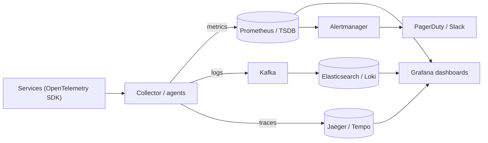

# Observability: Logs, Metrics & Traces

Monitoring tells you **that** something is wrong; observability lets you ask **why** without shipping new code. ([Metrics Monitoring & Alerting System (Prometheus / Datadog)](../03-problems/17-metrics-monitoring-alerting.md)) designs a metrics & alerting system.)

---

## 1. The three pillars

| Pillar | What | Example | Tools |
|---|---|---|---|
| **Metrics** | Numeric time series, cheap, aggregated | `http_requests_total{status="500"}`, p99 latency, CPU | Prometheus, Datadog, CloudWatch, Grafana |
| **Logs** | Discrete timestamped events, rich detail | `{"level":"error","user":42,"msg":"payment declined","trace_id":"abc"}` | ELK/OpenSearch, Loki, Splunk |
| **Traces** | The path of one request across services, with timing per hop (spans) | Gateway 5ms -> Order 20ms -> Payment 180ms | Jaeger, Zipkin, Tempo, X-Ray, Honeycomb |

Glue: **OpenTelemetry** (vendor-neutral SDK/collector for all three) and a **trace_id / correlation id** propagated through every service and included in every log line.

---

### Diagram

## 2. What to measure

### The Four Golden Signals (Google SRE)
1. **Latency** - time to serve requests (track p50, p95, **p99**, not averages; separate success vs error latency).
2. **Traffic** - demand (QPS, concurrent connections).
3. **Errors** - rate of failed requests (5xx, timeouts, wrong answers).
4. **Saturation** - how "full" the system is (CPU, memory, queue depth, connection pool usage).

### RED method (for request-driven services)
**R**ate, **E**rrors, **D**uration.

### USE method (for resources)
**U**tilization, **S**aturation, **E**rrors - for CPU, disk, network, memory.

### Business metrics
Orders/minute, sign-ups, payment success rate - often the first sign something's wrong.

---

## 3. Why percentiles, not averages
If p50 = 50 ms and p99 = 2 s, the average (~70 ms) hides that 1 in 100 users waits 2 s. With **fan-out** (a page calls 100 services), almost every page hits some service's p99 -> **tail latency amplification**. Mitigate with hedged requests, timeouts, and reducing fan-out.

---

## 4. Logging best practices
- **Structured logs** (JSON) with consistent fields: timestamp, level, service, trace_id, user_id, request_id.
- Log levels: DEBUG < INFO < WARN < ERROR; don't log at DEBUG in prod by default.
- **Never log secrets/PII** (passwords, tokens, card numbers) - mask them.
- Centralize: agents (Fluent Bit, Vector, Filebeat) -> Kafka (buffer) -> Elasticsearch/Loki -> Kibana/Grafana.
- **Sampling** for high-volume debug logs; **retention tiers** (hot 7 days, cold S3 for 1 year).

---

## 5. Distributed tracing
- A **trace** = tree of **spans**; each span has name, start, duration, parent span id, tags.
- Context propagated via headers (`traceparent` W3C standard).
- **Sampling**: head-based (decide at the start, e.g., 1%) or tail-based (keep all errors and slow traces).
- Reveals: which service is slow, N+1 call patterns, unexpected dependencies.

---

## 6. Alerting
- Alert on **symptoms** (SLO burn rate, error rate, latency) - not on every cause (CPU 80%).
- **Burn-rate alerts**: page if the error budget is being consumed 14× faster than sustainable over 1 h.
- Every page must be **actionable** and have a **runbook**. Avoid alert fatigue.
- Severity routing: page (PagerDuty) vs ticket vs dashboard.

---

## 7. Dashboards & on-call
- One overview dashboard per service: golden signals + dependencies + saturation.
- On-call rotation, incident commander, blameless post-mortems with action items.

---

## 8. Other observability tools
- **Health checks & synthetic monitoring** - probes calling your API from around the world.
- **RUM (Real User Monitoring)** - browser/mobile performance metrics.
- **Profiling** (continuous profilers like Pyroscope) - CPU/memory hot spots in prod.
- **Audit logs** - who did what, for security/compliance.

---

## 9. Points to mention in an interview
- "Each service emits RED metrics to Prometheus, structured JSON logs with trace ids to Loki/ELK, and OpenTelemetry traces to Jaeger."
- "Alert on SLO burn rate, dashboards on golden signals, p99 latency over averages."
- "Logs go through Kafka so a log spike can't take down the logging cluster."
