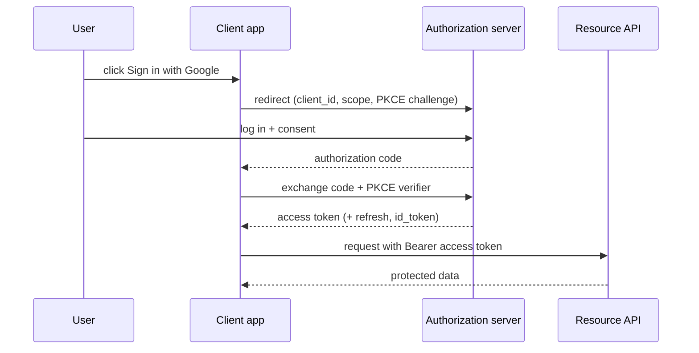

# Security in System Design

> Interviewers rarely expect a full security design, but mentioning authentication, authorization, encryption and abuse prevention at the right moments shows maturity.

---

## 1. Authentication (AuthN) vs Authorization (AuthZ)
- **AuthN** – *who are you?* (login, tokens, MFA)
- **AuthZ** – *what are you allowed to do?* (roles, permissions, ownership checks)

---

## 2. Session-based vs Token-based auth

| | Server sessions (cookie) | JWT (stateless token) |
|---|---|---|
| Storage | Session id in cookie → session data in Redis/DB | Signed token contains claims (user id, roles, expiry) |
| Validation | Lookup per request | Verify signature locally — no lookup |
| Revocation | Easy (delete session) | Hard (wait for expiry, or keep a denylist) |
| Scaling | Needs shared session store | Stateless, scales trivially |
| Typical | Traditional web apps | APIs, mobile, microservices |

**Best practice:** short-lived **access tokens** (5–15 min JWT) + long-lived **refresh tokens** (stored securely, rotated, revocable).

### JWT structure
`header.payload.signature` — base64url encoded. Payload is **readable by anyone** (only signed, not encrypted) → never put secrets in it. Sign with RS256/ES256 (asymmetric) so services verify with a public key.

---

## 3. OAuth 2.0 & OpenID Connect
- **OAuth 2.0** – *delegated authorization*: let App X access your Google Drive without giving it your password. Roles: resource owner, client, authorization server, resource server.
- **Authorization Code flow + PKCE** – the recommended flow for web & mobile apps.
- **Client Credentials flow** – service-to-service.
- **OpenID Connect (OIDC)** – identity layer on top of OAuth 2.0 (adds `id_token`) → "Sign in with Google".
- **SSO** – one login across many apps (SAML for enterprise, OIDC for modern).

---

### Diagram

## 4. Authorization models
- **RBAC** (Role-Based) – user → roles → permissions (admin, editor, viewer).
- **ABAC** (Attribute-Based) – policies over attributes (department, region, time).
- **ReBAC** (Relationship-Based) – permissions from relationships ("can edit if member of the doc's folder") — Google **Zanzibar**, OpenFGA, SpiceDB. Used for Google Docs/Drive sharing.
- Always check ownership on the server: prevent **IDOR** (changing `/orders/123` to `/orders/124`).

---

## 5. Encryption
- **In transit** – TLS 1.2/1.3 everywhere; **mTLS** between internal services (zero-trust, service mesh).
- **At rest** – disk/DB encryption (AES-256); keys managed by **KMS** (AWS KMS, HashiCorp Vault). **Envelope encryption**: data encrypted with a data key, data key encrypted with a master key in KMS.
- **End-to-end encryption (E2EE)** – only endpoints hold keys (WhatsApp/Signal protocol); server can't read messages.
- **Hashing passwords** – never encrypt or plain-hash; use slow salted hashes: **bcrypt, scrypt, Argon2**.
- **Tokenization** – replace card numbers with tokens (PCI DSS scope reduction).

---

## 6. Secrets management
No secrets in code or git. Use Vault / AWS Secrets Manager, rotate regularly, least privilege IAM roles.

---

## 7. Common attacks & defenses (OWASP highlights)

| Attack | Defense |
|---|---|
| SQL injection | Parameterized queries / ORM |
| XSS (cross-site scripting) | Output encoding, Content-Security-Policy, HttpOnly cookies |
| CSRF | SameSite cookies, CSRF tokens |
| SSRF (server fetches attacker URL, e.g., cloud metadata) | Allowlists, block internal IP ranges — relevant for web crawlers / URL previewers |
| Broken access control / IDOR | Server-side authorization on every resource |
| Credential stuffing / brute force | Rate limiting, MFA, CAPTCHA, breached-password checks |
| DDoS | CDN/edge absorption (Cloudflare, AWS Shield), anycast, rate limiting, autoscaling, WAF |
| Replay attacks | Nonces, timestamps, idempotency keys, short-lived tokens |
| Webhook spoofing | HMAC signatures + timestamp verification |

---

## 8. Privacy & compliance
- **PII minimization**, data retention policies, right to be deleted (**GDPR**), data residency (store EU data in EU).
- **PCI DSS** for card data, **HIPAA** for health data, **SOC 2** for SaaS.
- **Audit logs** – immutable records of who accessed/changed what.

---

## 9. Abuse & fraud
Rate limiting, bot detection, device fingerprinting, risk scoring (ML), spam filters, content moderation pipelines.

---

## 10. Interview cheat-sheet
- "API gateway validates JWTs (short-lived access + refresh tokens); OAuth2/OIDC for login."
- "TLS everywhere, mTLS internally, encryption at rest with KMS-managed keys."
- "Passwords hashed with bcrypt/Argon2; card data tokenized via the PSP so we stay out of PCI scope."
- "Rate limiting + WAF + CDN to absorb DDoS."
- "Authorization checks on every resource (no IDOR); Zanzibar-style ACLs for sharing."
