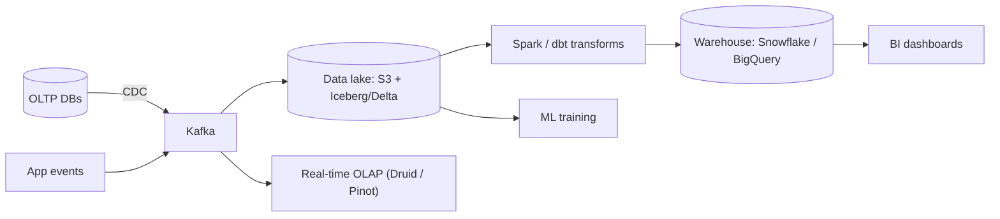

# Storage Systems: Block, File, Object, Data Lakes & Warehouses

---

## 1. Block vs File vs Object storage

| | Block | File | Object |
|---|---|---|---|
| Abstraction | Raw fixed-size blocks (a virtual disk) | Hierarchical files & folders (POSIX) | Flat namespace: `bucket/key -> blob + metadata` |
| Access | Mounted by one VM; OS filesystem on top | NFS/SMB, shared by many machines | HTTP API (`PUT/GET/DELETE`) |
| Performance | Lowest latency, high IOPS | Medium | Higher latency, massive throughput |
| Scale | TBs | PBs (with effort) | Virtually unlimited (exabytes) |
| Mutability | In-place updates | In-place | **Immutable objects** (replace whole object) |
| Examples | AWS EBS, SAN, local SSD | AWS EFS, NFS, HDFS(ish), CephFS | **S3**, GCS, Azure Blob, MinIO, Ceph RGW |
| Use | Databases, VM boot disks | Shared home dirs, legacy apps, ML training data | Images, videos, backups, logs, data lakes, static sites |

In system designs: **metadata in a DB, bytes in object storage, served through a CDN.** ([S3-like Object Storage](../03-problems/21-object-storage-s3.md)) designs S3.)

---

## 2. Object storage tips
- **Pre-signed URLs** - clients upload/download directly to S3 with a temporary signed URL; your servers never touch the bytes.
- **Multipart upload** - split large files into parts (e.g., 5-100 MB), upload in parallel, resume on failure.
- **Storage classes / lifecycle** - hot (Standard) -> infrequent access -> archive (Glacier) after N days to save cost.
- **Durability** - S3 claims 11 nines via replication across AZs and **erasure coding**.

---

## 3. Replication vs Erasure coding
- **3× replication** - simple, fast reads/repairs, 200% storage overhead.
- **Erasure coding (e.g., Reed-Solomon 8+4)** - split data into 8 data chunks + 4 parity chunks; any 8 of 12 reconstruct the data. ~50% overhead, survives 4 failures, but more CPU and slower repair. Used for cold/warm data in S3, HDFS, Azure, Backblaze.

---

## 4. Distributed file systems
- **GFS / HDFS** - a master (NameNode) stores metadata; data split into large chunks (64-128 MB) replicated on DataNodes. Optimized for large sequential reads/writes (MapReduce).
- **Colossus** - Google's successor with distributed metadata.

---

## 5. OLTP vs OLAP

| | OLTP (transactional) | OLAP (analytical) |
|---|---|---|
| Queries | Many small reads/writes by key | Few huge scans & aggregations |
| Users | End users via apps | Analysts, dashboards, ML |
| Data | Current state | Historical |
| Storage | Row-oriented | **Column-oriented** |
| Examples | Postgres, MySQL, DynamoDB | Snowflake, BigQuery, Redshift, ClickHouse, Druid, Pinot |

### Why columnar storage is fast for analytics
- Query `SELECT avg(price) FROM sales WHERE date > X` reads only `price` and `date` columns, not entire rows.
- Same-type values compress extremely well (run-length, dictionary, bit-packing).
- Vectorized execution (process batches of column values with SIMD).
- File formats: **Parquet**, **ORC**.

---

## 6. Data Warehouse vs Data Lake vs Lakehouse
- **Data Warehouse** - structured, cleaned, schema-on-write data for BI (Snowflake, BigQuery, Redshift).
- **Data Lake** - cheap object storage holding raw data of any format, schema-on-read (S3 + Parquet + Hive/Glue catalog, queried by Spark/Presto/Trino/Athena).
- **Lakehouse** - lake + table format adding ACID, schema evolution, time travel: **Delta Lake, Apache Iceberg, Apache Hudi**.

### Getting data there: ETL vs ELT
- **ETL** - Extract, Transform (outside), Load.
- **ELT** - Extract, Load raw into warehouse, Transform with SQL (dbt). Modern default.
- Sources via **CDC** (Debezium), Kafka, batch dumps, or tools like Fivetran/Airbyte.

---

### Diagram

## 7. Data modeling for analytics
- **Star schema** - central **fact table** (sales events: amount, quantity, foreign keys) + **dimension tables** (product, customer, date, store).
- **Snowflake schema** - normalized dimensions.
- **Slowly Changing Dimensions (SCD Type 2)** - keep history of dimension changes with valid_from/valid_to.

---

## 8. Specialized stores worth naming
- **Time-series DB** (Prometheus, InfluxDB, TimescaleDB) - metrics with downsampling & retention.
- **Real-time OLAP** (Druid, Pinot, ClickHouse) - sub-second aggregations on streaming data (ad clicks, [Ad Click Event Aggregation](../03-problems/18-ad-click-aggregation.md); Uber/LinkedIn dashboards).
- **Search engine** (Elasticsearch) - inverted indexes.
- **Vector DB** - embeddings similarity search.
- **Blob + CDN** - media.

---

## 9. Points to mention in an interview
- "Media -> S3 via pre-signed multipart uploads; metadata -> Postgres; served via CDN."
- "Old data lifecycle-moved to Glacier; erasure coding for warm data."
- "Events stream through Kafka into a lakehouse (Iceberg on S3) for batch analytics and into Pinot/Druid for real-time dashboards."
- "Columnar storage (Parquet) because analytical queries touch few columns over many rows."
