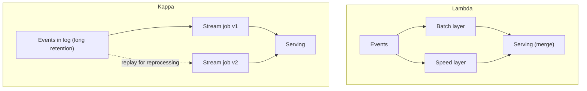

# Batch & Stream Processing

Many designs have a "data pipeline" box: counting views, building search indexes, computing recommendations, aggregating ad clicks, detecting fraud. This note explains what goes inside that box.

---

## 1. Batch vs Stream

| | Batch | Stream |
|---|---|---|
| Input | Bounded dataset (yesterday's logs) | Unbounded, continuous events |
| Latency | Minutes -> hours | Milliseconds -> seconds |
| Throughput | Very high | High |
| Correctness | Easy to reprocess / exact | Late & out-of-order events complicate things |
| Tools | Hadoop MapReduce, **Spark**, Hive, Trino, dbt | **Flink**, Kafka Streams, Spark Structured Streaming, Beam/Dataflow, Storm |
| Examples | Daily billing, ML training, search index rebuild, reports | Fraud detection, real-time dashboards, trending topics, alerting |

---

## 2. MapReduce (the classic)
```
Input splits → MAP (emit key,value) → SHUFFLE & SORT (group by key) → REDUCE (aggregate per key) → Output
```
Word count:
- Map: `"the cat the" -> (the,1) (cat,1) (the,1)`
- Shuffle: `the -> [1,1]`, `cat -> [1]`
- Reduce: `the -> 2`, `cat -> 1`

Spark improved on MapReduce by keeping intermediate data **in memory** (RDDs/DataFrames) and building a DAG of operations -> 10-100× faster for iterative jobs.

---

## 3. Stream processing concepts

### Event time vs Processing time
- **Event time** - when the event actually happened (on the device).
- **Processing time** - when the system processes it.
Mobile clients go offline; events arrive minutes late and out of order. Correct aggregations use **event time**.

### Windows
| Window | Description | Example |
|---|---|---|
| **Tumbling** | Fixed, non-overlapping | Clicks per minute |
| **Hopping / Sliding** | Fixed size, overlapping (advance by slide) | Clicks in last 5 min, updated every 1 min |
| **Session** | Grouped by activity with an inactivity gap | User session analytics |

### Watermarks
A watermark says "I believe all events with event time ≤ T have arrived." When the watermark passes the end of a window, the window result is emitted. Events arriving after that are **late**: drop them, send to a side output, or update results (allowed lateness).

### State & checkpoints
Stream processors keep state (counts per key) in local stores (RocksDB) and periodically **checkpoint** it (Flink snapshots) to durable storage, together with Kafka offsets -> on failure, restore and replay -> **exactly-once state**.

---

## 4. Lambda vs Kappa architecture

### Lambda
```
               ┌─► Batch layer (Spark on all historical data, accurate) ─┐
Events ─► Kafka┤                                                         ├─► Serving layer (merge)
               └─► Speed layer (Flink, real-time, approximate) ──────────┘
```
 Accurate + fast. Two codebases doing the same logic.

### Kappa
Only a streaming layer. To recompute, **replay the log** from Kafka (long retention / tiered storage) through a new version of the job.
 One codebase. Reprocessing huge history via streaming can be slow.

---

### Diagram



## 5. Common pipeline building blocks
- **Ingestion**: Kafka/Kinesis, Fluent Bit, CDC (Debezium).
- **Processing**: Flink/Spark/Beam.
- **Storage**: S3/Iceberg (lake), Snowflake/BigQuery (warehouse), Druid/Pinot/ClickHouse (real-time OLAP), Cassandra/Redis (serving).
- **Orchestration**: Airflow, Dagster, Prefect (schedule batch DAGs, retries, dependencies).
- **Data quality**: schema registry, Great Expectations, dedupe, reconciliation.

---

## 6. Exactly-once & deduplication in pipelines
- Kafka idempotent producers + transactions; Flink two-phase-commit sinks.
- Dedupe by event id within a window (state store or Bloom filter).
- Idempotent sinks (upserts by key).
- **Reconciliation**: compare streaming results with batch results nightly ([Ad Click Event Aggregation](../03-problems/18-ad-click-aggregation.md)) - Ad Click Aggregation).

---

## 7. Approximate algorithms in streams
When exact answers are too expensive:
- **Count-Min Sketch** - approximate frequencies (top-K / heavy hitters).
- **HyperLogLog** - approximate distinct counts (unique visitors).
- **Reservoir sampling** - uniform sample of a stream.
See the Probabilistic Data Structures note.

---

## 8. Points to mention in an interview
- "Click events -> Kafka -> Flink with 1-minute tumbling windows on **event time**, watermarks for late data -> Druid for dashboards."
- "A nightly Spark batch job recomputes from raw S3 data and reconciles with the streaming results (Lambda)."
- "Flink checkpoints state + offsets for exactly-once."
- "Use Count-Min Sketch for trending/top-K, HyperLogLog for unique counts."
