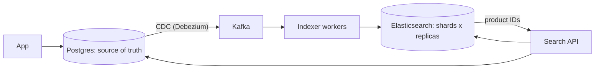

# Search Systems & the Inverted Index

Product search, tweet search, log search, people search... Any "search box" in a design usually means **Elasticsearch/OpenSearch (or a custom inverted index) fed asynchronously from the primary DB**.

---

## 1. Why not `LIKE '%shoe%'` in SQL?
A leading wildcard can't use a B-tree index -> full table scan. No relevance ranking, no typo tolerance, no stemming. Fine for 10k rows; useless for 1B.

---

## 2. Inverted index
Forward index: `doc -> words`. Inverted index: `word -> docs`.
```
Doc1: "red running shoes"
Doc2: "blue running jacket"

running → [Doc1, Doc2]
red     → [Doc1]
shoes   → [Doc1]
blue    → [Doc2]
jacket  → [Doc2]
```
Query `running AND shoes` = intersect posting lists -> `[Doc1]`. Posting lists are sorted by doc id -> intersection is a linear merge; compressed with delta + variable-byte encoding.

### Text analysis pipeline (index & query time)
1. **Tokenization** - split into terms.
2. **Normalization** - lowercase, remove accents.
3. **Stop words** - drop "the", "a" (optional).
4. **Stemming / lemmatization** - "running" -> "run".
5. **Synonyms** - "sneakers" vs "shoes".
6. **N-grams / edge n-grams** - for partial matching & autocomplete.

---

## 3. Relevance ranking
- **TF-IDF** - term frequency in doc × inverse document frequency (rare words matter more).
- **BM25** - improved TF-IDF with saturation and document-length normalization (Elasticsearch default).
- **Signals** - popularity, recency, personalization, CTR, seller rating, location.
- **Learning to Rank (LTR)** - ML model re-ranks the top N candidates.
- **Semantic / vector search** - embed query & docs; ANN search (HNSW) for meaning-based matches; **hybrid search** combines BM25 + vectors.

Two-stage retrieval: **candidate generation** (cheap, recall-oriented, top 1000) -> **ranking** (expensive ML, precision-oriented, top 20).

---

## 4. Elasticsearch architecture
- **Index** split into **primary shards**, each with **replica shards** (on other nodes).
- Each shard is a **Lucene** index made of immutable **segments**; new docs are buffered then "refreshed" into a new segment (~1 s) -> **near-real-time** search. Segments merge in the background.
- Query execution: **scatter-gather** - coordinating node sends query to one copy of every shard, each returns top-K, coordinator merges.
- Choose shard count up front (resharding = reindex); aim for 10-50 GB per shard.

---

## 5. Keeping search in sync with the source of truth
```
App → Postgres (source of truth) ──CDC (Debezium)──► Kafka ──► Indexer workers ──► Elasticsearch
```
- Search index is a **derived view**; it can always be rebuilt from the DB.
- Eventual consistency (seconds).
- Use document versioning to avoid out-of-order updates overwriting newer data.
- Full reindex via alias swap: build `products_v2`, then point alias `products` to it.

---

### Diagram



## 6. Scaling search
- **Document-partitioned** (each shard has a subset of docs; query all shards) - standard (Elasticsearch, Google).
- **Term-partitioned** (each shard has a subset of terms) - fewer shards per query but hot terms and multi-term queries are hard.
- **Replicas** for read throughput; **caching** popular queries; **tiering** (recent tweets in memory, older on disk).
- Early termination: stop once enough high-quality results found (index sorted by quality/static rank).

---

## 7. Typeahead / autocomplete
Different from full search: trie or edge-ngram index of **popular queries**, top-K cached per prefix, <100 ms. ([Search Autocomplete (Typeahead)](../03-problems/10-search-autocomplete.md)).)

---

## 8. Facets & filters
"Brand: Nike (120), Adidas (98)" - computed with aggregations over the matching doc set; filters (price range, category) use cached bitsets.

---

## 9. Points to mention in an interview
- "Postgres is the source of truth; CDC -> Kafka -> Elasticsearch for search; reindexing is always possible."
- "Inverted index with BM25, plus popularity/recency boosts; optionally an ML re-ranker on the top 500."
- "Shards × replicas; scatter-gather query; cache hot queries."
- "Search is eventually consistent - a new product shows up within a few seconds."
