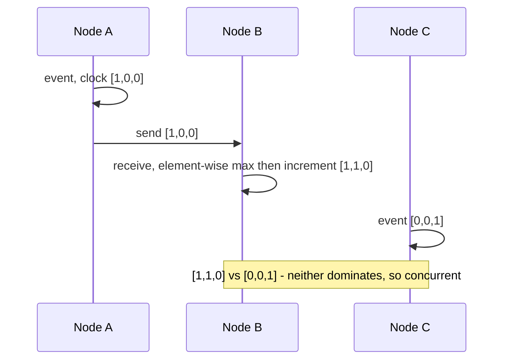

# Time, Clocks & Ordering in Distributed Systems

> "Which happened first?" is surprisingly hard when events happen on different machines with different clocks.

---

## 1. Physical clocks and why they lie
- Each machine's quartz clock **drifts** (~10–100 ppm → seconds per day).
- **NTP** syncs clocks over the network; typical accuracy is a few ms in a data center, tens of ms over the internet.
- Clocks can **jump backwards** after NTP correction, VM migration, leap seconds.
- Never use wall-clock timestamps from different machines to decide order of critical events (e.g., Last-Write-Wins can silently drop the "later" write).
- Use **monotonic clocks** for measuring durations/timeouts on a single machine.

---

## 2. Lamport timestamps (logical clocks)
Each node keeps a counter `C`.
- Before each local event: `C = C + 1`.
- Send message with `C`.
- On receive with timestamp `T`: `C = max(C, T) + 1`.
Property: if A **happened-before** B then `L(A) < L(B)`. (Converse isn't true — can't detect concurrency.) Ties broken by node id → **total order** consistent with causality.

---

## 3. Vector clocks
Each node keeps a vector `[c1, c2, ..., cn]` — one counter per node.
- Local event: increment own entry.
- Send: attach vector. Receive: element-wise max, then increment own entry.
- Compare: `V(A) ≤ V(B)` element-wise → A happened before B. Neither ≤ the other → **concurrent** (conflict!).
Used in Dynamo/Riak to detect conflicting writes ([Distributed Key-Value Store (Dynamo / Cassandra style)](../03-problems/03-key-value-store.md)). Downside: vector size grows with number of writers.

---

### Diagram

## 4. Hybrid Logical Clocks (HLC)
Combine physical time with a logical counter: stays close to wall-clock time (human-readable, good for snapshots) but preserves causality. Used by **CockroachDB**, MongoDB, YugabyteDB.

---

## 5. Google TrueTime (Spanner)
- GPS receivers + atomic clocks in every data center give time as an interval `[earliest, latest]` with bounded uncertainty ε (~1–7 ms).
- **Commit wait**: Spanner waits out ε before making a commit visible → **external consistency** (global linearizability) using timestamps.

---

## 6. Ordering guarantees you may need
| Need | Technique |
|---|---|
| Order within a chat / account | Single partition per entity (Kafka partition key), per-entity sequence numbers |
| Globally unique, roughly time-sorted IDs | Snowflake (timestamp + machine + sequence), ULID, UUIDv7 |
| Detect concurrent updates | Vector clocks, version numbers (optimistic concurrency) |
| Total order of all operations | Single leader / consensus log (Raft) / sequencer (stock exchange, [Stock Exchange (matching engine)](../03-problems/25-stock-exchange.md) |
| Causal order (reply after post) | Lamport/vector clocks, causal consistency |

---

## 7. Practical tips
- Generate ordering ids at **one place per entity** (leader, sequencer) instead of trusting client clocks.
- Store both **client timestamp** (for display) and **server sequence** (for ordering).
- Chat apps: per-conversation monotonically increasing message ids ([Chat System (WhatsApp / Messenger / Slack)](../03-problems/09-chat-system.md)).
- Distributed locks: use **fencing tokens**, not timestamps.
- Snowflake IDs: if the clock goes backwards, refuse to generate (or wait) to avoid duplicates.

---

## 8. Interview cheat-sheet
- "We can't trust wall clocks across machines; ordering comes from a per-entity sequence or Snowflake ids."
- "Vector clocks detect concurrent writes; LWW is simpler but may drop data."
- "Spanner uses TrueTime with commit-wait for external consistency."
