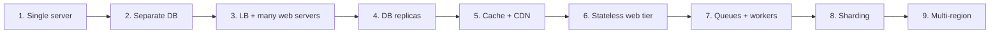
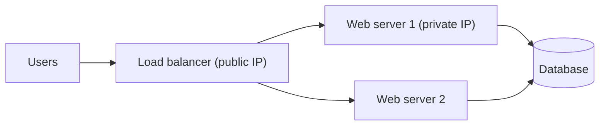
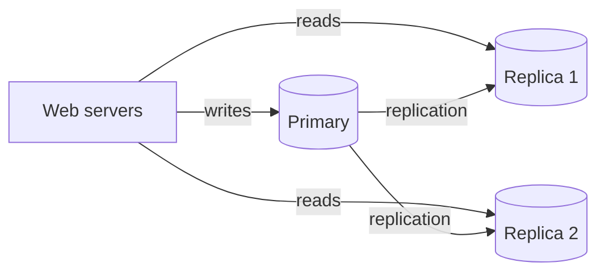
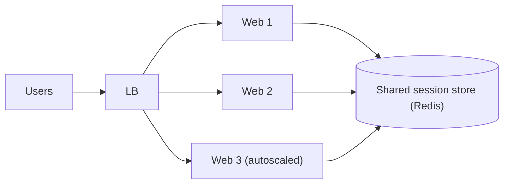
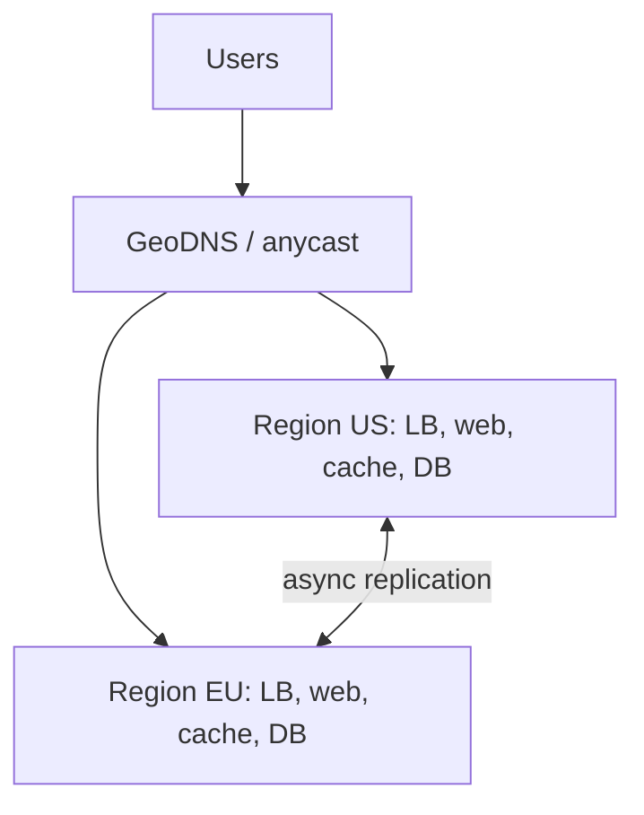

# Scaling from Zero to Millions of Users

> How a system evolves step by step. In interviews, this is the mental model behind "how would you scale this?".

---

## The journey in one picture

| Users | Typical change | Why |
|---|---|---|
| ~1K | Single server (app + DB) | Simplest thing that works |
| ~10K | Separate DB server | Scale web and data tiers independently |
| ~100K | Load balancer + multiple web servers; DB primary + read replicas | Redundancy, read throughput |
| ~1M | Redis cache, CDN, sessions in shared store, message queues | Latency, offload DB, async work |
| ~10M | Sharding, service decomposition, multi-AZ, autoscaling | Write scale, team scale, availability |
| 100M+ | Multi-region, cell-based architecture, specialized stores | Latency for global users, blast radius |

---

## Step 1 — Single server
DNS resolves the domain to one server running web app + DB. Fine for prototypes; single point of failure.

## Step 2 — Separate the database
Web tier and data tier scale independently. Choose a DB by access pattern (see [Databases](04-databases-sql-vs-nosql-acid-indexing.md)).

## Step 3 — Load balancer + horizontal scaling

Vertical scaling hits a ceiling and has no redundancy; horizontal scaling adds servers behind an LB. If one server dies, traffic goes to the others. See [Load balancing](03-load-balancing.md).

## Step 4 — Database replication

Reads usually dominate, so add replicas. If a replica dies, reads go elsewhere; if the primary dies, promote a replica. Watch replication lag. See [Replication](05-replication.md).

## Step 5 — Cache and CDN
- **Cache** (Redis/Memcached) for frequently read, rarely changed data; set TTLs, handle invalidation and eviction. See [Caching](07-caching-deep-dive.md).
- **CDN** for static assets and media close to users; version file names for invalidation. See [CDN design](../03-problems/52-cdn.md).

## Step 6 — Stateless web tier

Move sessions out of servers → any server serves any user → autoscaling and rolling deploys become easy.

## Step 7 — Message queues & workers
Slow work (emails, image processing, reports) goes to a queue; workers scale independently. See [Message queues](11-message-queues-pub-sub-and-event-streaming.md).

## Step 8 — Logging, metrics, automation
Centralized logs, metrics dashboards, alerting, CI/CD. You can't scale what you can't see. See [Observability](14-observability-logs-metrics-tracing.md).

## Step 9 — Sharding the database
Split data by a shard key when one primary can't handle writes or size. Challenges: resharding, hot keys (celebrities), cross-shard joins → denormalize. See [Sharding](06-partitioning-and-sharding.md).

## Step 10 — Multiple data centers / regions

Route users to the nearest healthy region; replicate data; automate deployments across regions; test failover.

---

## Key takeaways
1. Keep the web tier stateless.
2. Build redundancy at every tier; remove SPOFs.
3. Cache as much as is safe; use CDNs for static/media.
4. Scale reads with replicas, writes with sharding.
5. Decouple with queues.
6. Monitor everything and automate.
7. Go multi-region when latency/availability needs justify the complexity.

---

## Interview Q&A
**Q: The app is slow at 1M users — where do you start?** Measure first (metrics, slow queries), then cache hot reads, add read replicas, move slow work async, then shard if writes are the bottleneck.

**Q: Why not just buy a bigger DB server?** Works for a while (and is simpler), but has a hard ceiling, high cost, and remains a SPOF.
