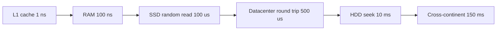
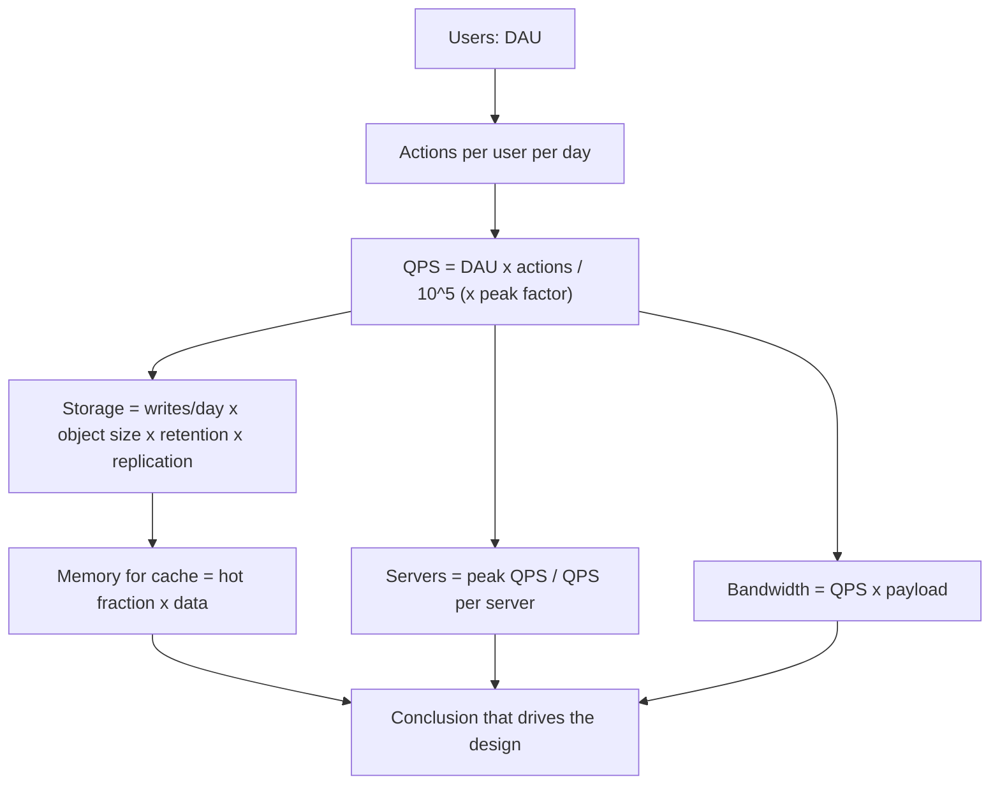

# Back-of-the-Envelope Estimation

Quick, rough numbers that tell you **which design decisions are forced** (need a CDN? does it fit in memory? need sharding?). Precision doesn't matter; the reasoning does.

---

## 1. Powers of two & units
| Power | Approx | Name |
|---|---|---|
| 2¹⁰ | 1 thousand | KB |
| 2²⁰ | 1 million | MB |
| 2³⁰ | 1 billion | GB |
| 2⁴⁰ | 1 trillion | TB |
| 2⁵⁰ | 1 quadrillion | PB |

## 2. Time shortcuts
| Quantity | Value |
|---|---|
| Seconds per day | 86,400 ≈ **10⁵** |
| 1M requests/day | ≈ **12 req/s** |
| 1B requests/day | ≈ **12K req/s** |
| Peak | 2-3× average (more for events) |

## 3. Latency numbers (orders of magnitude)

Takeaways: memory is fast, disk/network slow; avoid disk seeks; compress before sending over the internet; keep data close to users.

## 4. Availability "nines"
| Availability | Downtime / year | Downtime / day |
|---|---|---|
| 99% | 3.65 days | 14.4 min |
| 99.9% | 8.77 hours | 1.44 min |
| 99.99% | 52.6 min | 8.6 s |
| 99.999% | 5.26 min | 0.86 s |

Serial dependencies multiply: two 99.9% services in series -> 99.8%.

## 5. Typical sizes
| Item | Size |
|---|---|
| ID (64-bit) | 8 B |
| UUID | 16 B |
| Short text post + metadata | ~0.5-1 KB |
| Image (compressed) | 200 KB - 2 MB |
| 1 min HD video | ~50-100 MB |

## 6. The method

## 7. Worked example - Twitter-like service
Assumptions: 300M MAU, 50% daily active, 2 tweets/day, 10% contain 1 MB media, 5-year retention.
- DAU = 150M -> tweets/day = 300M -> **QPS ≈ 3,500**, peak ≈ 7,000.
- Media/day = 300M × 10% × 1 MB = **30 TB/day** -> 5 years ≈ **55 PB**.
- Conclusion: object storage + CDN for media; text and metadata in a sharded store.

More drills: [Estimation drills](../04-interview-questions/03-estimation-drills.md).

## 8. Tips
- Round aggressively (99,987 / 9.1 ≈ 100,000 / 10).
- Write assumptions down; label units (MB vs Mb).
- Do reads, writes, storage, bandwidth, memory, servers - then state what it implies.
- Spend 3-5 minutes, not 15.
