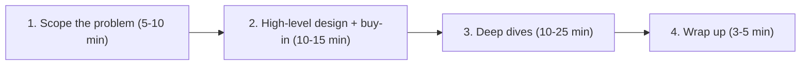
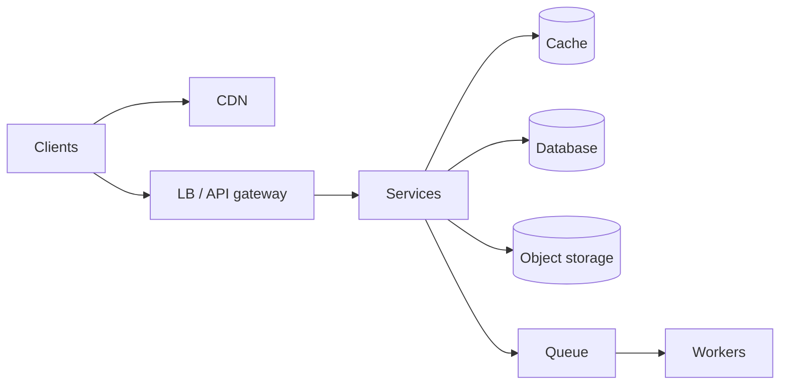

# The System Design Interview Framework

> A repeatable 4-step process for 45–60 minute interviews. The interviewer evaluates **how you think**: scoping, trade-offs, communication — not a single "right" diagram.

---

## The four steps

### Step 1 — Understand the problem & scope
- Ask clarifying questions; never start drawing immediately.
- Pin down **functional requirements** (3–5 core features; say what's out of scope).
- Pin down **non-functional requirements**: scale (DAU, QPS), latency, availability, consistency, durability.
- Quick **estimates** to size the problem.

Good questions: Who are the users? What are the top features? How many users / requests? Read- or write-heavy? Real-time? Consistency needs? Mobile/web? Existing tech to reuse?

### Step 2 — High-level design
- Define the **API** (3–5 endpoints) and **data model** (main entities, DB choice with reason).
- Draw boxes: clients, LB/gateway, services, caches, DBs, queues, object storage, CDN.
- Walk through the main flows end to end. Get agreement before going deeper.

Starter skeleton:

### Step 3 — Deep dives
Pick the 2–3 hardest or most interesting parts (or follow the interviewer's lead). For each:
1. State the problem precisely ("fan-out to 50M followers takes minutes").
2. Offer 2–3 options with trade-offs.
3. Choose, justify with requirements/numbers.
4. Cover failure modes and monitoring.

Typical deep dives: data partitioning, hot keys, consistency, caching strategy, queue semantics, ID generation, ranking, rate limiting.

### Step 4 — Wrap up
- Recap the design and key decisions.
- Discuss bottlenecks and how to scale 10×.
- Failure scenarios (node, AZ, region, dependency) and operational concerns (metrics, alerts, deploys).
- Future improvements.

---

## Do's and don'ts
| ✅ Do | ❌ Don't |
|---|---|
| Ask questions, state assumptions | Jump into a solution |
| Think out loud, involve the interviewer | Stay silent for long stretches |
| Quantify (QPS, storage) | Use buzzwords without reasons |
| Discuss trade-offs and alternatives | Claim one perfect design |
| Design for the stated scale | Over-engineer for 1B users when asked for 1M |
| Mention failures, monitoring, security | Ignore reliability |

## What different levels show
| Level | Expected |
|---|---|
| Mid | Working end-to-end design, sensible components |
| Senior | Drives the discussion, quantifies, deep trade-offs, failure handling |
| Staff+ | Evolution over time, operational cost, multiple valid designs and when each wins, org impact |

---

**Practice:** [Patterns](../02-patterns/README.md) · [Problems](../03-problems/) · [Quick drills](../04-interview-questions/04-quick-design-drills.md) · [Cheat sheet](00-interview-cheat-sheet-and-problem-patterns.md)
