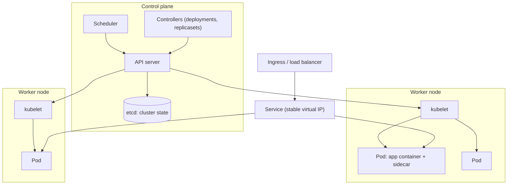
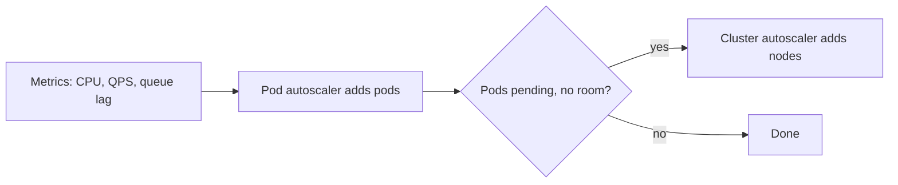
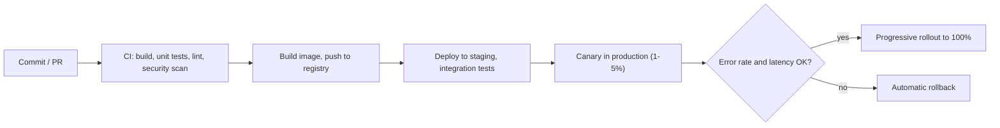

# Containers, Kubernetes and Deployment Infrastructure

Interviewers rarely ask you to design Kubernetes, but they expect you to know where your services actually run, how they scale, and how code gets to production safely.

---

## VMs vs containers vs serverless

| | Virtual machines | Containers | Serverless functions |
|---|---|---|---|
| Isolation | Full OS per VM (hypervisor) | Shared kernel, isolated processes (namespaces, cgroups) | Managed by provider (often micro-VMs) |
| Start time | Minutes | Seconds | Milliseconds to seconds (cold starts) |
| Density | Low | High | Very high |
| You manage | OS, runtime, app | Image + orchestration | Only code |
| Good for | Legacy apps, strong isolation | Microservices, most backends | Spiky event-driven glue, low-traffic APIs |

A container image bundles the app and its dependencies, so it runs the same on a laptop and in production.

---

## Kubernetes in one diagram

| Object | What it does |
|---|---|
| Pod | Smallest unit: one or more containers sharing network and storage |
| Deployment | Keeps N replicas of a pod running; handles rolling updates |
| Service | Stable name/IP that load-balances across pods |
| Ingress | HTTP routing from outside into services |
| ConfigMap / Secret | Configuration and credentials injected into pods |
| HPA | Horizontal Pod Autoscaler: adds/removes pods by CPU or custom metrics |
| StatefulSet | Pods with stable identity and storage (databases, Kafka) |
| DaemonSet | One pod per node (log agents, monitoring) |

Kubernetes is declarative: you describe the desired state, and controllers keep moving the actual state toward it (restart crashed pods, reschedule pods from dead nodes).

---

## Autoscaling layers

Scale on the signal that actually reflects load. For workers that is usually queue depth or consumer lag, not CPU.

---

## From commit to production (CI/CD)

Deployment strategies (rolling, blue-green, canary, feature flags) are covered in [Reliability patterns](13-reliability-and-resilience-patterns.md). A full CI/CD system design is in [problem 62](../03-problems/62-ci-cd-deployment-system.md).

---

## Infrastructure as code
Define infrastructure (networks, databases, clusters) in Terraform/CloudFormation/Pulumi, reviewed and versioned like code. This makes environments reproducible and changes auditable.

---

## Things worth saying in an interview
- Stateless services run as Deployments behind a Service, scaled by HPA.
- Stateful systems (databases, Kafka) usually use managed cloud services or StatefulSets with persistent volumes.
- Spread replicas across availability zones (pod anti-affinity) so a zone failure does not take out a service.
- Readiness probes keep pods out of the load balancer until they can serve; liveness probes restart stuck pods.
- Resource requests and limits prevent one service from starving others on a node.

---

## Interview Q&A

**Q: Why containers over VMs for microservices?**
A: Faster startup, higher density, identical images across environments, and good fit with orchestrators for scaling and self-healing.

**Q: What happens when a node dies?**
A: The control plane marks it NotReady, and controllers reschedule its pods on healthy nodes. Services stop routing to the dead pods.

**Q: When would you choose serverless?**
A: Spiky or low-volume workloads, event handlers and glue code where paying per invocation and not managing servers is worth cold starts and execution limits.
