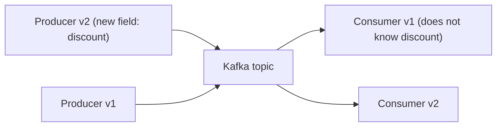
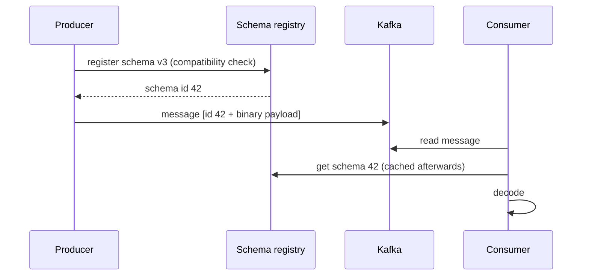

# Serialization Formats and Schema Evolution

Every time data crosses a network or lands on disk it is encoded. The format affects payload size, CPU cost, and most importantly whether old and new versions of your services can still talk to each other.

---

## Common formats

| Format | Type | Schema | Size / speed | Typical use |
|---|---|---|---|---|
| JSON | Text | Optional (JSON Schema) | Larger, slower to parse | Public REST APIs, configs |
| XML | Text | XSD | Large | Legacy enterprise, SOAP |
| Protocol Buffers | Binary | Required (`.proto`) | Small, fast | gRPC, internal services |
| Avro | Binary | Required, stored with data or in a registry | Small, fast | Kafka events, Hadoop |
| Thrift | Binary | Required | Small, fast | Older RPC stacks |
| MessagePack / CBOR | Binary | None | Smaller than JSON | Caches, mobile |
| Parquet / ORC | Columnar binary | Embedded | Very compact for analytics | Data lakes, warehouses |

Rule of thumb: JSON at the edges where humans and browsers are involved, a binary schema-based format between services and on event streams, columnar formats for analytics storage.

---

## Why schemas matter: compatibility

Services are deployed independently, so at any moment some producers run new code and some consumers run old code (or the reverse).

| Compatibility | Meaning | Allows you to |
|---|---|---|
| Backward | New code can read data written by old code | Upgrade consumers first |
| Forward | Old code can read data written by new code | Upgrade producers first |
| Full | Both | Upgrade in any order |

### Safe changes
- Add an optional field with a default.
- Remove an optional field (and never reuse its tag number in Protobuf).
- Add a new enum value only if old readers handle unknown values.

### Breaking changes
- Renaming a field (in JSON) or changing its type.
- Making an optional field required.
- Reusing a Protobuf field number for a different meaning.

---

## Schema registry
For event streams, producers register schemas in a schema registry (Confluent, Apicurio). Each message carries a small schema ID; consumers fetch the schema to decode. The registry rejects incompatible changes before they reach production.

---

## API versioning vs schema evolution
- For public APIs, additive changes go into the same version; breaking changes need a new version (`/v2`) and a deprecation period.
- For internal events, prefer evolving schemas compatibly instead of creating new topics for each change.

---

## Interview Q&A

**Q: Why use Protobuf instead of JSON between microservices?**
A: Smaller payloads, faster parsing, generated clients, and a schema that enforces compatibility rules.

**Q: How do you add a field to an event without breaking consumers?**
A: Add it as optional with a default, register the new schema (the registry checks compatibility), deploy producers; old consumers ignore the new field.

**Q: Why columnar formats for analytics?**
A: Queries read a few columns over many rows; columnar layout reads only those columns and compresses similar values very well.
