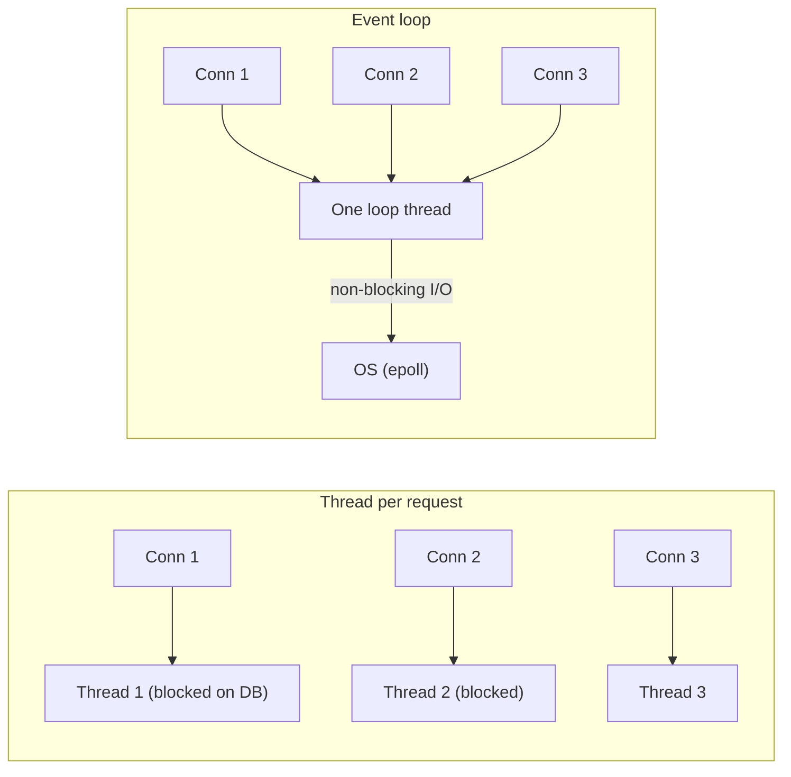

# Concurrency Models and Connection Handling

How a single server handles thousands of simultaneous requests decides how many servers you need, and whether long-lived connections (WebSockets, streaming) are cheap or expensive.

---

## Processes, threads and event loops

| Model | How it works | Strengths | Weaknesses | Examples |
|---|---|---|---|---|
| Process per request | Fork a process per connection | Strong isolation | Heavy memory, slow | Old CGI, Apache prefork |
| Thread per request | One OS thread per connection from a pool | Simple blocking code | Each thread costs ~1 MB stack; context switching at 10K+ threads | Tomcat, classic Java servers |
| Event loop (async I/O) | One thread multiplexes many sockets with epoll/kqueue, callbacks or async/await | Handles 100K+ idle connections cheaply | CPU-heavy work blocks everyone; needs async libraries | Node.js, Nginx, Netty, Python asyncio |
| Lightweight threads / goroutines / actors | Runtime schedules many cheap tasks on few OS threads | Blocking-style code with event-loop efficiency | Runtime-specific | Go, Erlang/Elixir, Java virtual threads |

---

## The C10K problem and beyond
Serving 10,000 concurrent connections used to be hard with thread-per-connection designs. Event-driven servers and lightweight threads solved it; modern chat servers handle hundreds of thousands to millions of mostly idle WebSocket connections per machine. The limits become memory per connection, file descriptors (`ulimit`), and ephemeral ports.

---

## I/O-bound vs CPU-bound work
- **I/O-bound** (waiting on DB, network): async/event loops or many lightweight threads keep the CPU busy while requests wait.
- **CPU-bound** (image resizing, encryption, ML inference): parallelism across cores or separate worker processes; push the work to a queue so it does not block request handling.

---

## Shared state and locking inside a service
- Race conditions appear whenever two threads read-modify-write the same data.
- Tools: mutexes, read-write locks, atomic operations (compare-and-swap), concurrent data structures, and the simplest option, avoiding shared mutable state (message passing, actors, single-writer designs).
- Deadlock needs four conditions (mutual exclusion, hold and wait, no preemption, circular wait); avoid by always acquiring locks in the same order, and use timeouts.

---

## Connection pooling
Opening TCP/TLS or database connections is expensive. Pools keep a set of warm connections:
- HTTP clients: keep-alive pools per downstream host.
- Databases: pool size roughly `cores * 2` per DB server is a common starting point; a proxy (PgBouncer, RDS Proxy) lets thousands of app instances share a small pool.
- Size pools from the downstream's capacity, not the number of app threads, otherwise you overload the database during spikes.

---

## Backpressure inside a process
Bounded queues between stages; when full, reject or slow producers instead of growing memory until the process crashes. The same idea applies between services (see [Message queues](11-message-queues-pub-sub-and-event-streaming.md)).

---

## Interview Q&A

**Q: Why does a chat server use an event loop or goroutines instead of a thread per connection?**
A: Most connections are idle most of the time. Threads would waste memory and context-switching; event-driven or lightweight-thread runtimes keep the per-connection cost to a few kilobytes.

**Q: Your Node.js API gets slow when one endpoint resizes images. Why?**
A: CPU-heavy work blocks the single event-loop thread, so every other request waits. Move it to worker threads or a separate worker service behind a queue.

**Q: How big should a DB connection pool be?**
A: Small. Size it to what the database can actually process concurrently, then queue the rest in the application. Bigger pools usually make latency worse.
