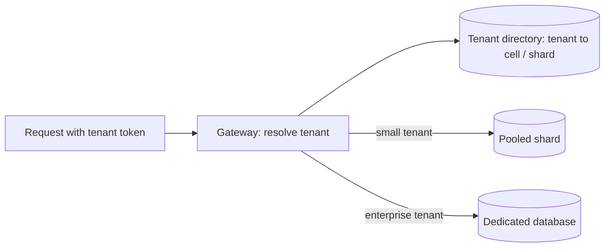
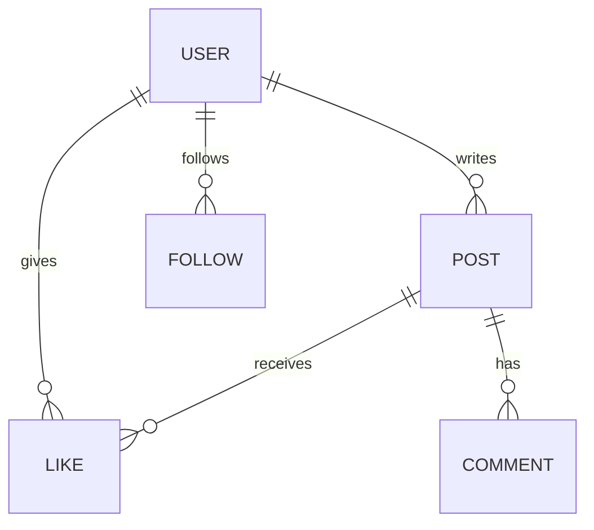

# Multi-Tenancy and Data Modeling

Two topics that come up in almost every design but rarely get their own question: how to separate customers in a SaaS product, and how to turn requirements into tables and keys.

---

## Part 1: Multi-tenancy

A tenant is a customer organization (a Slack workspace, a Shopify store). The question is how much infrastructure tenants share.

| Model | Description | Pros | Cons |
|---|---|---|---|
| Shared everything (pooled) | All tenants in the same tables, `tenant_id` column | Cheapest, simplest ops | Noisy neighbours, risk of data leaks through missing filters |
| Schema per tenant | One DB, separate schema per tenant | Better isolation, per-tenant backups | Thousands of schemas are painful to migrate |
| Database per tenant (siloed) | Own database (or cluster) per tenant | Strong isolation, per-tenant scaling, data residency | Expensive, many databases to operate |
| Hybrid | Pooled for small tenants, dedicated for large/enterprise | Balances cost and isolation | Two code paths for routing |

### Things to get right
- **Isolation of data:** every query filtered by `tenant_id`; enforce it in a data-access layer or with row-level security, not by convention.
- **Noisy neighbours:** per-tenant rate limits and quotas; move heavy tenants to their own shard or cell.
- **Tenant routing:** a directory service maps tenant to shard/cell; cache it at the gateway.
- **Per-tenant keys:** encrypt with a per-tenant key (or customer-managed keys for enterprise).
- **Data residency:** place EU tenants in EU regions.
- **Operations:** migrations run per shard in waves; per-tenant export and deletion.

---

## Part 2: Data modeling for system design interviews

### A repeatable process
1. List the **entities** from the requirements (User, Post, Follow, Like).
2. List the **access patterns** (queries) with their frequency: "get the latest 20 posts of user X", "has user X liked post Y?".
3. Pick the store per pattern (SQL for relationships/transactions, wide-column for huge time-ordered data, KV for lookups).
4. Choose **primary keys and partition keys** so the hot queries hit one partition.
5. Add indexes only for real queries; denormalize when a join would cross partitions.

### Example: a simple social app

| Table | Key design | Serves |
|---|---|---|
| `users(user_id PK, handle UNIQUE, ...)` | SQL | Profile lookup, unique handle |
| `posts(user_id, post_id DESC, ...)` | Partition by `user_id`, cluster by `post_id` | User's timeline |
| `follows(follower_id, followee_id)` and reverse table | Partition by each side | Who I follow / who follows me |
| `likes(post_id, user_id)` | Partition by `post_id` | "Did X like Y?" and like lists |
| `post_counters(post_id, likes, comments)` | KV / counter | Display counts |

### Relational vs NoSQL modeling mindset
- **Relational:** model the data, normalize, then write queries. Joins are cheap on one machine.
- **NoSQL (Cassandra, DynamoDB):** model the queries. One table per access pattern is normal, and duplicated data is expected.

### Common modeling mistakes
- Partition keys with low cardinality (country, status) causing hot partitions.
- Unbounded partitions (all messages of a huge channel in one partition): add a time bucket to the key.
- Using auto-increment IDs across shards: use Snowflake or UUIDv7.
- Storing large blobs in the database: put them in object storage and keep a reference.
- Floats for money: use integer minor units or decimals.

---

## Interview Q&A

**Q: How do you stop one big customer from slowing everyone down?**
A: Per-tenant quotas and rate limits, then move them to a dedicated shard or cell; keep tenant routing in a directory so moves are transparent.

**Q: How do you guarantee tenant A never sees tenant B's data in a pooled database?**
A: Mandatory tenant filters in the data-access layer, row-level security policies, tests that check every query, and per-tenant encryption keys as a second barrier.

**Q: How do you pick a partition key?**
A: From the most frequent query: it should keep that query on one partition while spreading load evenly. See [Partitioning and sharding](06-partitioning-and-sharding.md).
