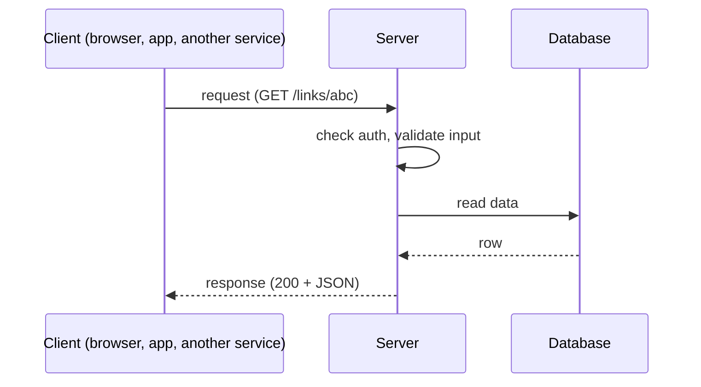
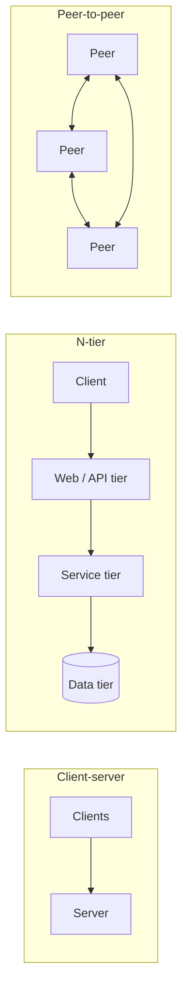

# Clients and Servers

The starting point for every design. A **client** asks for something; a **server** does the work and answers. The server owns the data, and clients can only reach it through the server's API.

---

## The basic exchange

- The client never talks to the database directly. That lets the server enforce rules, hide the schema, and change storage later without breaking clients.
- A "client" is just whoever sends the request. Your order service is a client of the payment service.

---

## Who is responsible for what

| Client | Server |
|---|---|
| Collects input, shows results | Owns and validates data |
| Can't be trusted (users can modify apps, scripts can fake requests) | Enforces auth, permissions, limits |
| Caches for speed | Is the source of truth |
| Retries on failure | Must make retries safe (idempotency) |

Anything the client says (prices, user IDs, "I'm an admin") has to be checked on the server.

---

## Thin vs thick clients
- **Thin client:** server renders most things (server-rendered web pages). Simple clients, more server work.
- **Thick client:** client holds logic and state (single-page apps, mobile apps). Better interactivity and offline use, but logic and versions are spread across millions of devices you don't control.
- Mobile apps stay on old versions for months, so server APIs must stay backward compatible.

---

## Other shapes you will meet

- **N-tier:** separate presentation, logic and data so each tier scales on its own. Most web systems.
- **Peer-to-peer:** nodes are both clients and servers (BitTorrent, WebRTC calls, some blockchain systems). No central bottleneck, but hard to coordinate and secure.

---

## What to say in an interview
- Start every diagram with the clients (web, mobile, partner APIs) and say how they connect (HTTPS REST, WebSocket).
- Point out where the source of truth lives.
- Mention that the server validates everything and that clients will retry.

---

## Interview Q&A

**Q: Why not let the mobile app read the database directly?**
A: You can't enforce permissions or validation, credentials would ship in the app, and every schema change would break old app versions.

**Q: What changes when the client is another service instead of a browser?**
A: Usually binary protocols (gRPC), service-to-service auth (mTLS, tokens), stricter timeouts and retry budgets, and no human waiting to click "retry".

**Next:** [Scaling from zero to millions](21-scaling-from-zero-to-millions.md) · [Networking basics](01-networking-basics.md) · [API design](02-api-design.md)
