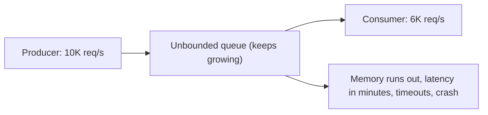
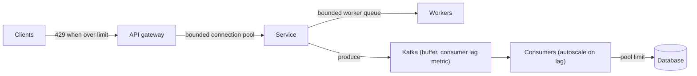

# Back-Pressure

When a consumer can't keep up with a producer, something has to give. Without back-pressure, work piles up in queues and memory until latency explodes or the process crashes. With back-pressure, the slow side **pushes back**: the queue is bounded, and producers are slowed down or told no.

---

## What goes wrong without it

Every request in the queue is one the user is still waiting for. By the time it's processed, the client may have given up and retried, adding even more load. That's how a small slowdown turns into an outage.

---

## The options when the queue is full

| Strategy | What happens | Good for |
|---|---|---|
| **Block / slow the producer** | Producer waits until there is room | Internal pipelines, batch jobs, TCP itself |
| **Reject (load shedding)** | Return 429 / 503 right away | User-facing APIs: a fast "try later" beats a 30 s timeout |
| **Drop** | Discard new or oldest items | Metrics, logs, video frames, where losing some is fine |
| **Buffer to disk** | Spill to durable storage (Kafka) | Spiky producers where every item matters |
| **Scale consumers** | Add workers when lag grows | Sustained load, but scaling takes time |
| **Degrade** | Do less work per item (skip recommendations) | Keeping the core path alive |

Usually you combine them: buffer short bursts, autoscale for sustained load, and shed load when even that isn't enough.

---

## Where back-pressure shows up

- **TCP:** the receiver advertises a window; a slow reader makes the sender wait. Built-in back-pressure.
- **Thread and connection pools:** a fixed size is a form of back-pressure; requests queue (bounded) or are rejected.
- **Message queues:** consumer lag is the signal; producers can be throttled, consumers scaled.
- **Reactive streams / gRPC streaming:** the consumer asks for N more items when ready (pull-based).
- **Rate limiters:** cap what each client can push in.

---

## Practical rules
1. **Bound every queue** (in memory, thread pools, connection pools). Unbounded means "crash later".
2. **Reject early, at the edge**, before expensive work is done.
3. **Prioritize:** shed analytics and background traffic before checkout and login.
4. **Set timeouts and propagate deadlines**, so nobody processes requests whose callers already gave up.
5. **Make clients back off:** return `Retry-After`; clients use exponential backoff with jitter.
6. **Watch the signals:** queue depth, consumer lag, pool saturation, rejected-request rate.

---

## Interview Q&A

**Q: Your workers fall behind during a traffic spike. What do you do?**
A: Short term, let the durable queue absorb it and autoscale workers on lag. If lag keeps growing, throttle or reject low-priority producers and degrade non-essential work. Long term, fix the slow step or add capacity.

**Q: Why is an unbounded queue dangerous?**
A: It hides overload until memory runs out, and items wait so long that their results are useless. A bounded queue turns overload into an explicit, fast signal.

**Q: Reject or block?**
A: Block inside your own pipelines where producers can wait. Reject at the boundary with users or other teams, where waiting just turns into timeouts and retries.

**Related:** [Message queues](11-message-queues-pub-sub-and-event-streaming.md) · [Reliability patterns](13-reliability-and-resilience-patterns.md) · [Concurrency](26-concurrency-and-connection-handling.md) · [Rate limiter](../03-problems/01-rate-limiter.md)
