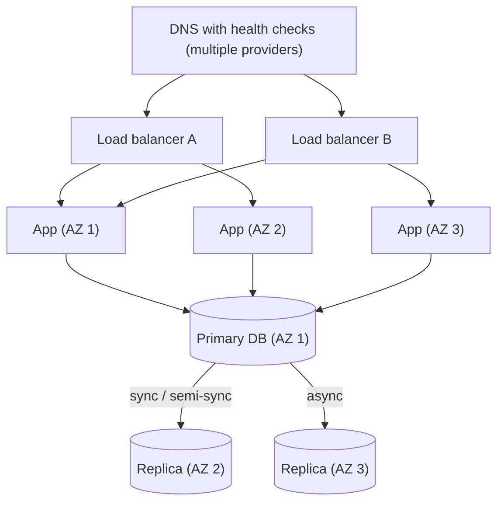
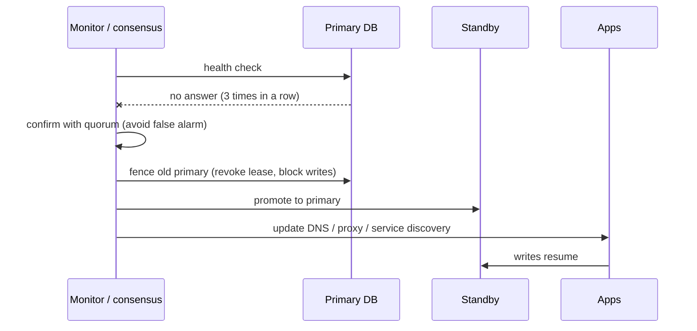

# Availability and Failover

Keep a spare for every part, notice failures quickly, and switch to the spare within a minute or two, ideally without a human.

---

## Measuring availability

| Target | Downtime per year | Downtime per month |
|---|---|---|
| 99% | 3.65 days | 7.3 hours |
| 99.9% | 8.8 hours | 43 minutes |
| 99.99% | 52.6 minutes | 4.4 minutes |
| 99.999% | 5.3 minutes | 26 seconds |

- Parts **in series** multiply: an app (99.9%) that needs a database (99.9%) is at most 99.8%.
- Parts **in parallel** (redundant copies) combine: two independent 99% servers give 1 - 0.01 x 0.01 = 99.99%.

So the recipe is: put redundant copies of every part, and keep the critical request path short.

---

## Redundancy at every layer

| Layer | Spare |
|---|---|
| DNS | Multiple name servers, anycast |
| Load balancer | Pair with floating IP, or managed cloud LB |
| App servers | N+2 stateless instances across availability zones |
| Cache | Replicas per shard |
| Database | Standby replica with automatic promotion |
| Queue | Replicated partitions |
| Whole region | Second region (see [Multi-region design](31-multi-region-design.md)) |

---

## Active-passive vs active-active

| | Active-passive | Active-active |
|---|---|---|
| How | Standby waits and takes over on failure | All copies serve traffic all the time |
| Capacity | Pay for idle standby | Every copy does useful work |
| Failover | Needs detection + promotion (seconds to minutes) | Load balancer just stops sending to the dead copy |
| Data | Simple (one writer) | Writes in several places need conflict handling |
| Typical | Databases, leader-based systems | Stateless services, caches, read replicas |

---

## The failover sequence

Steps that matter:
1. **Detect:** heartbeats and health checks with timeouts. Too short means false failovers under load; too long means a long outage.
2. **Decide with a quorum:** one observer can be partitioned; a majority avoids **split brain** (two primaries).
3. **Fence the old primary:** so it can't keep accepting writes if it comes back.
4. **Promote and redirect:** update the endpoint clients use.
5. **Recover:** rebuild a new standby so you have a spare again.

---

## RPO and RTO
- **RPO** (recovery point objective): how much data you can lose. Async replication means RPO > 0.
- **RTO** (recovery time objective): how long until service is back.
- Lower RPO and RTO cost more (synchronous replication, hot standbys, more regions).

---

## Things that quietly break availability
- **Shared dependencies:** two "redundant" services both relying on one config server or DNS zone.
- **Correlated failures:** replicas in the same rack, or the same bad deploy rolled to all copies at once.
- **Untested failover:** the standby's config is stale or the runbook is wrong. Run failover drills (game days).
- **Capacity:** after losing one of two zones, the survivor must handle 100% of traffic. Plan for N+1.
- **Deploys and config changes** cause most outages. Canary them.

---

## Interview Q&A

**Q: How do you make the database highly available?**
A: Primary plus a synchronous or semi-synchronous standby in another zone, automatic failover through a consensus-based manager (Patroni, Orchestrator, or a managed service), fencing of the old primary, and read replicas for read traffic.

**Q: How do you prevent split brain?**
A: Decide failover by majority vote, give the primary a lease that must be renewed, and fence the old primary (revoke its lease or block it at the proxy) before promoting a new one.

**Q: What is the availability of three services in series at 99.9% each?**
A: About 99.7% (0.999 cubed). Reduce the chain or make each link redundant.

**Related:** [Replication](05-replication.md) · [Reliability patterns](13-reliability-and-resilience-patterns.md) · [Consensus](09-consensus-leader-election-and-distributed-locks.md)
