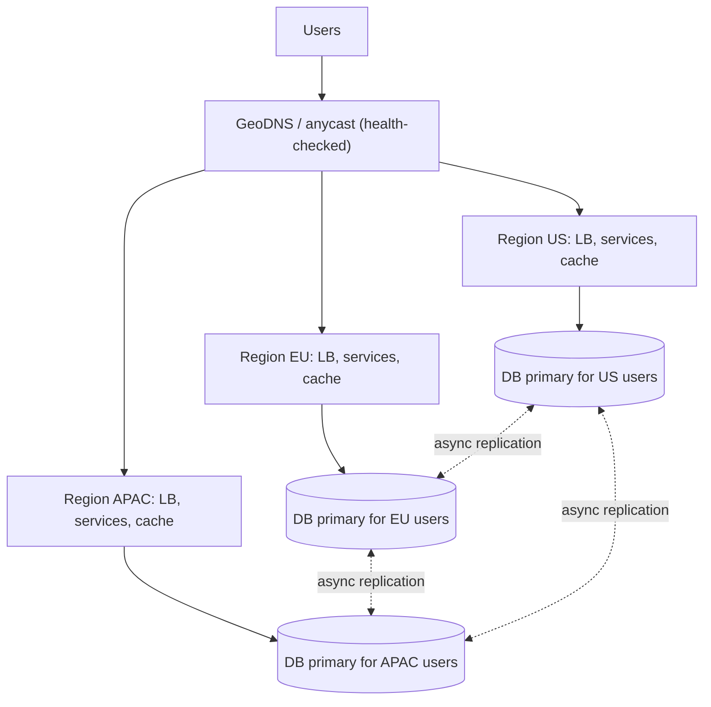
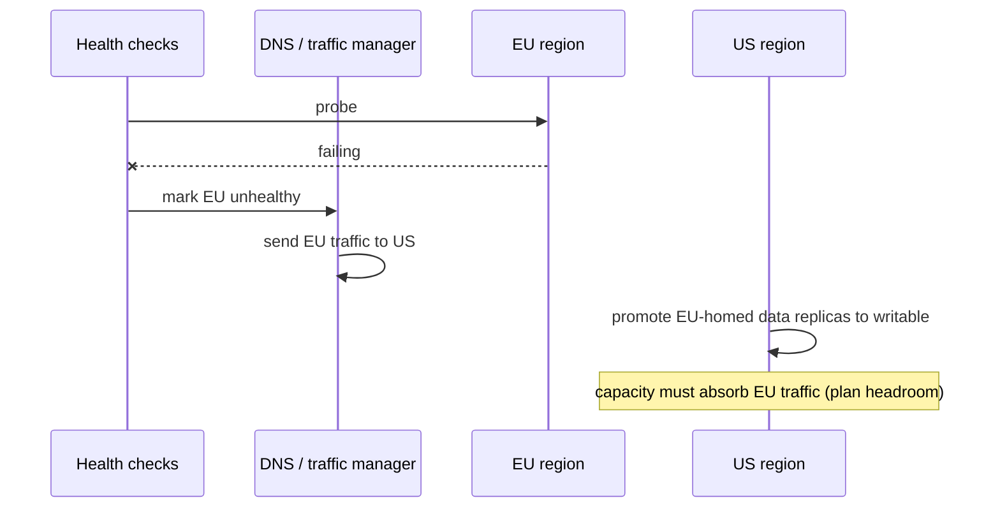

# Multi-Region Design

Serve users from a region near them, and keep working when a whole region goes dark. Going multi-region is expensive and complicated, so be clear about which of the two goals you need.

---

## Why go multi-region
| Reason | Example |
|---|---|
| Latency | Users in India shouldn't wait 250 ms round trips to a US region |
| Disaster recovery | A cloud region outage, fibre cut or bad regional deploy |
| Data residency | EU user data must stay in the EU |
| Scale | One region's capacity limits |

If only DR matters, active-passive is often enough. If latency for global users matters, you need serving (at least reads) in several regions.

---

## Deployment models

| Model | Reads | Writes | Failover | Complexity |
|---|---|---|---|---|
| Single region + backups | One region | One region | Restore from backup (hours) | Low |
| Active-passive (warm standby) | Primary region | Primary region | Promote standby (minutes), lose async lag (RPO > 0) | Medium |
| Active-active, read-local | Every region | One home region per record / one primary | Re-home writes on failure | Medium-high |
| Active-active, write-anywhere | Every region | Every region | Built in | High (conflicts) |
| Geo-partitioned | Home region of each user | Home region | Move user's home on failure | High |

---

## The hard part: data
- **Speed of light:** a synchronous write across continents costs 100-200 ms. Strong global consistency always pays this (Spanner, CockroachDB) on writes.
- **Async replication** is fast but loses recent writes in a failover and allows stale reads in other regions.
- **Write-anywhere** needs conflict resolution: last-write-wins, CRDTs, or per-record ownership.

Decide per data type:

| Data | Typical choice |
|---|---|
| Static assets, media | CDN + replicated object storage |
| Sessions, caches | Regional; rebuildable |
| User profile, posts | Home region per user, async copies elsewhere for reads |
| Money, inventory, usernames | Single writer (one region or a global consensus database) |
| Counters, likes | Per-region counters merged (CRDT counters) |

---

## Routing users
- **GeoDNS / latency-based DNS** sends users to the nearest healthy region; TTL decides how fast failover takes effect.
- **Anycast** (one IP advertised everywhere) fails over at the network level in seconds.
- **Sticky home region:** route a user's writes to their home region even if they travel, or migrate their home.

---

## Regional failover

Checklist:
- Each region runs with spare capacity (or can autoscale fast) to take a failed region's load.
- Failover is automated but can be triggered manually; practice it regularly.
- Avoid global single points: one config database, one auth provider, one DNS zone in a single region.
- Deploy changes one region at a time so a bad release never hits all regions together.

---

## Interview Q&A

**Q: How do you make a social app work for users on three continents?**
A: Serve from three regions behind GeoDNS; give each user a home region for writes, replicate asynchronously for reads elsewhere, use CDNs for media, and keep strongly consistent data (handles, payments) in a single-writer store.

**Q: What do you lose with async cross-region replication?**
A: Writes not yet replicated when a region dies (RPO of seconds), and readers in other regions may see slightly stale data.

**Q: When is Spanner-style global consistency worth it?**
A: When correctness across regions matters more than write latency, for example ledgers, inventory, or global unique constraints.

**Related:** [Availability and failover](30-availability-and-failover.md) · [Replication](05-replication.md) · [CAP and consistency](08-cap-pacelc-and-consistency-models.md) · [DNS](../03-problems/59-dns.md)
